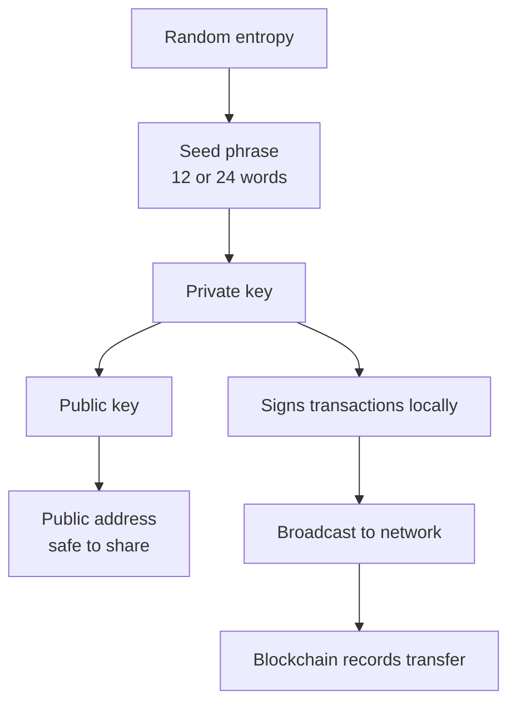
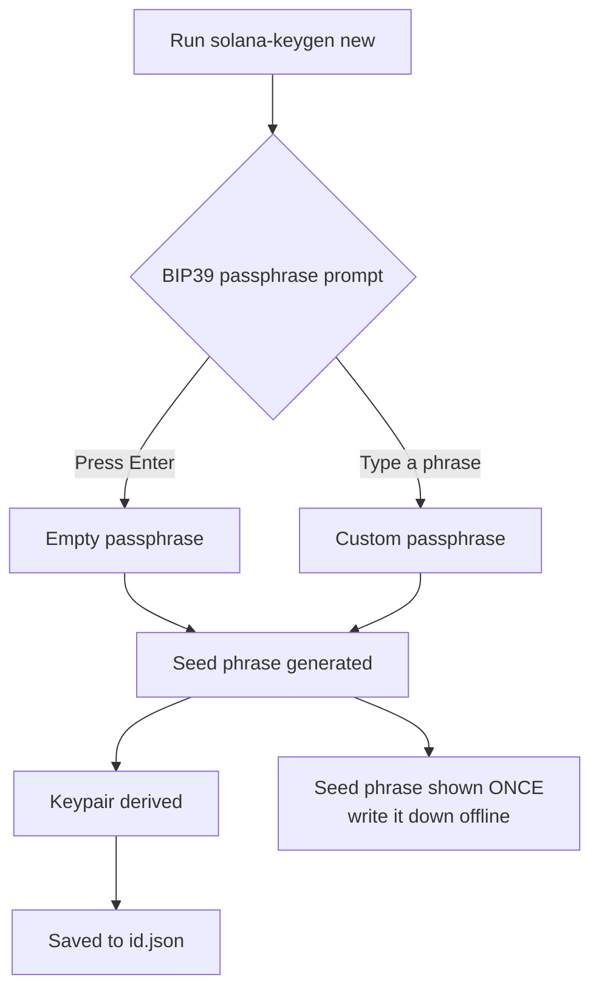
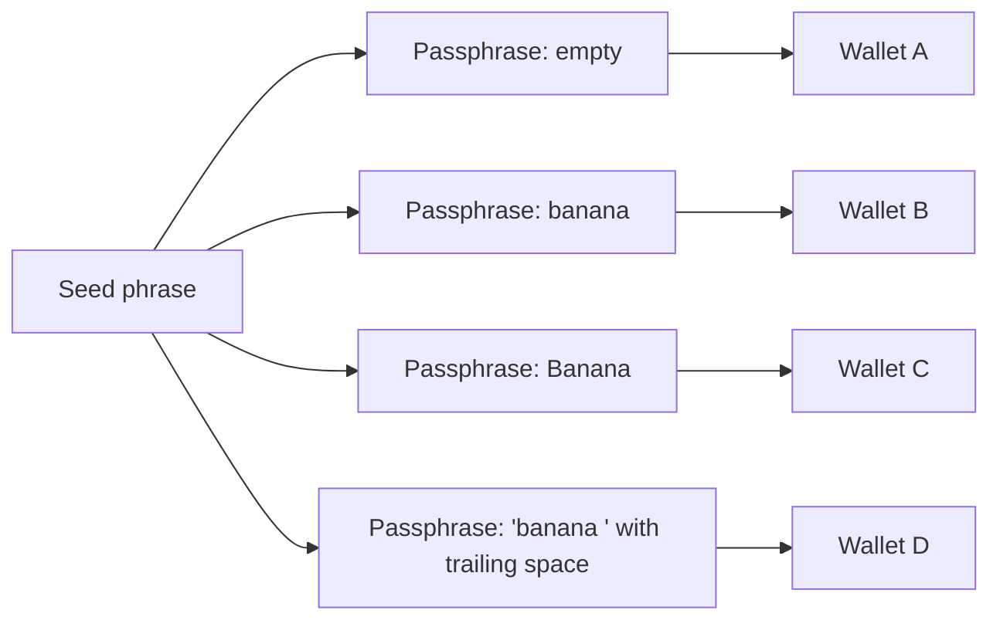
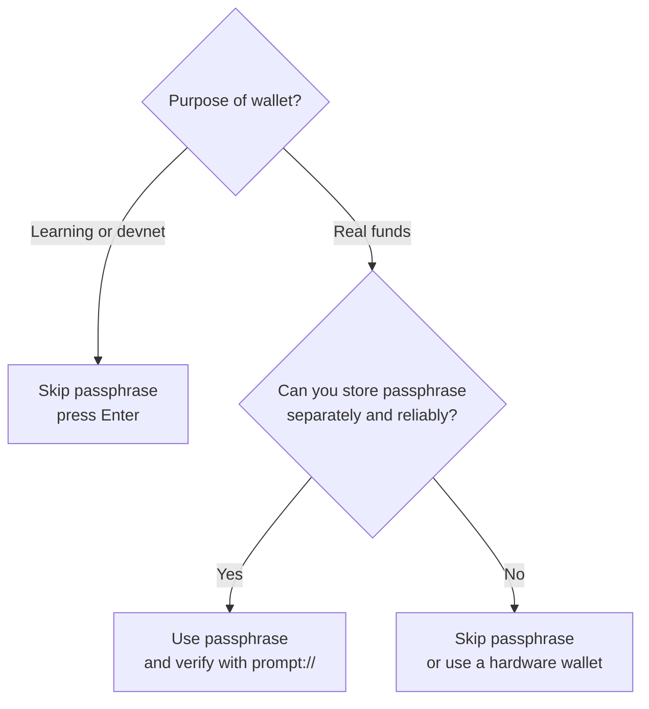
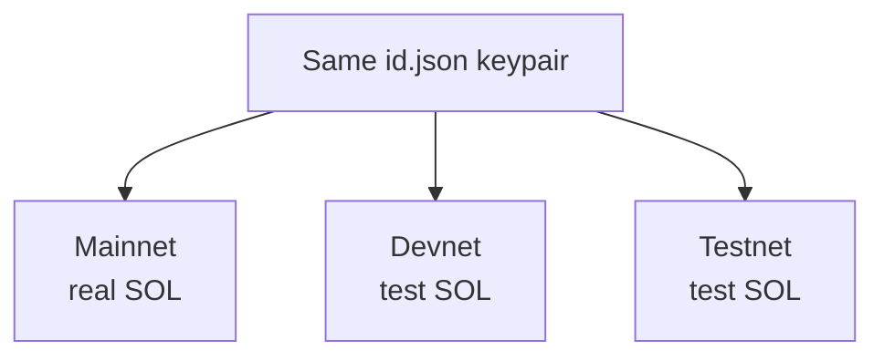
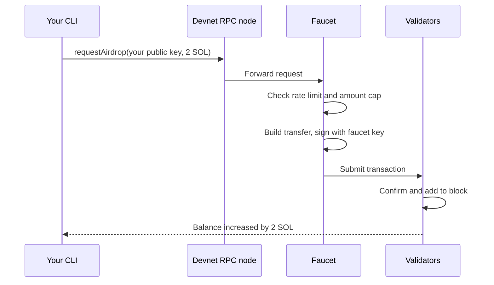
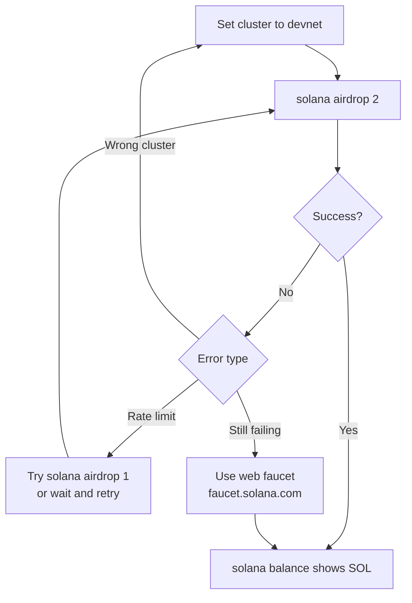
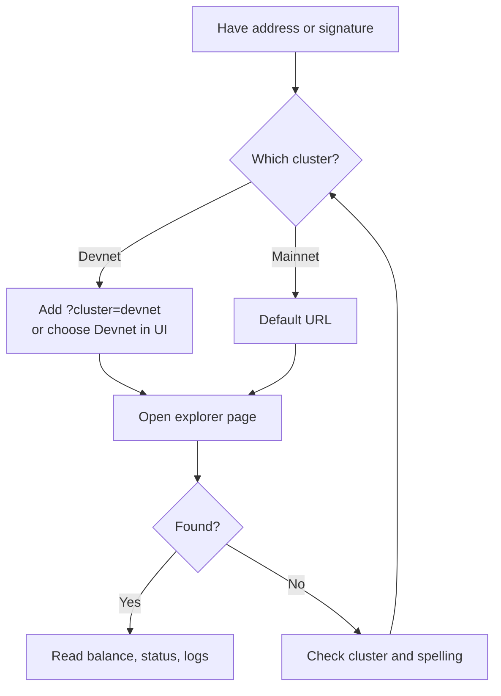
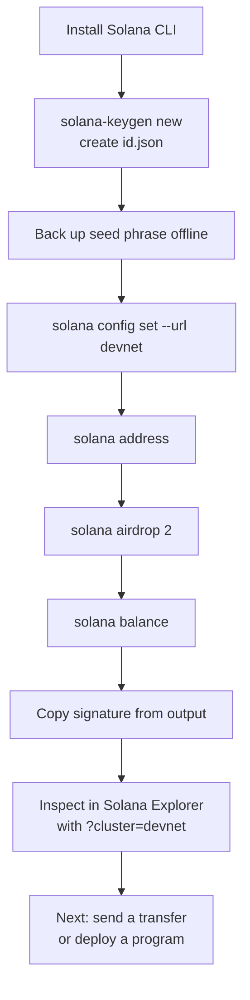

# Solana Local Wallet, Devnet & Explorer: Study Notes

> Compiled from a learning session on local wallets, BIP39 passphrases, devnet, faucets, airdrops, and Solana Explorer.

## Table of Contents

1. [Local Wallet Basics](#1-local-wallet-basics)
2. [Creating a Wallet with solana-keygen](#2-creating-a-wallet-with-solana-keygen)
3. [BIP39 Passphrase](#3-bip39-passphrase)
4. [Clusters: Mainnet, Devnet, Testnet](#4-clusters-mainnet-devnet-testnet)
5. [Faucet and Airdrop](#5-faucet-and-airdrop)
6. [Lamports, Fees and Rent](#6-lamports-fees-and-rent)
7. [Solana Explorer](#7-solana-explorer)
8. [End-to-End Workflow](#8-end-to-end-workflow)
9. [Command Cheat Sheet](#9-command-cheat-sheet)
10. [Security Checklist](#10-security-checklist)
11. [Common Errors](#11-common-errors)
12. [Glossary](#12-glossary)

---

## 1. Local Wallet Basics

A **local wallet** (self-custody / non-custodial wallet) stores your **private keys on your own device** instead of with a third party such as an exchange.

**Key idea:** a wallet does not hold coins. Coins live on the blockchain. The wallet holds the **private key** that proves ownership and signs transactions. Whoever controls the private key controls the funds.



### How it works

1. The wallet generates a random private key (or a seed phrase from which keys are derived).
2. A public key, then an address, is derived. This is **one-way**: you cannot recover the private key from the address.
3. You share the address to receive funds.
4. To send, the wallet **signs locally** and broadcasts the transaction.

### Types of local wallets

| Type | Examples | Notes |
|---|---|---|
| Desktop | Electrum, Exodus, Bitcoin Core | Software on your computer |
| Mobile | Trust Wallet, MetaMask Mobile | App on your phone |
| Browser extension | MetaMask, Phantom | Convenient, exposed to browser threats |
| Hardware | Ledger, Trezor | Keys stay offline, generally most secure |
| Paper | Printed keys | Largely discouraged |

### Local vs custodial

| | Local (non-custodial) | Custodial (exchange) |
|---|---|---|
| Who holds keys | You | The company |
| Control | Full | Limited |
| Recovery | Only via seed phrase | Account recovery possible |
| Main risk | Losing keys, malware | Company failure, freezes |

Simplified Python sketch (real wallets use elliptic curve cryptography):

```python
import secrets
import hashlib

private_key = secrets.token_hex(32)  # 256-bit random key
address = hashlib.sha256(bytes.fromhex(private_key)).hexdigest()[:40]

print("Private key (never share):", private_key)
print("Address (safe to share):  ", address)
```

---

## 2. Creating a Wallet with solana-keygen

```bash
solana-keygen new -o /home/rishav/.config/solana/id.json
```

The command:

1. Generates a seed phrase.
2. Asks for an optional **BIP39 passphrase**.
3. Writes the resulting keypair to `id.json`.
4. Shows your seed phrase **once**. Write it down offline.



Useful variants:

```bash
# Skip the passphrase prompt
solana-keygen new --no-bip39-passphrase -o /home/rishav/.config/solana/id.json

# Recover from seed phrase later
solana-keygen recover -o /home/rishav/.config/solana/id.json

# Protect the file on disk
chmod 600 /home/rishav/.config/solana/id.json
```

> `id.json` contains the raw keypair and is **not encrypted**. Anyone who copies it can spend your funds.

---

## 3. BIP39 Passphrase

### Analogy: recipe and secret ingredient

- **Seed phrase** = a recipe card.
- **Passphrase** = your secret ingredient.
- **Wallet** = the finished dish.

A thief with only the recipe cannot make *your* dish without the secret ingredient.

### The twist: no "wrong" passphrase

Every passphrase produces a valid wallet. Think of a building with endless vaults: the seed phrase gets you into the building, and the passphrase picks **which vault** you stand in front of. A wrong passphrase silently opens a different, empty vault.



### Under the hood

```
seed = PBKDF2-HMAC-SHA512(
    password   = seed phrase,
    salt       = "mnemonic" + passphrase,
    iterations = 2048
)
```

```python
import hashlib

mnemonic = "pill tomorrow foster begin walnut borrow virtual kick shift mutual shoe scatter"

def derive_seed(mnemonic: str, passphrase: str = "") -> str:
    seed = hashlib.pbkdf2_hmac(
        "sha512",
        mnemonic.encode("utf-8"),
        ("mnemonic" + passphrase).encode("utf-8"),
        2048,
    )
    return seed.hex()[:32]

print("no passphrase :", derive_seed(mnemonic))
print("'banana'      :", derive_seed(mnemonic, "banana"))
print("'Banana'      :", derive_seed(mnemonic, "Banana"))
print("'banana '     :", derive_seed(mnemonic, "banana "))
```

> That mnemonic is a well-known example. Never use it for real funds.

### Benefits

1. **Two-factor backup:** a thief needs the seed phrase *and* the passphrase.
2. **Plausible deniability:** keep a decoy wallet with no passphrase.
3. **Multiple wallets from one backup:** `"savings"`, `"trading"`, etc.

### Risks

- Forgetting the passphrase means permanent loss.
- A typo during recovery gives a different, empty wallet (no error).
- Case and whitespace matter.
- Storing it next to the seed phrase defeats its purpose.

### What it is NOT

- It is **not** stored in `id.json`.
- It does **not** encrypt `id.json`.

### Verify your backup before depositing real funds

```bash
solana-keygen pubkey prompt://   # enter seed phrase + passphrase
solana address                   # compare: addresses must match
```



---

## 4. Clusters: Mainnet, Devnet, Testnet

**Analogy:** Mainnet is the real casino. Devnet is the practice arcade next door with free, worthless tokens.

| Cluster | Purpose | SOL has value? |
|---|---|---|
| Mainnet-beta | Real usage | Yes |
| Devnet | App development and testing | No |
| Testnet | Validator and core-protocol testing | No |

The **same keypair** works on every cluster, but **balances are independent**.



```bash
solana config set --url devnet
solana config get        # verify the RPC URL contains devnet
```

> Devnet can be reset, wiping balances and deployed programs. Don't treat it as permanent.

---

## 5. Faucet and Airdrop

- **Faucet:** a *service* that gives away small amounts of test tokens.
- **Airdrop:** the *action* of tokens being delivered to your address without you sending anything.

### Two meanings of "airdrop"

| | Devnet airdrop (your case) | Marketing airdrop |
|---|---|---|
| Purpose | Give developers test tokens | Promote or reward users |
| Value | Zero | Often real |
| Sender | Network faucet | A project or protocol |
| Risk | None | Scams are common |

> Unrequested tokens appearing in a **mainnet** wallet are often scams. Never "claim" or swap them.

### What happens during `solana airdrop 2`



Only your **public key** is used. Receiving never needs your signature.

### Flowchart: getting devnet SOL



### Commands

```bash
solana config set --url devnet
solana address
solana balance
solana airdrop 2
solana airdrop 2 <PUBLIC_KEY>
solana balance
```

### From code (`@solana/web3.js`)

```javascript
import { Connection, Keypair, LAMPORTS_PER_SOL, clusterApiUrl } from "@solana/web3.js";
import fs from "fs";

const secret = JSON.parse(
  fs.readFileSync("/home/rishav/.config/solana/id.json", "utf8")
);
const keypair = Keypair.fromSecretKey(Uint8Array.from(secret));

const connection = new Connection(clusterApiUrl("devnet"), "confirmed");

const sig = await connection.requestAirdrop(keypair.publicKey, 1 * LAMPORTS_PER_SOL);
await connection.confirmTransaction(sig, "confirmed");
console.log("Balance:", await connection.getBalance(keypair.publicKey));
```

### Why the faucet is rate-limited

Its wallet is finite. Without limits, bots would drain it. Typical limits: max amount per request, max requests per time window per IP or wallet, and sometimes a login on the web faucet. Exact limits change over time.

---

## 6. Lamports, Fees and Rent

```
1 SOL = 1,000,000,000 lamports
```

```javascript
import { LAMPORTS_PER_SOL } from "@solana/web3.js";
console.log(LAMPORTS_PER_SOL);       // 1000000000
console.log(2 * LAMPORTS_PER_SOL);   // 2000000000
```

Even on devnet, actions cost fees:

| Action | Costs devnet SOL? |
|---|---|
| Sending a transfer | Yes (small fee) |
| Deploying a program | Yes (fee + rent) |
| Creating a token or account | Yes (rent deposit) |
| Calling a program | Yes (small fee) |
| Reading data | No |

**Rent** is a deposit for storing data on-chain. Deploying programs needs several SOL, so multiple airdrops are common.

---

## 7. Solana Explorer

**Analogy:** a bank publishes its entire ledger in a street-facing window. Anyone can read it, and only account numbers are shown, not names. The blockchain is the ledger, and the explorer is the window.

An explorer is **read-only**. You cannot send or change anything through it.

### What you can search

| Search for | You see |
|---|---|
| Wallet address | Balance, tokens, history |
| Transaction signature | Status, fee, accounts, logs |
| Block or slot | Included transactions |
| Program address | Deployed program details |
| Token mint | Supply, holders, metadata |
| Validator | Stake, performance, commission |

### Explorers

- Official: `https://explorer.solana.com`
- Alternatives: Solscan, SolanaFM, Solana Beach

All read the same chain. They differ only in presentation.

### Cluster selection (critical)

```
https://explorer.solana.com/address/<YOUR_ADDRESS>?cluster=devnet
https://explorer.solana.com/tx/<SIGNATURE>?cluster=devnet
```

Without `?cluster=devnet`, the explorer searches mainnet and reports "not found".



### Reading a transaction page

| Field | Meaning |
|---|---|
| Signature | Unique transaction ID |
| Result | Success or failure |
| Timestamp | When processed |
| Slot | Block-like position |
| Fee | Cost in SOL |
| Account Inputs | Accounts touched, before/after balances |
| Instructions | What it did (e.g. System Program transfer) |
| Program Logs | Messages from programs, great for debugging |

### CLI equivalents

```bash
solana confirm -v <SIGNATURE>
solana transaction-history $(solana address)
solana account <ADDRESS>
```

### Privacy

Addresses are **pseudonymous, not anonymous**. If you link an address to your identity, your whole history is visible. Use a separate wallet for development.

---

## 8. End-to-End Workflow



Full command run:

```bash
solana-keygen new -o /home/rishav/.config/solana/id.json
solana config set --url devnet
solana config get
solana address
solana balance
solana airdrop 2
solana balance
```

---

## 9. Command Cheat Sheet

| Task | Command |
|---|---|
| Create wallet | `solana-keygen new -o <path>` |
| Create without passphrase prompt | `solana-keygen new --no-bip39-passphrase -o <path>` |
| Recover wallet | `solana-keygen recover -o <path>` |
| Verify seed and passphrase | `solana-keygen pubkey prompt://` |
| Show address | `solana address` |
| Show config | `solana config get` |
| Switch to devnet | `solana config set --url devnet` |
| Check balance | `solana balance` |
| Request airdrop | `solana airdrop 2` |
| Inspect transaction | `solana confirm -v <SIGNATURE>` |
| Inspect account | `solana account <ADDRESS>` |
| Lock down key file | `chmod 600 <path>` |

---

## 10. Security Checklist

- [ ] Seed phrase written down offline, never photographed or stored in cloud notes
- [ ] Never share the seed phrase, private key, or `id.json`
- [ ] `id.json` permissions set to `600`
- [ ] Backup verified with `solana-keygen pubkey prompt://` before depositing real funds
- [ ] Passphrase (if used) stored separately from the seed phrase
- [ ] Separate keypair for devnet experiments
- [ ] Cluster checked with `solana config get` before every transaction
- [ ] Never "claim" unsolicited tokens on mainnet
- [ ] Never pay for devnet SOL (anyone selling it is a scammer)

---

## 11. Common Errors

| Problem | Likely cause | Fix |
|---|---|---|
| `airdrop request failed` | Rate limit or busy faucet | Wait, try `solana airdrop 1` |
| `Rate limit reached` | Too many requests | Wait, or use the web faucet |
| Balance is 0 after airdrop | Wrong cluster | `solana config get`, then set to devnet |
| Explorer says not found | Missing `?cluster=devnet` | Add the parameter or switch cluster in UI |
| Recovered wallet is empty | Wrong passphrase or typo | Retry with exact case and spacing |
| Timeout | Congestion | Retry later |

---

## 12. Glossary

| Term | Definition |
|---|---|
| **Local wallet** | Wallet whose keys are stored on your own device |
| **Private key** | Secret that proves ownership and signs transactions |
| **Public key / address** | Shareable identifier used to receive funds |
| **Seed phrase (mnemonic)** | 12 or 24 words that deterministically generate keys |
| **BIP39 passphrase** | Optional extra secret mixed into the seed derivation |
| **PBKDF2** | Slow hashing function used to turn words into a seed |
| **Keypair** | Private + public key pair, stored in `id.json` |
| **Cluster** | A separate Solana network (mainnet, devnet, testnet) |
| **Devnet** | Test network for developers with worthless SOL |
| **Faucet** | Service that dispenses free test tokens |
| **Airdrop** | Delivery of tokens to an address without payment |
| **Lamport** | Smallest SOL unit; 1 SOL = 1,000,000,000 lamports |
| **Rent** | Deposit required to store data on-chain |
| **Signature** | Transaction ID; also proof the sender authorized it |
| **Slot** | Time/position unit in which transactions are processed |
| **RPC node** | Server your CLI talks to for reading and sending |
| **Explorer** | Read-only website for viewing on-chain data |
| **Program** | Solana's term for a smart contract |

---

## Next Steps

- Send a SOL transfer between two devnet addresses and inspect it in the explorer.
- Create and mint an SPL token on devnet.
- Deploy a simple program (e.g. with Anchor) to devnet.
