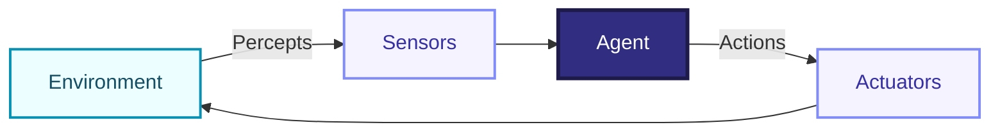
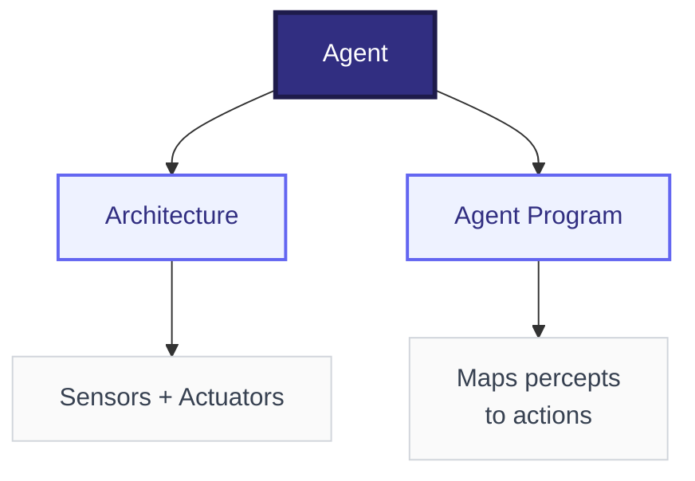
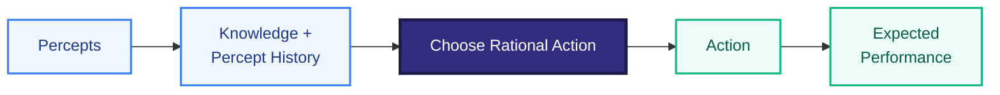
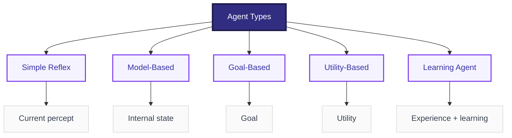
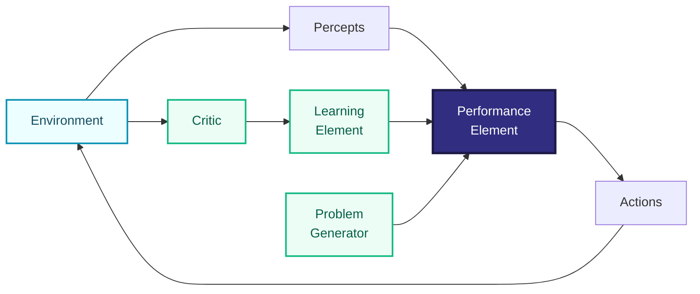
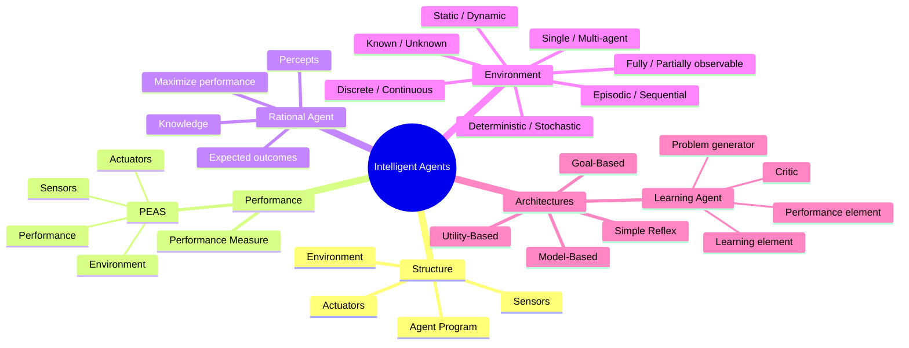

# Intelligent Agents — Short Exam Notes

## 1. Intelligent Agent

An **intelligent agent** is a system that **perceives its environment through sensors and acts on it through actuators** to achieve goals.

**Examples:** robot, self-driving car, virtual assistant, game-playing program.

---

## 2. Structure of an Intelligent Agent

The basic structure contains:

- **Sensors:** collect information from the environment.
- **Agent program:** processes percepts and decides what to do.
- **Actuators:** perform the selected action.
- **Environment:** the world in which the agent operates.

### Agent = Architecture + Program

**Agent = Architecture + Agent Program**

---

## 3. Agent Performance

The **performance measure** defines how successful an agent is.

A good performance measure should reflect the **actual goal**, not merely the agent's actions.

**Example — Vacuum cleaner:**
- Clean floor → good performance
- Use less energy → better performance
- Avoid damaging objects → better performance

### PEAS Framework

PEAS describes an agent's task environment:

| Component | Meaning | Example: Self-driving car |
|---|---|---|
| **P** | Performance measure | Safety, speed, comfort |
| **E** | Environment | Roads, traffic, pedestrians |
| **A** | Actuators | Steering, brakes, accelerator |
| **S** | Sensors | Cameras, GPS, radar |

**Exam shortcut:** **PEAS = Performance, Environment, Actuators, Sensors**

---

## 4. Rational Agent

A **rational agent** chooses the action expected to **maximize its performance measure**, based on:
- Percept history
- Available knowledge
- Available actions
- Expected outcomes

**Important:** Rational does **not** mean perfect. It means choosing the best expected action using the information available.

---

## 5. Types of Agent Environment

An environment can be classified using several properties:

| Property | Type 1 | Type 2 |
|---|---|---|
| **Observability** | Fully observable | Partially observable |
| **Agents** | Single-agent | Multi-agent |
| **Predictability** | Deterministic | Stochastic |
| **Episodes** | Episodic | Sequential |
| **Change** | Static | Dynamic |
| **State space** | Discrete | Continuous |
| **Knowledge** | Known | Unknown |

### Simple meanings

- **Fully observable:** agent can access all relevant information.
- **Partially observable:** some information is hidden or unavailable.
- **Single-agent:** only one agent is making decisions.
- **Multi-agent:** multiple agents affect the outcome.
- **Deterministic:** next state is determined by the current state and action.
- **Stochastic:** outcomes involve uncertainty.
- **Episodic:** each task is largely independent.
- **Sequential:** current actions affect future decisions.
- **Static:** environment does not change while the agent is deciding.
- **Dynamic:** environment can change during decision-making.
- **Discrete:** limited/countable states or actions.
- **Continuous:** values can vary over a range.
- **Known:** rules/outcomes are known to the agent.
- **Unknown:** agent must learn or discover them.

---

## 6. Agent Architectures / Types of Agents

### 1. Simple Reflex Agent
Acts only on the **current percept** using condition–action rules.

**Example:** If obstacle detected → turn.

### 2. Model-Based Reflex Agent
Maintains an **internal model/state** to handle partially observable environments.

### 3. Goal-Based Agent
Chooses actions that help achieve a **goal**.

### 4. Utility-Based Agent
Chooses actions based on a **utility function**, allowing comparison between different desirable outcomes.

### 5. Learning Agent
**Learns from experience** and improves its performance over time.

### Learning Agent Structure

A learning agent is commonly described using four components:

- **Performance element:** selects actions.
- **Learning element:** improves the performance element.
- **Critic:** gives feedback about performance.
- **Problem generator:** suggests exploratory actions.

---

## 7. Quick Revision

**Intelligent Agent:** Sensors → Agent → Actuators

**PEAS:** Performance + Environment + Actuators + Sensors

**Rational Agent:** chooses the action expected to maximize performance.

**Agent types:**  
**Simple Reflex → Model-Based → Goal-Based → Utility-Based → Learning**

**Environment properties:**  
Observable, Agents, Deterministic, Episodic, Static, Discrete, Known.

---

## Mindmap

