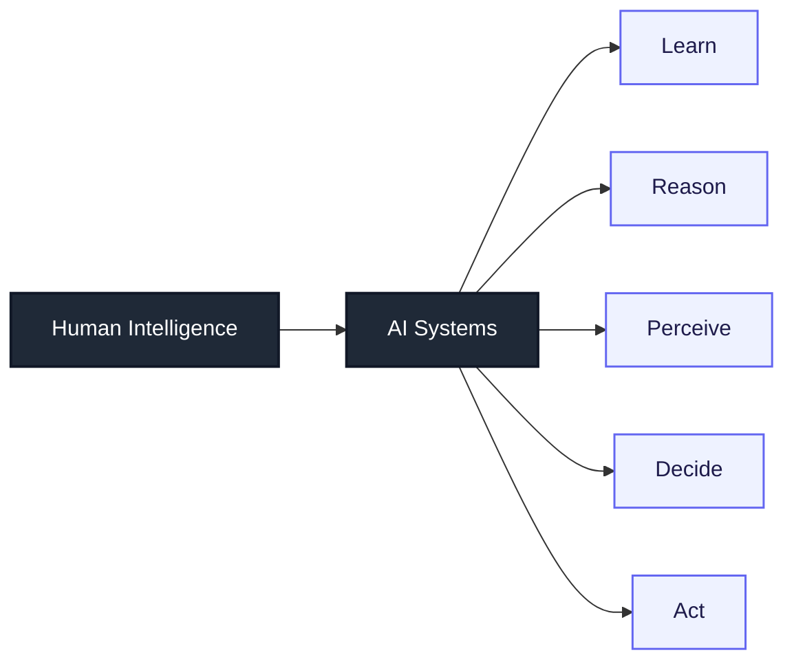
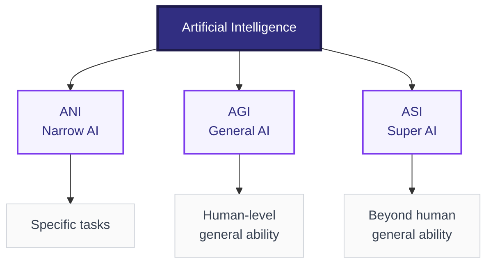
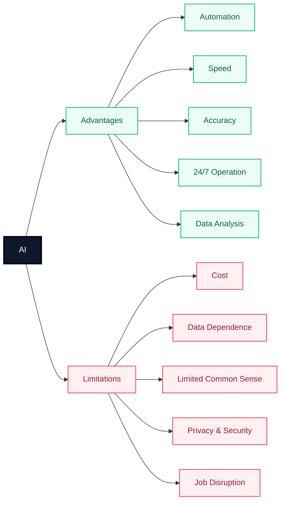
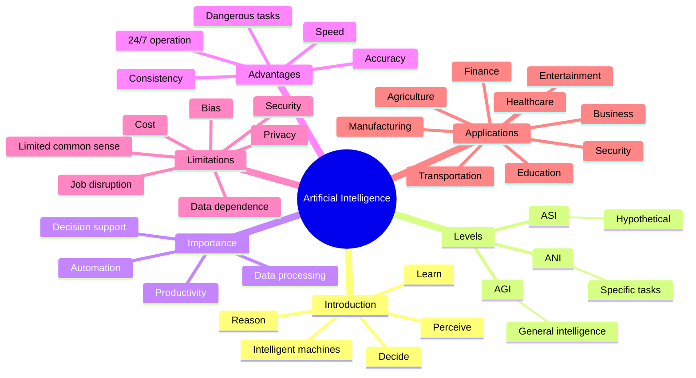

# Artificial Intelligence — Short Exam Notes

## 1. Introduction to Artificial Intelligence

**Artificial Intelligence (AI)** is the branch of computer science that develops machines and software capable of performing tasks that normally require human intelligence.

Examples of intelligent tasks:
- Learning from data
- Reasoning and problem-solving
- Understanding language
- Recognizing images/speech
- Making decisions

### Simple idea

---

## 2. Notion of Intelligence

**Intelligence** is the ability to acquire knowledge, learn from experience, reason, solve problems, adapt to new situations, and achieve goals.

In AI, intelligence is modeled through:
- **Perception** — receiving information from the environment.
- **Learning** — improving from data or experience.
- **Reasoning** — drawing conclusions from available information.
- **Problem-solving** — finding solutions to goals or problems.
- **Decision-making** — selecting suitable actions.
- **Language ability** — understanding or generating human language.

---

## 3. Levels of Artificial Intelligence

AI is commonly classified by **capability**:

| Level | Meaning | Example |
|---|---|---|
| **ANI — Artificial Narrow Intelligence** | Designed for a specific task | Spam filter, voice assistant |
| **AGI — Artificial General Intelligence** | Human-like ability across many intellectual tasks | Not yet achieved |
| **ASI — Artificial Superintelligence** | Intelligence exceeding humans across essentially all intellectual areas | Hypothetical |

### Another classification: by functionality

1. **Reactive Machines** — respond only to current input; no memory of past experiences.
2. **Limited Memory** — use past data/experience for decisions; most modern AI systems fit here.
3. **Theory of Mind** — intended to understand emotions, beliefs, and intentions; still a research concept.
4. **Self-Aware AI** — would possess self-awareness; hypothetical.

---

## 4. Importance of AI

AI is important because it can:
- Automate repetitive and complex tasks.
- Process huge amounts of data quickly.
- Support better and faster decision-making.
- Improve productivity and efficiency.
- Enable personalized services.
- Help solve problems that are difficult or expensive for humans to handle manually.

---

## 5. Advantages of AI

- **Automation:** performs repetitive work automatically.
- **Speed:** processes data much faster than humans.
- **Accuracy:** can reduce errors in suitable, well-defined tasks.
- **24/7 operation:** does not need normal human working hours.
- **Data analysis:** identifies patterns in large datasets.
- **Consistency:** gives consistent results when conditions remain the same.
- **Dangerous-task support:** can operate in hazardous environments.

---

## 6. Limitations of AI

- **High cost:** development, computing, and maintenance can be expensive.
- **Data dependence:** poor or biased data can produce poor or biased results.
- **Limited common sense:** AI may fail on unfamiliar situations.
- **Lack of human qualities:** does not naturally possess human emotions, values, or lived experience.
- **Job disruption:** automation can change or replace some types of work.
- **Privacy risks:** AI systems may process sensitive or personal data.
- **Security risks:** AI can be misused or attacked.
- **Explainability:** some complex models are difficult to interpret.

### Advantages vs. Limitations

---

## 7. Uses and Applications of AI

| Area | Applications |
|---|---|
| **Healthcare** | Medical-image analysis, clinical decision support, drug discovery |
| **Education** | Personalized learning, tutoring, automated feedback |
| **Finance** | Fraud detection, risk analysis, customer service |
| **Transportation** | Route planning, driver assistance, traffic prediction |
| **Agriculture** | Crop monitoring, disease detection, smart irrigation |
| **Business** | Recommendations, forecasting, chatbots, automation |
| **Manufacturing** | Quality inspection, predictive maintenance, robotics |
| **Security** | Threat detection, anomaly detection, identity verification |
| **Entertainment** | Content recommendations, game AI, media generation |
| **Daily life** | Search, voice assistants, translation, smart devices |

## Quick Revision

**AI = Machines performing tasks requiring human-like intelligence.**

**Remember the 3 capability levels:**  
**ANI → AGI → ASI**  
Specific → General → Beyond human

**Key advantages:** Automation, Speed, Accuracy, 24/7 operation, Data analysis.

**Key limitations:** Cost, Data dependence, Bias, Privacy/Security, Limited common sense, Job disruption.

**Common applications:** Healthcare, Education, Finance, Transport, Agriculture, Business, Manufacturing, Security, Entertainment.

