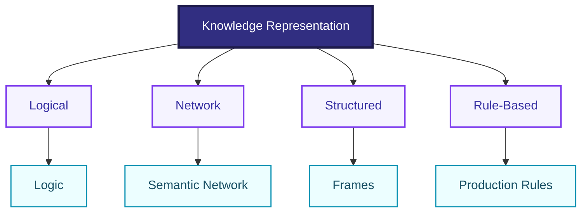
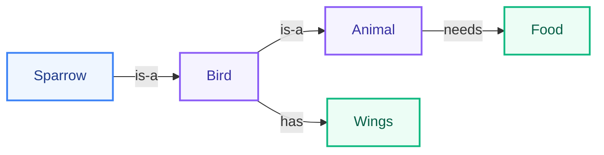
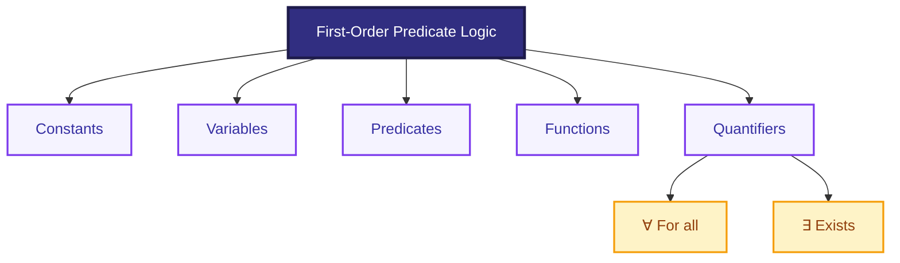
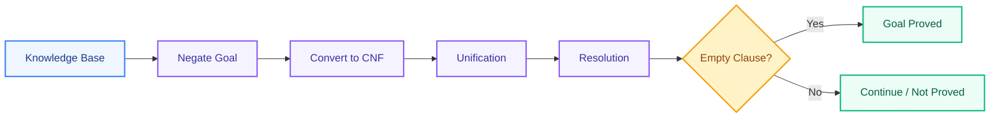
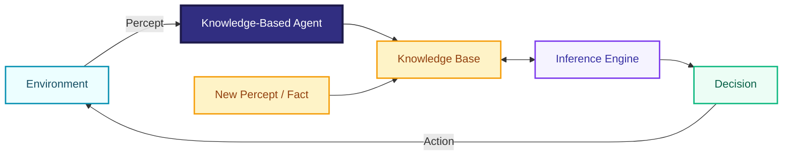
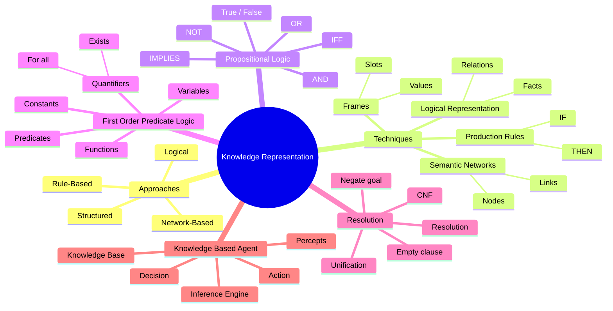

# Knowledge Representation — Short Exam Notes

## 1. Knowledge Representation (KR)

**Knowledge Representation** is the process of representing facts, relationships, and rules about the world in a form that an AI system can **store, reason with, and use for decision-making**.

### Main approaches to KR

1. **Symbolic / logical:** represents knowledge using formal symbols, facts, and rules.
2. **Network-based:** represents concepts as nodes and relationships as links.
3. **Structured:** represents knowledge using objects, attributes, and values.
4. **Rule-based:** represents knowledge as IF–THEN rules.



---

# 2. Knowledge Representation Techniques

## A. Logical Representation

Uses formal logic to represent **facts and relationships**.

Example:

**Human(Socrates)**  
**∀x [Human(x) → Mortal(x)]**

Therefore:

**Mortal(Socrates)**

**Advantages:** precise, supports formal reasoning.  
**Limitation:** can become complex for large real-world knowledge.

---

## B. Semantic Networks

A **semantic network** represents knowledge as a **graph of nodes and links**.

Example:



**Key idea:** **Nodes = concepts/objects; links = relationships.**

---

## C. Frames

A **frame** represents an object or situation using **slots (attributes)** and their values.

Example:

```text
FRAME: Student
-------------------
Name      : Riya
Age       : 20
Course    : AI
College   : ABC
```

**Key idea:** Frame = **object + attributes + values**.

Frames are useful for representing structured, stereotypical knowledge.

---

## D. Production Rules

Knowledge is represented using **IF–THEN rules**.

Example:

```text
IF  temperature > 38°C
THEN fever = true
```

A production system commonly contains:
- **Rule base**
- **Working memory**
- **Inference/control mechanism**

---

# 3. Propositional Logic

**Propositional logic** represents knowledge using propositions that are either **True or False**.

### Basic operators

| Symbol | Meaning | Example |
|---|---|---|
| **¬P** | NOT | It is not raining |
| **P ∧ Q** | AND | P and Q |
| **P ∨ Q** | OR | P or Q |
| **P → Q** | IMPLIES | If P, then Q |
| **P ↔ Q** | IF AND ONLY IF | P iff Q |

### Example

Let:
- **P:** It is raining.
- **Q:** Road is wet.

Rule:

**P → Q**

Fact:

**P**

Conclusion:

**Q**

**Limitation:** propositional logic cannot naturally represent objects, variables, or relationships between objects.

---

# 4. First-Order Predicate Logic (FOPL)

**First-Order Predicate Logic** extends propositional logic by allowing:
- **Objects**
- **Predicates**
- **Variables**
- **Quantifiers**
- **Relations**

### Example

**Human(Ram)**  
means: Ram is human.

**∀x [Human(x) → Mortal(x)]**  
means: Every human is mortal.

**∃x Student(x)**  
means: There exists at least one student.

### Quantifiers

- **∀** = For all
- **∃** = There exists



---

# 5. Resolution in First-Order Predicate Logic

**Resolution** is an inference method used to prove whether a conclusion follows from a set of logical statements.

### Basic idea

To prove a goal:
1. Add the **negation of the goal** to the knowledge base.
2. Convert statements to **clause form (CNF)**.
3. Use **unification** to match variables/terms.
4. Apply the **resolution rule**.
5. If an **empty clause (□)** is produced, a contradiction is found, so the original goal is proved.

### Simple example

Given:

**Human(Socrates)**  
**∀x [Human(x) → Mortal(x)]**

Goal: **Mortal(Socrates)**

After conversion:

**¬Human(x) ∨ Mortal(x)**  
**Human(Socrates)**

Unify **x = Socrates**:

**Mortal(Socrates)**



### Important terms

- **CNF:** Conjunctive Normal Form.
- **Unification:** finding substitutions that make expressions match.
- **Clause:** a disjunction (OR) of literals.
- **Empty clause:** indicates contradiction in resolution.

---

# 6. Architecture of a Knowledge-Based Agent

A **knowledge-based agent** stores knowledge about the world and uses an **inference mechanism** to derive new information and choose actions.

### Main components

- **Knowledge Base (KB):** stores facts and rules.
- **Inference Engine:** derives new facts/conclusions.
- **Percepts:** information received from the environment.
- **Action mechanism:** performs the selected action.



### Working cycle

**Perceive → Add knowledge → Infer → Decide → Act**

---

# Quick Revision

| Topic | One-line definition |
|---|---|
| **Knowledge Representation** | Representing knowledge so AI can reason with it |
| **Logical Representation** | Uses formal logic |
| **Semantic Network** | Concepts connected by relationships |
| **Frames** | Objects represented using slots and values |
| **Production Rules** | IF–THEN knowledge |
| **Propositional Logic** | True/False propositions |
| **FOPL** | Logic with objects, variables, predicates, and quantifiers |
| **Resolution** | Inference by deriving contradiction |
| **Knowledge-Based Agent** | Uses a knowledge base + inference to choose actions |

### Must Remember

**Semantic Network → Nodes + Links**  
**Frame → Slots + Values**  
**Production Rule → IF + THEN**  
**Propositional Logic → True/False propositions**  
**FOPL → Predicates + Variables + Quantifiers**  
**Resolution → Unification + CNF + Contradiction**  
**KBA → Perceive → Know → Infer → Act**

---

# Mindmap


