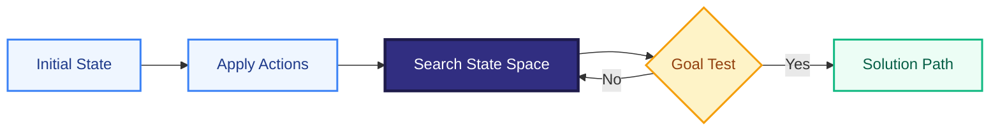
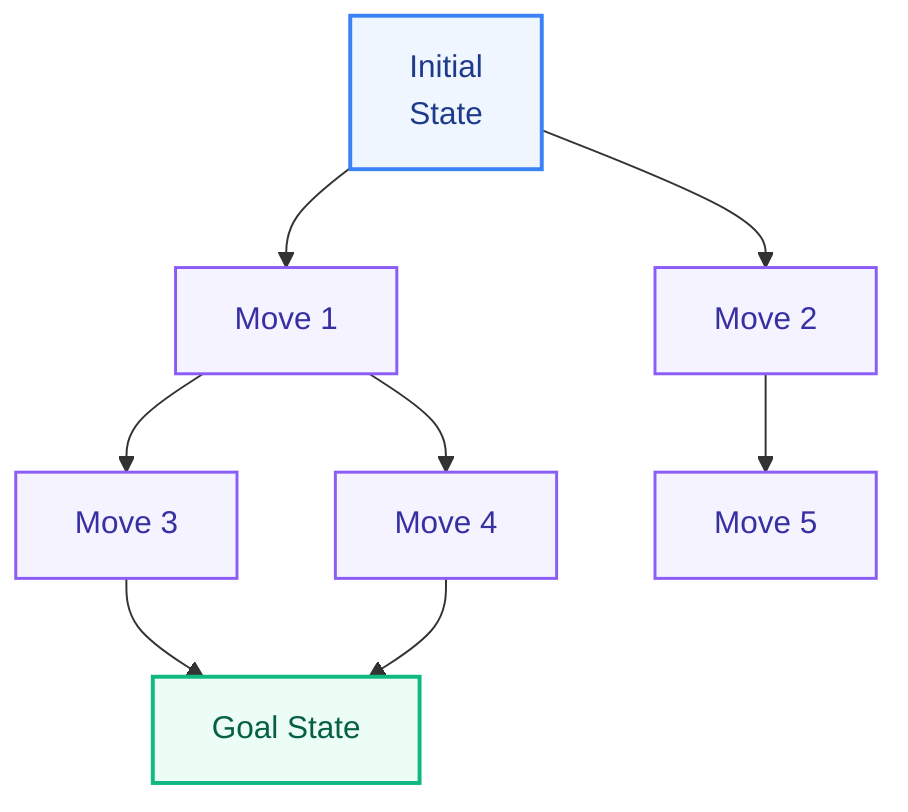
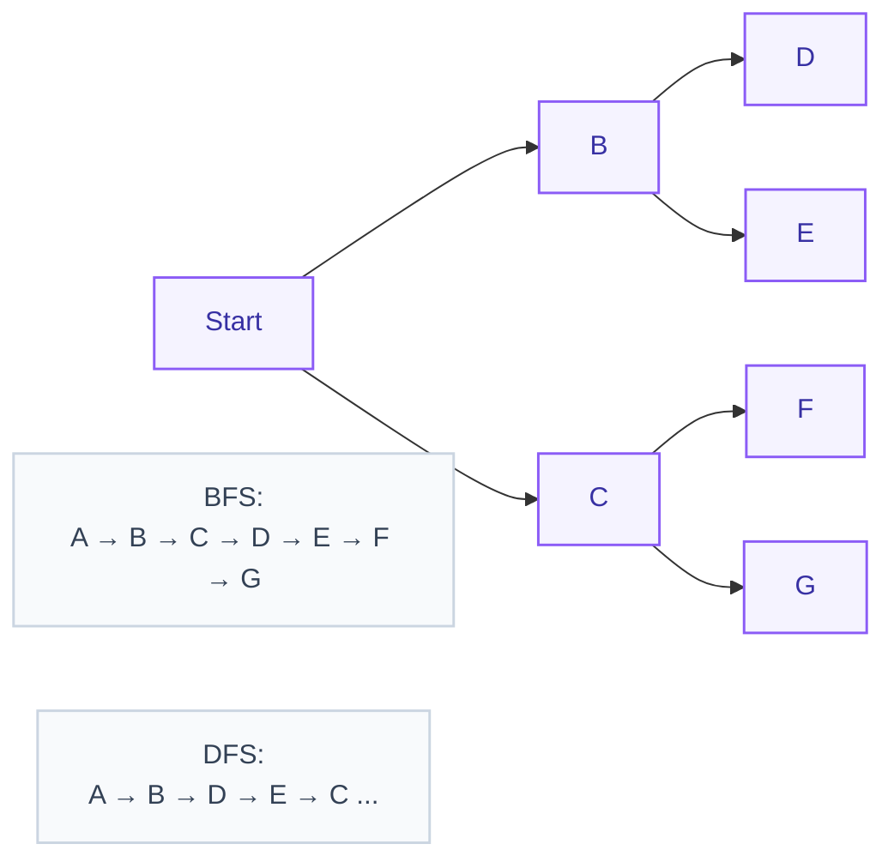
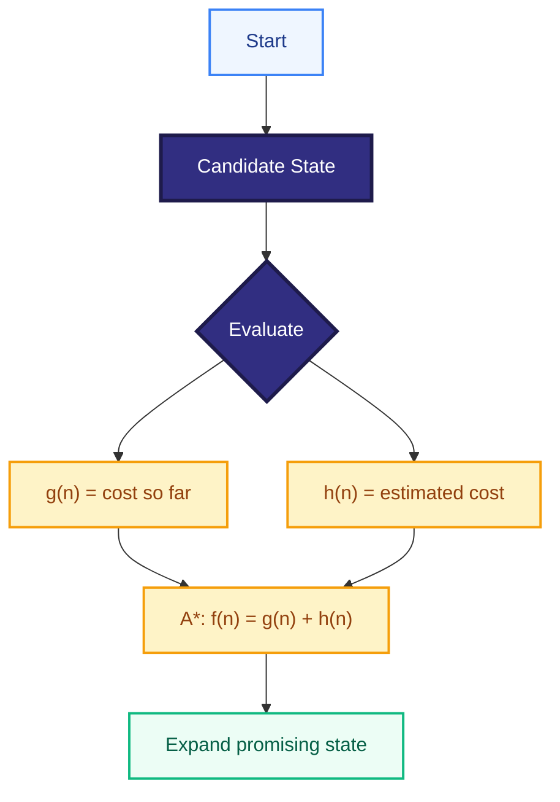
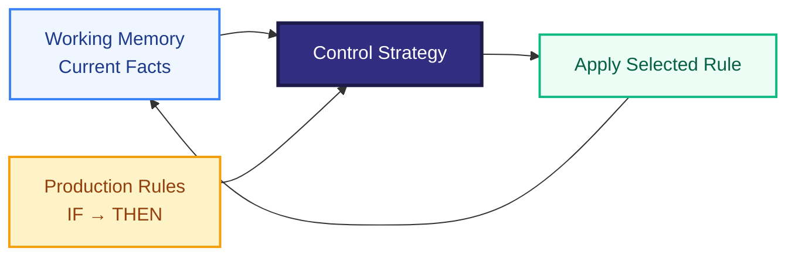
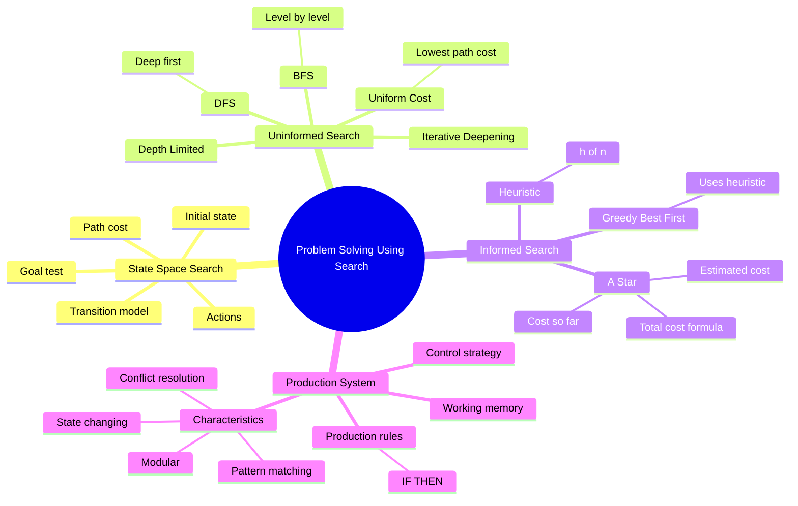

# Problem Solving Using Search — Short Exam Notes

## 1. Problem Solving Using Search

In AI, **problem solving by search** means finding a sequence of actions from an **initial state** to a **goal state**.

A search problem is usually defined by:
- **Initial state** — where the agent starts.
- **Actions/operators** — possible actions.
- **Transition model** — result of applying an action.
- **Goal test** — checks whether the goal is reached.
- **Path cost** — total cost of the solution path.

---

## 2. State Space Search

A **state space** is the set of all possible states reachable from the initial state.

**State space search** explores these states to find a path to the goal.

### Example: 8-Puzzle

**Key idea:** Search = **states + actions + goal test + path cost**.

---

# 3. Uninformed Search Strategies

**Uninformed (blind) search** uses no extra knowledge about how close a state is to the goal.

| Strategy | Main idea | Key point |
|---|---|---|
| **BFS** | Explore level by level | Complete; optimal with equal step costs |
| **DFS** | Go as deep as possible first | Low memory; not generally optimal |
| **Uniform Cost Search** | Expand lowest path-cost node | Optimal when step costs are non-negative |
| **Depth-Limited Search** | DFS with a depth limit | Avoids infinite depth |
| **Iterative Deepening** | Repeated depth-limited DFS | Combines low memory with BFS-like completeness |

### BFS vs DFS

---

# 4. Informed Search Strategies

**Informed (heuristic) search** uses additional knowledge called a **heuristic** to guide the search toward the goal.

### Heuristic Function

**h(n)** = estimated cost from node **n** to the goal.

### Greedy Best-First Search
Chooses the node with the smallest:

**h(n)**

It tries to reach the goal quickly but is **not generally optimal**.

### A* Search
Uses:

**f(n) = g(n) + h(n)**

Where:
- **g(n)** = actual cost from start to n
- **h(n)** = estimated cost from n to goal
- **f(n)** = estimated total solution cost

With an appropriate admissible heuristic and standard conditions, A* can produce an optimal solution.

### Uninformed vs Informed

| Uninformed | Informed |
|---|---|
| No heuristic | Uses heuristic |
| Explores more blindly | Guides search toward goal |
| Examples: BFS, DFS, UCS | Examples: Greedy, A* |

---

# 5. Production System

A **production system** is a rule-based problem-solving system consisting of:

1. **Rule set (production rules)** — IF–THEN rules.
2. **Working memory** — current facts/state.
3. **Control strategy** — decides which rule to apply.

### Example

**IF** temperature is high  
**THEN** turn on the fan.

## 6. Characteristics of Production Systems

- **Rule-based:** knowledge is represented as IF–THEN rules.
- **Modular:** rules can often be added or changed independently.
- **Pattern matching:** rules are selected by matching conditions with working memory.
- **Control strategy:** resolves conflicts when multiple rules can fire.
- **State changing:** applying rules changes the current state.
- **Traceable:** the sequence of applied rules can explain how a solution was reached.
- **May be monotonic or non-monotonic:** applying a rule may or may not remove previously valid facts.

---

## Quick Revision

### Search
**Initial state → Search → Goal state**

### State Space
All possible states + transitions between them.

### Uninformed
**BFS, DFS, UCS, DLS, IDS**

### Informed
**Greedy:** uses **h(n)**  
**A\*:** uses **f(n) = g(n) + h(n)**

### Production System
**Rules + Working Memory + Control Strategy**

---

# Mindmap

