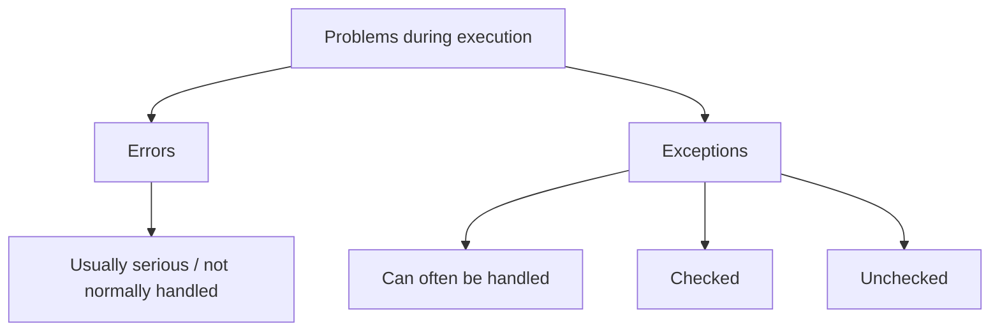
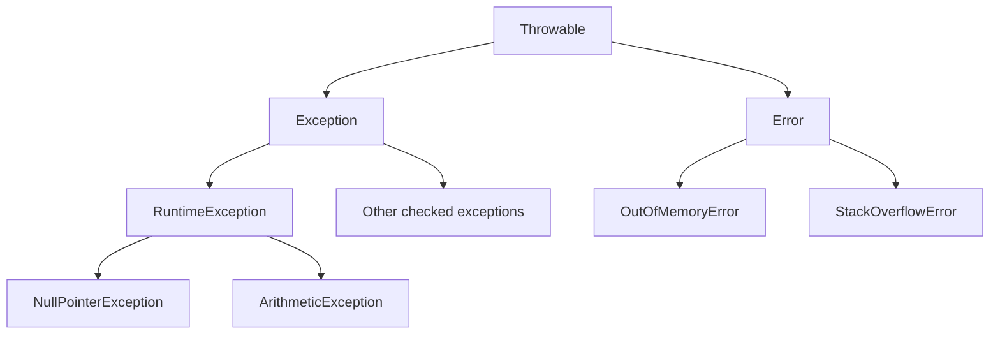
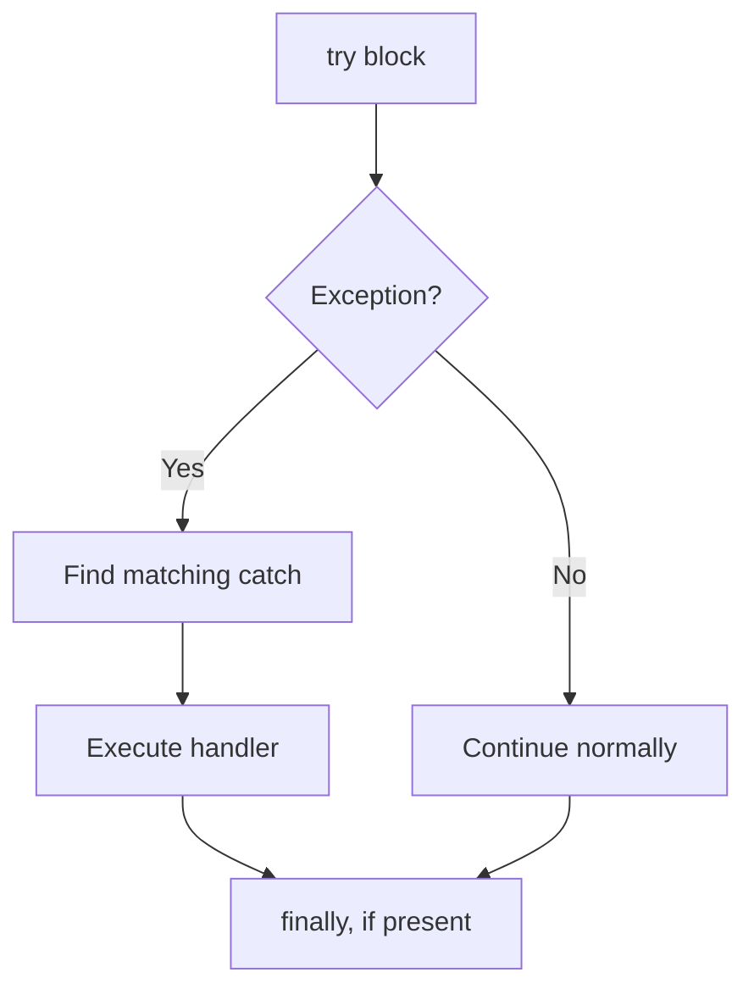

# Java Exam Notes — Exception Handling

## 1. Errors and Exceptions

An **exception** is an event that disrupts the normal flow of program execution and can often be handled by the program.

An **error** generally represents a serious problem that applications usually should not try to recover from.



Examples:
- **Error:** `OutOfMemoryError`, `StackOverflowError`
- **Exception:** `IOException`, `ArithmeticException`, `NullPointerException`

---

## 2. Types of Exceptions

### Checked Exceptions
- Checked by the compiler.
- Must be caught or declared with `throws`.
- Usually represent conditions outside the immediate program logic.

Examples:
```text
IOException
SQLException
```

### Unchecked Exceptions
- Subclasses of `RuntimeException`.
- Compiler does not require explicit handling.

Examples:
```text
ArithmeticException
NullPointerException
ArrayIndexOutOfBoundsException
```

### Hierarchy



---

## 3. `try`

The `try` block contains code that may throw an exception.

```java
try {
    int x = 10 / 0;
}
```

A `try` block must be followed by at least one `catch` or a `finally`.

---

## 4. `catch`

A `catch` block handles an exception thrown from the associated `try` block.

```java
try {
    int x = 10 / 0;
}
catch (ArithmeticException e) {
    System.out.println("Cannot divide by zero");
}
```

`e` is the exception object.

### Multiple `catch` blocks

```java
try {
    // risky code
}
catch (ArithmeticException e) {
    // handle arithmetic problem
}
catch (Exception e) {
    // handle other exceptions
}
```

**Important:** Put more specific exception types before general types.

---

## 5. `finally`

The `finally` block is used for code that should normally execute whether an exception occurs or not.

```java
try {
    System.out.println("Try");
}
catch (Exception e) {
    System.out.println("Catch");
}
finally {
    System.out.println("Finally");
}
```

Common use: cleanup such as closing resources.

**Note:** `finally` normally executes, but there are exceptional cases such as JVM termination.

---

## 6. `throw`

`throw` is used to **explicitly throw an exception object**.

```java
throw new ArithmeticException("Invalid operation");
```

Example:

```java
if (age < 18) {
    throw new IllegalArgumentException("Age must be 18 or above");
}
```

---

## 7. `throws`

`throws` is used in a method declaration to indicate exceptions that the method may pass to its caller.

```java
void readFile() throws IOException {
    // code
}
```

### `throw` vs `throws`

| `throw` | `throws` |
|---|---|
| Actually throws an exception | Declares possible exceptions |
| Used inside method/block | Used in method declaration |
| Followed by an exception object | Followed by exception class names |

---

## 8. Creating Exception Subclasses

You can create a custom exception by extending `Exception` or another suitable exception class.

```java
class InvalidAgeException extends Exception {
    InvalidAgeException(String message) {
        super(message);
    }
}
```

Use it:

```java
if (age < 18) {
    throw new InvalidAgeException("Invalid age");
}
```

If it extends `Exception`, it is a **checked custom exception**.

If it extends `RuntimeException`, it is an **unchecked custom exception**:

```java
class InvalidAgeException extends RuntimeException {
    InvalidAgeException(String message) {
        super(message);
    }
}
```

---

## 9. Exception Handlers

An **exception handler** is code that responds to an exception, usually a `catch` block.



If no matching `catch` exists in the current method, the exception **propagates up the call stack** until a suitable handler is found. If none is found, the thread terminates with an uncaught exception.

---

## 10. Default Exception Handling

If you do not handle an exception, Java's runtime performs **default handling**.

```java
class Demo {
    public static void main(String[] args) {
        int x = 10 / 0;
    }
}
```

The program terminates and the JVM prints information such as:
- Exception type
- Message
- Stack trace

Example:

```text
Exception in thread "main" java.lang.ArithmeticException: / by zero
    at Demo.main(Demo.java:3)
```

---

## 11. Custom Exception Handling

Custom handling means writing your own response to an exception.

```java
try {
    int age = 15;

    if (age < 18)
        throw new InvalidAgeException("Not eligible");

}
catch (InvalidAgeException e) {
    System.out.println(e.getMessage());
}
finally {
    System.out.println("Done");
}
```

Output:

```text
Not eligible
Done
```

---

## 12. Quick Exam Revision

- **Exception:** Disrupts normal program execution and can often be handled.
- **Error:** Generally serious problem not normally handled by application code.
- **Checked exception:** Compiler requires catch or declaration with `throws`.
- **Unchecked exception:** `RuntimeException` and its subclasses; no mandatory catch/declare.
- **`try`:** Contains risky code.
- **`catch`:** Handles an exception.
- **`finally`:** Cleanup code that normally executes.
- **`throw`:** Explicitly throws an exception.
- **`throws`:** Declares exceptions in a method signature.
- **Custom exception:** Create by extending `Exception` or `RuntimeException`.
- **Handler:** Usually a `catch` block.
- **Default handling:** JVM prints the uncaught exception and stack trace and terminates the affected thread.
