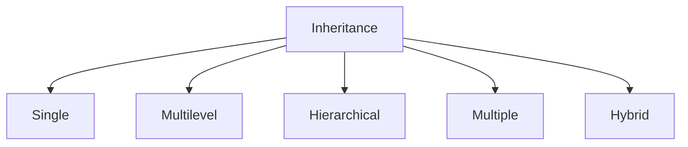
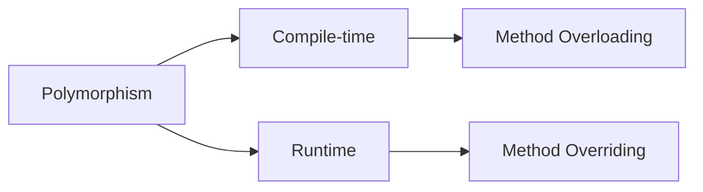
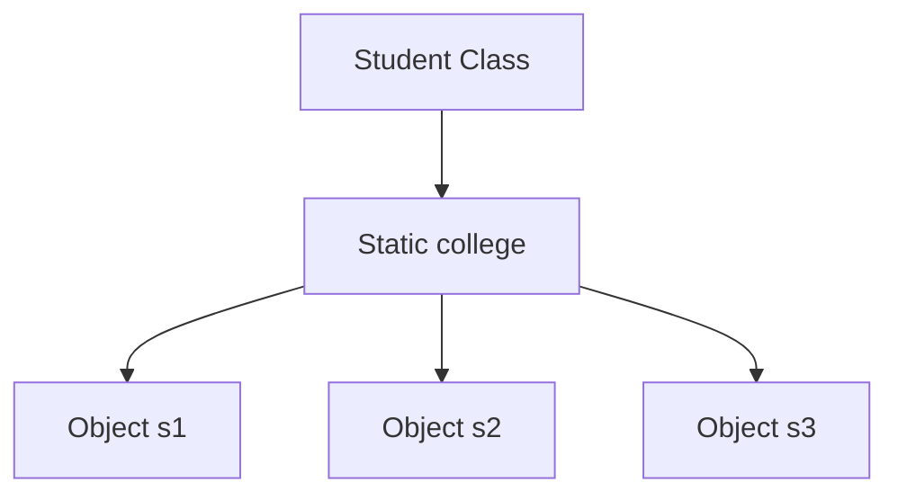
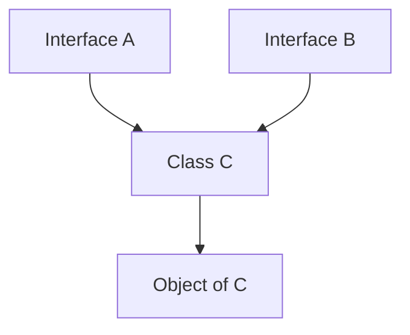

# Java Exam Notes — Inheritance & Related Concepts

## 1. Inheritance

**Inheritance** allows a child/subclass to acquire fields and methods of a parent/superclass.

```java
class Animal {
    void eat() {
        System.out.println("Eating");
    }
}

class Dog extends Animal {
    void bark() {
        System.out.println("Barking");
    }
}
```

`Dog` inherits `eat()` from `Animal`.

### Types of Inheritance



**1. Single:** One parent → one child.

```text
A
↓
B
```

**2. Multilevel:** Chain of inheritance.

```text
A
↓
B
↓
C
```

**3. Hierarchical:** One parent → multiple children.

```text
    A
   / \
  B   C
```

**4. Multiple:** One child → multiple parents.

```text
A   B
 \ /
  C
```

Java **does not support multiple inheritance through classes** because of ambiguity, but multiple inheritance of type can be achieved using **interfaces**.

**5. Hybrid:** Combination of inheritance types. Java can achieve suitable hybrid structures using interfaces.

---

## 2. Access Modifiers

Access modifiers control where a class member can be accessed.

| Modifier | Same Class | Same Package | Subclass (other package) | Other Package |
|---|---|---|---|---|
| `private` | Yes | No | No | No |
| `default` | Yes | Yes | No* | No |
| `protected` | Yes | Yes | Yes** | No |
| `public` | Yes | Yes | Yes | Yes |

`*` Default/package-private members are accessible only within the same package.

`**` In another package, `protected` access is available to a subclass through inheritance (with Java's access rules); it is not general access through an unrelated object.

### Key points
- **Private:** Most restrictive; only inside the declaring class.
- **Default:** No modifier; package-private.
- **Protected:** Same package + subclasses in other packages.
- **Public:** Accessible from anywhere the class itself is accessible.

---

## 3. Polymorphism

**Polymorphism** means "many forms": the same method name/interface can behave differently.

Two common forms:



### A. Method Overloading

Same method name, but **different parameter list** in the same class.

```java
int add(int a, int b) {
    return a + b;
}

int add(int a, int b, int c) {
    return a + b + c;
}
```

Changing only the return type is **not** enough for overloading.

### B. Method Overriding

A subclass provides its own implementation of an inherited instance method with a compatible signature.

```java
class Animal {
    void sound() {
        System.out.println("Animal sound");
    }
}

class Dog extends Animal {
    @Override
    void sound() {
        System.out.println("Bark");
    }
}
```

The method selected at runtime depends on the actual object.

---

## 4. `this` Keyword

`this` refers to the **current object**.

Common uses:
- Distinguish instance variables from parameters.
- Call another constructor using `this(...)`.
- Pass the current object as an argument.

```java
class Student {
    int age;

    Student(int age) {
        this.age = age;
    }
}
```

---

## 5. `super` Keyword

`super` refers to the **immediate parent class**.

Uses:
- Access parent class fields.
- Call parent class methods.
- Call parent class constructor using `super(...)`.

```java
class Dog extends Animal {
    Dog() {
        super();
    }

    void show() {
        super.eat();
    }
}
```

**Important:** `this(...)` and `super(...)` must be the first statement in a constructor.

---

## 6. Final Variable

A `final` variable can be assigned only once.

```java
final int MAX = 100;
MAX = 200;  // Error
```

A final instance variable can be initialized in a declaration or constructor, but it must receive a value before use.

For a constant, the common convention is:

```java
static final double PI = 3.14159;
```

---

## 7. Final Class

A `final` class **cannot be extended**.

```java
final class A {
}
```

```java
class B extends A { }  // Error
```

Example: `String` is a final class.

---

## 8. Final Method

A `final` method **cannot be overridden** by a subclass.

```java
class A {
    final void show() {
        System.out.println("Hello");
    }
}
```

```java
class B extends A {
    // void show() { }  // Error
}
```

---

## 9. Static Variables

A `static` variable belongs to the **class**, not to individual objects.

```java
class Student {
    static String college = "ABC";
}
```

All objects share the same static variable.



---

## 10. Static Methods

A `static` method belongs to the class.

```java
class Demo {
    static void show() {
        System.out.println("Hello");
    }
}

Demo.show();
```

### Important
A static method cannot directly access instance variables/methods because it does not have a particular object (`this`) associated with it.

---

## 11. Abstract Methods and Classes

### Abstract Method

An abstract method has **no body** and must be implemented by a concrete subclass.

```java
abstract void display();
```

### Abstract Class

A class declared with `abstract`.

```java
abstract class Animal {
    abstract void sound();

    void eat() {
        System.out.println("Eating");
    }
}
```

- Cannot create an object directly using `new`.
- Can contain abstract and concrete methods.
- A subclass must implement inherited abstract methods unless the subclass is also abstract.

---

## 12. Packages

A **package** groups related classes/interfaces and helps organize code and control access.

Example declaration:

```java
package mypack;
```

Typical structure:

```text
mypack/
 ├── Student.java
 └── Teacher.java
```

### Importing a Package/Class

Import a specific class:

```java
import java.util.Scanner;
```

Import all accessible types in a package:

```java
import java.util.*;
```

Without an import, you can use a fully qualified name:

```java
java.util.Scanner sc = new java.util.Scanner(System.in);
```

`java.lang` is automatically imported.

---

## 13. Interfaces

An **interface** defines a contract that implementing classes must follow.

```java
interface Animal {
    void sound();
}

class Dog implements Animal {
    public void sound() {
        System.out.println("Bark");
    }
}
```

Key points:
- A class uses `implements` to implement an interface.
- Interface methods that are abstract must be implemented by a concrete class.
- A class can implement **multiple interfaces**.
- Interfaces can contain `default` and `static` methods with implementations, and can also contain constants.

---

## 14. Multiple Inheritance Using Interfaces

Java does not allow:

```java
class C extends A, B { }  // Error
```

But a class can implement multiple interfaces:

```java
interface A {
    void showA();
}

interface B {
    void showB();
}

class C implements A, B {
    public void showA() {
        System.out.println("A");
    }

    public void showB() {
        System.out.println("B");
    }
}
```



This provides a way to combine multiple contracts without multiple class inheritance.

---

## 15. Quick Exam Revision

- **Inheritance:** Reuse/extend features of a parent class.
- **`extends`:** Used for class inheritance.
- **`implements`:** Used when a class implements an interface.
- **Single:** One parent → one child.
- **Multilevel:** A → B → C.
- **Hierarchical:** One parent → many children.
- **Multiple class inheritance:** Not supported in Java.
- **`private`:** Same class only.
- **Default:** Same package.
- **`protected`:** Same package + subclasses (with cross-package restrictions).
- **`public`:** Broadest access.
- **Overloading:** Same name, different parameters; compile-time selection.
- **Overriding:** Subclass redefines inherited method; runtime dispatch.
- **`this`:** Current object.
- **`super`:** Immediate parent.
- **`final` variable:** Cannot be reassigned.
- **`final` class:** Cannot be extended.
- **`final` method:** Cannot be overridden.
- **`static`:** Belongs to the class.
- **Abstract class:** Cannot be directly instantiated.
- **Abstract method:** Declared without a body.
- **Package:** Groups related types.
- **Interface:** Contract implemented by classes.
- **Multiple interfaces:** A class can implement multiple interfaces.
