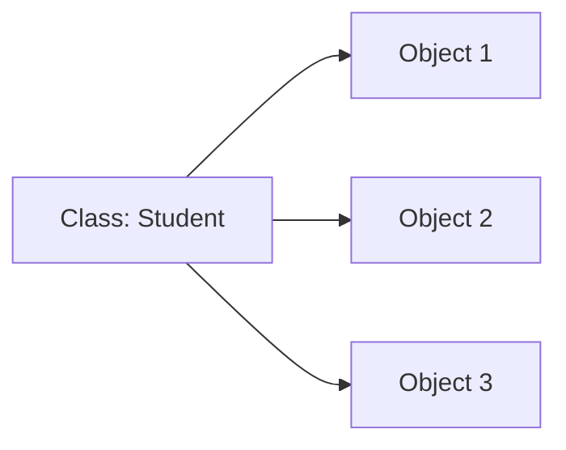
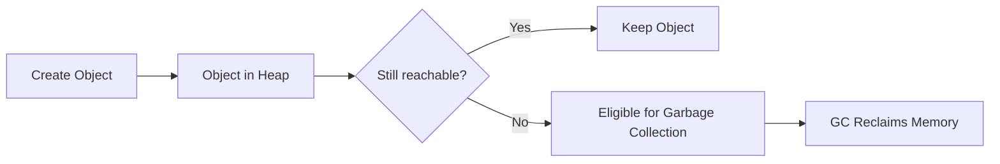
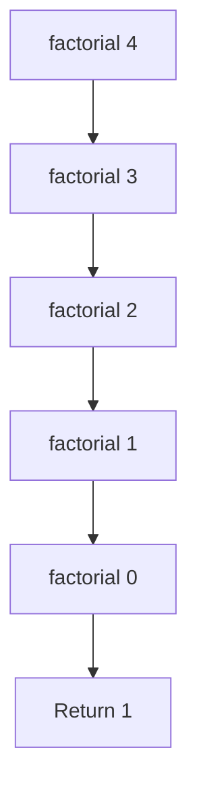

# Java Exam Notes — Introduction to Classes

## 1. Class Fundamentals

A **class** is a blueprint/template used to create objects. It contains:
- **Fields:** data/state
- **Methods:** behavior
- **Constructors:** initialize objects

```java
class Student {
    int age;                 // field

    void study() {           // method
        System.out.println("Studying");
    }
}
```

### Class → Object



A class defines what an object has and can do; each object has its own instance fields.

---

## 2. Declaring Objects

An object is an **instance of a class**.

```java
Student s;          // reference variable
s = new Student();  // creates object
```

Short form:

```java
Student s = new Student();
```

- `Student` → class type
- `s` → reference variable
- `new Student()` → creates an object

Multiple objects:

```java
Student s1 = new Student();
Student s2 = new Student();
```

Each object can have its own instance data.

---

## 3. Methods

A **method** is a block of code that performs a task.

### Syntax

```java
returnType methodName(parameters) {
    // statements
    return value;
}
```

Example:

```java
int add(int a, int b) {
    return a + b;
}
```

Calling a method:

```java
int result = add(10, 20);
```

### `void` method

A `void` method does not return a value.

```java
void display() {
    System.out.println("Hello");
}
```

### Static method

A `static` method belongs to the class and can be called without creating an object.

```java
static void show() {
    System.out.println("Hello");
}

ClassName.show();
```

---

## 4. Constructors

A **constructor** initializes an object when it is created.

### Rules
- Same name as the class.
- Has **no return type**, not even `void`.
- Called automatically when `new` creates an object.
- Can be overloaded.

Example:

```java
class Student {
    int age;

    Student(int a) {
        age = a;
    }
}

Student s = new Student(20);
```

### Default constructor

If **no constructor is declared**, Java provides a default no-argument constructor.

```java
class Student {
    int age;
}

Student s = new Student();
```

If you declare any constructor yourself, Java does **not** automatically add a no-argument constructor.

### Constructor vs Method

| Constructor | Method |
|---|---|
| Initializes objects | Performs an operation |
| Same name as class | Can have any valid name |
| No return type | Has a return type or `void` |
| Called during object creation | Called explicitly (or through other code) |

---

## 5. Garbage Collection

**Garbage collection (GC)** automatically removes objects that are no longer reachable by a Java program.



Example:

```java
Student s = new Student();
s = null;
```

The original `Student` object may become **eligible for garbage collection** if no other reference points to it.

### Important points
- GC is automatic.
- You cannot force exactly when GC runs.
- `System.gc()` only requests garbage collection; it does not guarantee it.

---

## 6. Passing Parameters to Methods

Java uses **pass-by-value**.

### Primitive values

A copy of the primitive value is passed.

```java
void change(int x) {
    x = 100;
}

int a = 10;
change(a);
// a is still 10
```

### Objects

For an object, the **reference value is copied**. Both the original reference and the parameter can refer to the same object.

```java
class Student {
    int age;
}

void change(Student s) {
    s.age = 25;
}
```

If an object field is changed, the change can be visible through the original reference.

**Exam point:** Java is always **pass-by-value**; it does not use pass-by-reference.

---

## 7. Recursion

**Recursion** occurs when a method calls itself.

A recursive method needs:
1. **Base case** — stops recursion.
2. **Recursive case** — calls itself with a smaller/simpler problem.

### Example: Factorial

```java
int factorial(int n) {
    if (n == 0)
        return 1;              // base case

    return n * factorial(n - 1);
}
```

For `factorial(4)`:

```text
4 × factorial(3)
    ↓
4 × 3 × factorial(2)
    ↓
4 × 3 × 2 × factorial(1)
    ↓
4 × 3 × 2 × 1 × factorial(0)
    ↓
24
```



**Warning:** Without a proper base case, recursion can continue until a `StackOverflowError` occurs.

---

## 8. Quick Exam Revision

- **Class:** Blueprint for objects.
- **Object:** Instance of a class.
- **Field:** Data stored in a class/object.
- **Method:** Performs an operation.
- **Constructor:** Initializes an object; same name as class and no return type.
- **`new`:** Creates an object.
- **Garbage collection:** Automatically reclaims memory from unreachable objects.
- **Parameter passing:** Java is always pass-by-value.
- **Recursion:** A method calling itself.
- **Base case:** Condition that stops recursion.
