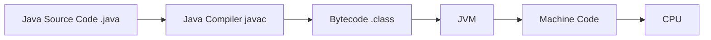
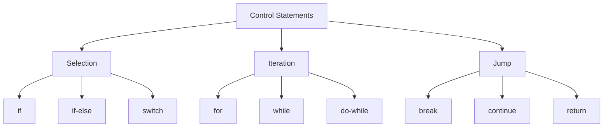

# Java Exam Notes — Introduction to Java

## 1. Features of Java

Java is a high-level, object-oriented programming language designed to be portable and platform-independent.

**Main features:**
- **Simple:** Easier syntax than many low-level languages.
- **Object-Oriented:** Based on classes and objects.
- **Platform Independent:** "Write Once, Run Anywhere" through the JVM.
- **Portable:** Java bytecode can run on different operating systems with a JVM.
- **Secure:** No direct pointer manipulation; bytecode verification and runtime checks.
- **Robust:** Strong type checking, exception handling, and garbage collection.
- **Multithreaded:** Supports execution of multiple threads.
- **Architecture-Neutral:** Bytecode is not tied to a particular CPU.
- **High Performance:** JIT (Just-In-Time) compilation improves execution speed.
- **Distributed:** Provides libraries/APIs for network programming.
- **Dynamic:** Classes can be loaded at runtime.

---

## 2. Java vs C++

| Java | C++ |
|---|---|
| Mainly object-oriented | Supports procedural + object-oriented programming |
| Platform-independent through JVM | Usually compiled for a specific platform |
| No explicit pointers | Supports pointers |
| Automatic garbage collection | Manual memory management is possible |
| No operator overloading (except built-in meaning) | Supports operator overloading |
| No multiple inheritance of classes | Supports multiple inheritance of classes |
| Has built-in exception handling | Has exception handling |
| No preprocessor/macros like C++ | Supports preprocessor directives |
| Uses `.java` → bytecode | Usually `.cpp` → native machine code |
| No `goto` statement | `goto` is available |

---

## 3. JVM (Java Virtual Machine)

The **JVM** is the runtime environment that executes Java bytecode.



### Main JVM responsibilities
- Loads `.class` files.
- Verifies bytecode.
- Executes bytecode.
- Converts bytecode to native machine instructions using interpretation/JIT compilation.
- Manages memory and garbage collection.

**Important:** Java is platform-independent, but the **JVM is platform-specific**. A different OS/CPU needs an appropriate JVM.

---

## 4. Bytecode

**Bytecode** is the intermediate code generated by the Java compiler.

Example:

```text
Hello.java
    ↓ javac
Hello.class
    ↓ JVM
Machine instructions
```

Bytecode is stored in `.class` files and is designed to be executed by a JVM.

### Machine Code vs Bytecode

| Machine Code | Bytecode |
|---|---|
| Native instructions for a CPU | Intermediate instructions for JVM |
| CPU can execute it directly | JVM executes/translates it |
| Platform/CPU dependent | Platform independent at the bytecode level |
| Usually produced by native compilers | Produced by Java compiler |
| Example: x86/ARM instructions | Java `.class` bytecode |

---

## 5. Data Types

Java data types are divided into **primitive** and **reference** types.

### Primitive Data Types

| Type | Size | Example |
|---|---:|---|
| `byte` | 8-bit | `byte x = 10;` |
| `short` | 16-bit | `short x = 100;` |
| `int` | 32-bit | `int x = 1000;` |
| `long` | 64-bit | `long x = 1000L;` |
| `float` | 32-bit | `float x = 2.5f;` |
| `double` | 64-bit | `double x = 2.5;` |
| `char` | 16-bit | `char c = 'A';` |
| `boolean` | JVM-dependent representation; values are `true/false` | `boolean ok = true;` |

**Default values for instance/static fields:** numeric types → `0`, `char` → `'\u0000'`, `boolean` → `false`, reference types → `null`.

**Local variables do not get automatic default values; they must be initialized before use.**

### Reference Types
Examples:
- Classes
- Objects
- Arrays
- Interfaces
- `String`

Example:

```java
String name = "Rishav";
int[] marks = {80, 90, 85};
```

---

## 6. Wrapper Types

Wrapper classes represent primitive values as **objects**.

| Primitive | Wrapper |
|---|---|
| `byte` | `Byte` |
| `short` | `Short` |
| `int` | `Integer` |
| `long` | `Long` |
| `float` | `Float` |
| `double` | `Double` |
| `char` | `Character` |
| `boolean` | `Boolean` |

### Why use wrappers?
- Needed where objects are required, e.g. collections.
- Provide useful methods such as parsing and conversion.
- Can represent `null`.

### Boxing and Unboxing

```java
Integer a = 10;  // autoboxing: int → Integer
int b = a;       // unboxing: Integer → int
```

---

## 7. Variables

A **variable** is a named memory location used to store a value.

### Types of variables

**1. Local variable**
- Declared inside a method/block.
- Must be initialized before use.

```java
void test() {
    int x = 10;
}
```

**2. Instance variable**
- Declared inside a class but outside methods.
- Each object has its own copy.

```java
class Student {
    int age;
}
```

**3. Static/Class variable**
- Declared using `static`.
- Shared by all objects of the class.

```java
class Student {
    static String college = "ABC";
}
```

### Constants

Use `final` for a variable whose value cannot be reassigned:

```java
final double PI = 3.14159;
```

---

## 8. Arrays

An **array** stores multiple values of the same type in a fixed-size structure.

### 1-D Array

```java
int[] marks = new int[5];
marks[0] = 90;
```

Or:

```java
int[] marks = {90, 80, 70};
```

- Index starts at **0**.
- `marks.length` gives the number of elements.
- Size cannot be changed after creation.

### 2-D Array

```java
int[][] matrix = {
    {1, 2},
    {3, 4}
};
```

Access:

```java
matrix[0][1];  // 2
```

### Enhanced for loop

```java
for (int x : marks) {
    System.out.println(x);
}
```

---

## 9. Control Statements

Control statements determine the order in which statements execute.



### A. Selection / Decision

#### `if`

```java
if (age >= 18) {
    System.out.println("Adult");
}
```

#### `if-else`

```java
if (marks >= 40)
    System.out.println("Pass");
else
    System.out.println("Fail");
```

#### `else-if`

```java
if (marks >= 90)
    grade = 'A';
else if (marks >= 75)
    grade = 'B';
else
    grade = 'C';
```

#### `switch`

Used when one expression is compared with multiple cases.

```java
switch (day) {
    case 1:
        System.out.println("Monday");
        break;
    case 2:
        System.out.println("Tuesday");
        break;
    default:
        System.out.println("Invalid");
}
```

**`break` prevents fall-through to the next case.**

---

### B. Iteration / Loops

#### `for`

Best when the number of iterations is known.

```java
for (int i = 0; i < 5; i++) {
    System.out.println(i);
}
```

#### `while`

Checks the condition **before** each iteration.

```java
while (x > 0) {
    x--;
}
```

#### `do-while`

Executes the body **at least once**, then checks the condition.

```java
do {
    x--;
} while (x > 0);
```

### Loop comparison

| Loop | Condition checked | Minimum executions |
|---|---|---:|
| `for` | Before body | 0 |
| `while` | Before body | 0 |
| `do-while` | After body | 1 |

---

### C. Jump Statements

#### `break`
Immediately exits the nearest loop or `switch`.

```java
if (x == 5)
    break;
```

#### `continue`
Skips the current loop iteration and moves to the next iteration.

```java
if (x == 5)
    continue;
```

#### `return`
Exits a method, optionally returning a value.

```java
return x + y;
```

---

## 10. Quick Exam Revision

- **JDK:** Tools for developing Java programs; includes the compiler and runtime components.
- **JRE:** Runtime environment for running Java applications.
- **JVM:** Executes Java bytecode.
- **`.java`:** Java source file.
- **`.class`:** Compiled bytecode file.
- **Bytecode:** Intermediate, JVM-oriented code.
- **Primitive types:** `byte, short, int, long, float, double, char, boolean`.
- **Wrapper classes:** Object forms of primitive types, e.g. `int → Integer`.
- **Array index:** Starts at `0`.
- **`length`:** Gives array size.
- **`final`:** Prevents reassignment of a variable.
- **`static`:** Makes a class-level member shared by the class.
- **`break`:** Exit.
- **`continue`:** Skip current iteration.
- **`return`:** Exit a method and optionally return a value.
