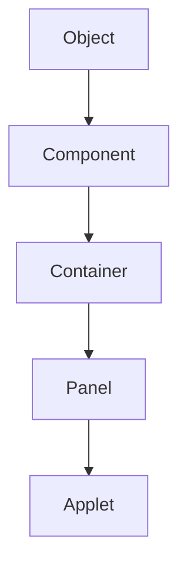
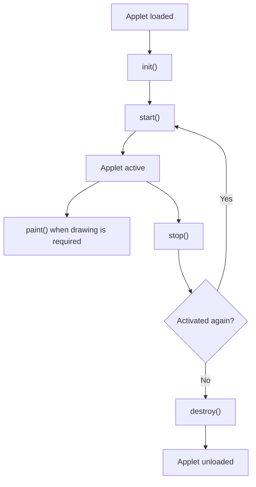
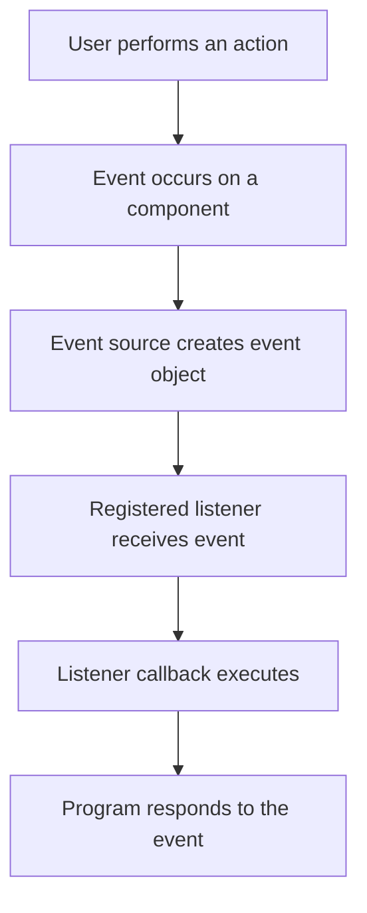
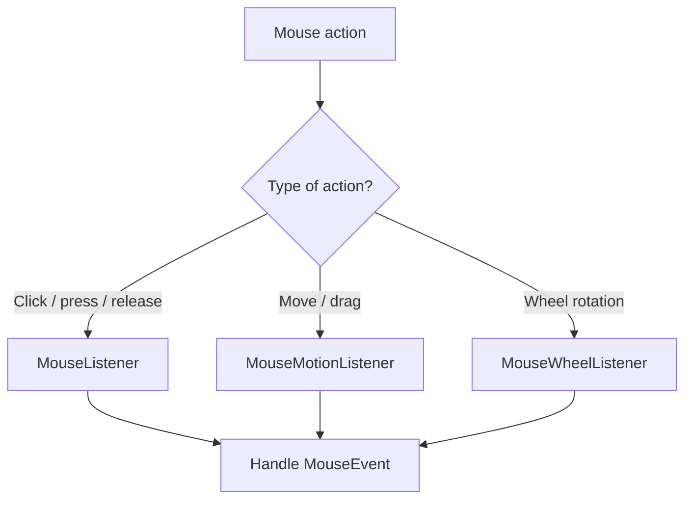
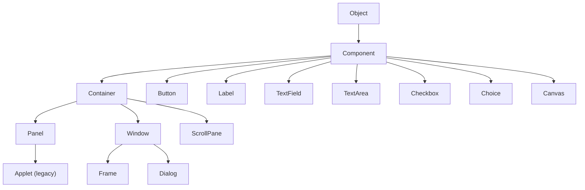
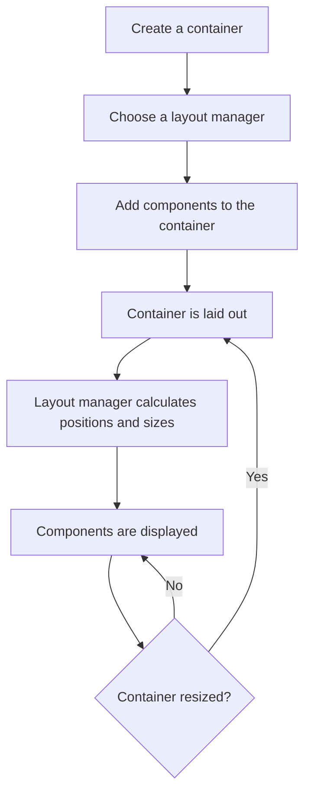
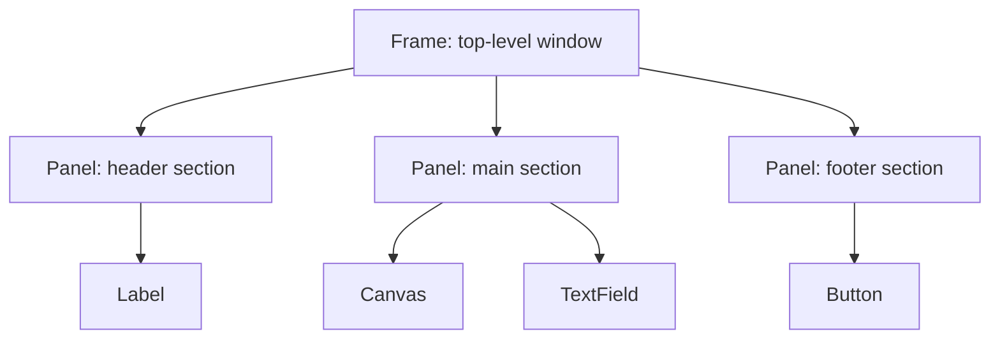

# Java Applets and Graphics — Detailed Notes

> **Important version note:** Java applets are a legacy technology. Modern web browsers do not support the Java browser plug-in, and the Applet API has been deprecated and removed from modern Java releases. The material below is useful for understanding older Java curricula and legacy applications, but applets should not be chosen for new projects. For modern desktop interfaces, consider Swing or JavaFX; for web interfaces, use web technologies.

## 1. Applets and Graphics: Introduction

### What is an applet?

An **applet** is a small Java program historically designed to run inside another application, usually a web browser or the Applet Viewer. Unlike a normal Java application, an applet traditionally did not start with a `main()` method. The host environment created the applet and called its lifecycle methods.

Historically, applets were embedded in HTML and downloaded by a browser running a Java plug-in. They were used for interactive animations, educational demonstrations, games, and small graphical applications.

### Applet vs. standalone application

| Applet (historical)                        | Standalone Java application                                         |
|:-------------------------------------------|:--------------------------------------------------------------------|
| Hosted by a browser or Applet Viewer       | Started by the Java launcher                                        |
| Traditionally has no `main()` entry point  | Usually starts with `public static void main(String[] args)`        |
| Lifecycle controlled by the host           | Application controls its own startup and shutdown                   |
| Historically subject to a security sandbox | Permissions depend on the environment and application configuration |
| Embedded in a web page                     | Runs as a separate application                                      |

### What is graphics programming in Java?

Graphics programming is the creation of visual output such as lines, shapes, text, colors, images, and animations. In the AWT (Abstract Window Toolkit), drawing is commonly performed with the `Graphics` object.

Common drawing operations include:

- `drawLine()` — draws a line.
- `drawRect()` — draws a rectangle outline.
- `fillRect()` — draws a filled rectangle.
- `drawOval()` — draws an oval outline.
- `fillOval()` — draws a filled oval.
- `drawString()` — draws text.
- `drawArc()` and `fillArc()` — draw or fill an arc.
- `drawPolygon()` and `fillPolygon()` — draw or fill polygons.
- `setColor()` — sets the current drawing color.
- `setFont()` — sets the current drawing font.

------------------------------------------------------------------------

## 2. Applet Fundamentals

An applet is based on the `java.applet.Applet` class in older Java versions. It is a graphical component and is also an AWT component, so it can use AWT drawing, event handling, and layout features.

### Basic structure of an applet

The following is a historical example written in the style of older Java versions that included the Applet API:

```java
import java.applet.Applet;
import java.awt.Graphics;

public class FirstApplet extends Applet {
    @Override
    public void paint(Graphics g) {
        g.drawString("Hello, Applet!", 40, 50);
    }
}
```

In this example:

- `Applet` is the superclass.
- `paint(Graphics g)` is called by the AWT painting system when the applet needs to display its contents.
- `drawString()` draws text at the specified coordinates.
- The coordinate `(0, 0)` is at the top-left of the component; x increases to the right and y increases downward.

### Historical HTML embedding

Older applet deployments used HTML similar to this:

```html
<applet code="FirstApplet.class" width="300" height="150">
</applet>
```

This is a historical example only. Modern browsers do not load applets this way, and the HTML `applet` element is obsolete.

### Applet parameters

Historically, a web page could pass parameters to an applet using HTML attributes. The applet could read them with `getParameter()`.

```java
import java.applet.Applet;
import java.awt.Graphics;

public class ParameterApplet extends Applet {
    private String message;

    @Override
    public void init() {
        message = getParameter("message");

        if (message == null) {
            message = "Default message";
        }
    }

    @Override
    public void paint(Graphics g) {
        g.drawString(message, 30, 40);
    }
}
```

The host page could historically provide a parameter such as `message`. Parameter-based applet deployment is obsolete along with browser applets.

### Applet characteristics

- A traditional applet is hosted rather than launched directly.
- Its lifecycle is managed by the host.
- It can draw using AWT’s `Graphics` API.
- It can receive user input through event listeners.
- Older applet environments imposed security restrictions.
- It was commonly used for small interactive graphical programs.

------------------------------------------------------------------------

## 3. The `Applet` Class

The `Applet` class historically provided the basic framework for applets. It belongs to the `java.applet` package and extends AWT’s `Panel` class.

Simplified inheritance relationship:



Because an applet is a kind of `Panel`, it can contain AWT components and use layout managers.

### Common methods of the `Applet` class

| Method                       | Purpose                                                         |
|:-----------------------------|:----------------------------------------------------------------|
| `init()`                     | Called once when the applet is initialized                      |
| `start()`                    | Called when the applet becomes active                           |
| `stop()`                     | Called when the applet becomes inactive                         |
| `destroy()`                  | Called before the applet is unloaded                            |
| `getParameter(String name)`  | Retrieves a parameter supplied by the host page                 |
| `getAppletContext()`         | Gets the applet’s host context                                  |
| `getCodeBase()`              | Returns the URL of the applet’s code location                   |
| `getDocumentBase()`          | Returns the URL of the containing document                      |
| `showStatus(String message)` | Displays a status message in the host environment, if supported |
| `getImage(URL url)`          | Retrieves an image from a URL                                   |
| `getAudioClip(URL url)`      | Retrieves an audio clip from a URL                              |

These methods are part of the historical Applet API. Availability depends on the Java version; the Applet API is no longer available in modern Java releases.

### Example: applet using lifecycle and drawing methods

```java
import java.applet.Applet;
import java.awt.Color;
import java.awt.Graphics;

public class ColorApplet extends Applet {
    private String message;

    @Override
    public void init() {
        message = "Applet initialized";
        setBackground(Color.WHITE);
    }

    @Override
    public void start() {
        message = "Applet started";
    }

    @Override
    public void paint(Graphics g) {
        g.setColor(Color.BLUE);
        g.drawString(message, 30, 40);
        g.drawRect(30, 55, 150, 70);
    }
}
```

------------------------------------------------------------------------

## 4. Applet Life Cycle

The **applet life cycle** is the sequence of methods called by the host environment as an applet is loaded, activated, deactivated, and unloaded.

### Main lifecycle methods

1.  **`init()`**
    - Called once when the applet is first loaded and initialized.
    - Used to create components, initialize variables, load resources, and set up the interface.
    - Normally called before `start()`.
2.  **`start()`**
    - Called after initialization when the applet becomes active.
    - Also called again when the applet becomes active after being stopped.
    - Historically used to start animations, timers, or background activity.
3.  **`paint(Graphics g)`**
    - Called by the AWT painting system when the applet needs to display or redraw its contents.
    - Used to draw text and graphics.
    - It is not one of the four host lifecycle callbacks in the same sense as `init()`, `start()`, `stop()`, and `destroy()`, but it is central to applet rendering.
4.  **`stop()`**
    - Called when the applet becomes inactive, such as when the user leaves its page.
    - Used to pause animations or other ongoing activity.
5.  **`destroy()`**
    - Called before the applet is unloaded.
    - Used to release resources and perform final cleanup.

### Applet lifecycle flowchart



### Lifecycle sequence

A typical first activation follows:

```text
init() -> start() -> paint() (when needed)
```

When the applet becomes inactive and is later activated again:

```text
stop() -> start()
```

When it is finally unloaded:

```text
stop() -> destroy()
```

The exact painting calls depend on the AWT event and repaint system. Do not assume that `paint()` is called exactly once or only immediately after `start()`.

### Applet vs. application lifecycle

A normal Java application controls its entry point and often uses `main()`. A traditional applet is created and managed by a host, which invokes its lifecycle methods.

------------------------------------------------------------------------

## 5. Event Handling in Java

**Event handling** is the mechanism by which a program responds to user actions or system events. Examples include clicking a button, pressing a key, moving the mouse, or closing a window.

AWT uses the **delegation event model**:

- **Event source:** The component on which an event occurs, such as a button or frame.
- **Event object:** An object containing information about the event.
- **Event listener:** An object registered to receive and handle the event.

### Delegation event model flowchart



### Common AWT event classes

| Event class       | Typical event                                         |
|:------------------|:------------------------------------------------------|
| `ActionEvent`     | Button click or menu action                           |
| `ItemEvent`       | Checkbox or choice selection changes                  |
| `MouseEvent`      | Mouse click, press, release, enter, exit, or movement |
| `MouseWheelEvent` | Mouse wheel movement                                  |
| `KeyEvent`        | Key press, release, or typed character                |
| `WindowEvent`     | Window opened, closing, closed, activated, etc.       |
| `FocusEvent`      | Component gains or loses keyboard focus               |
| `ComponentEvent`  | Component moved, resized, shown, or hidden            |
| `ContainerEvent`  | Component added to or removed from a container        |

### Common listener interfaces

| Listener              | Important methods                                                              |
|:----------------------|:-------------------------------------------------------------------------------|
| `ActionListener`      | `actionPerformed(ActionEvent e)`                                               |
| `ItemListener`        | `itemStateChanged(ItemEvent e)`                                                |
| `MouseListener`       | `mouseClicked`, `mousePressed`, `mouseReleased`, `mouseEntered`, `mouseExited` |
| `MouseMotionListener` | `mouseMoved`, `mouseDragged`                                                   |
| `MouseWheelListener`  | `mouseWheelMoved`                                                              |
| `KeyListener`         | `keyPressed`, `keyReleased`, `keyTyped`                                        |
| `WindowListener`      | Window lifecycle and state callbacks                                           |
| `FocusListener`       | `focusGained`, `focusLost`                                                     |

### Example: handling a button click

```java
import java.awt.Button;
import java.awt.Frame;
import java.awt.Label;
import java.awt.FlowLayout;
import java.awt.event.ActionEvent;
import java.awt.event.ActionListener;

public class ButtonEventExample {
    public static void main(String[] args) {
        Frame frame = new Frame("Event Example");
        Button button = new Button("Click me");
        Label label = new Label("Waiting for click");

        button.addActionListener(new ActionListener() {
            @Override
            public void actionPerformed(ActionEvent e) {
                label.setText("Button was clicked");
            }
        });

        frame.setLayout(new FlowLayout());
        frame.add(button);
        frame.add(label);
        frame.setSize(300, 150);
        frame.setVisible(true);
    }
}
```

This example demonstrates AWT event handling in a standalone desktop window; it does not require an applet.

------------------------------------------------------------------------

## 6. Keyboard Events

Keyboard events are represented by the `KeyEvent` class and handled using the `KeyListener` interface.

### KeyListener methods

| Method                    | When it is called    |
|:--------------------------|:---------------------|
| `keyPressed(KeyEvent e)`  | A key is pressed     |
| `keyReleased(KeyEvent e)` | A key is released    |
| `keyTyped(KeyEvent e)`    | A character is typed |

### Example: handling keyboard input

```java
import java.awt.Frame;
import java.awt.Label;
import java.awt.TextField;
import java.awt.FlowLayout;
import java.awt.event.KeyEvent;
import java.awt.event.KeyListener;

public class KeyboardExample {
    public static void main(String[] args) {
        Frame frame = new Frame("Keyboard Event Example");
        TextField field = new TextField(20);
        Label label = new Label("Type something");

        field.addKeyListener(new KeyListener() {
            @Override
            public void keyPressed(KeyEvent e) {
                label.setText("Key pressed: " + e.getKeyCode());
            }

            @Override
            public void keyReleased(KeyEvent e) {
                // Called when the key is released
            }

            @Override
            public void keyTyped(KeyEvent e) {
                label.setText("Character typed: " + e.getKeyChar());
            }
        });

        frame.setLayout(new FlowLayout());
        frame.add(field);
        frame.add(label);
        frame.setSize(350, 150);
        frame.setVisible(true);
    }
}
```

### Useful `KeyEvent` methods and constants

- `getKeyCode()` — returns the virtual key code.
- `getKeyChar()` — returns the character associated with a key-typed event.
- `isShiftDown()` — checks whether Shift is held.
- `isControlDown()` — checks whether Ctrl is held.
- `KeyEvent.VK_ENTER` — Enter key constant.
- `KeyEvent.VK_ESCAPE` — Escape key constant.
- `KeyEvent.VK_LEFT` — Left arrow key constant.

### Important keyboard concepts

- A component generally needs keyboard focus to receive key events.
- Clicking a text field often gives it focus.
- `keyPressed()` and `keyReleased()` describe physical key actions.
- `keyTyped()` describes character input and is not generated for every key, such as some modifier and function keys.
- For many modern Swing applications, key bindings are often preferable to a raw `KeyListener`, especially for actions that should work regardless of which child component has focus.

------------------------------------------------------------------------

## 7. Mouse Events

Mouse events are represented by `MouseEvent`. The main listener interfaces are `MouseListener` and `MouseMotionListener`.

### MouseListener methods

| Method            | Description                                    |
|:------------------|:-----------------------------------------------|
| `mouseClicked()`  | Mouse button is clicked (pressed and released) |
| `mousePressed()`  | Mouse button is pressed                        |
| `mouseReleased()` | Mouse button is released                       |
| `mouseEntered()`  | Pointer enters the component                   |
| `mouseExited()`   | Pointer leaves the component                   |

### MouseMotionListener methods

| Method           | Description                                |
|:-----------------|:-------------------------------------------|
| `mouseMoved()`   | Pointer moves without a button being held  |
| `mouseDragged()` | Pointer moves while a mouse button is held |

### Example: handling mouse events

```java
import java.awt.Frame;
import java.awt.Label;
import java.awt.Panel;
import java.awt.BorderLayout;
import java.awt.event.MouseEvent;
import java.awt.event.MouseListener;
import java.awt.event.MouseMotionListener;

public class MouseExample {
    public static void main(String[] args) {
        Frame frame = new Frame("Mouse Event Example");
        Label status = new Label("Move or click inside the panel");
        Panel panel = new Panel();

        panel.addMouseListener(new MouseListener() {
            @Override
            public void mouseClicked(MouseEvent e) {
                status.setText("Clicked at " + e.getX() + ", " + e.getY());
            }

            @Override
            public void mousePressed(MouseEvent e) {
                status.setText("Mouse pressed");
            }

            @Override
            public void mouseReleased(MouseEvent e) {
                status.setText("Mouse released");
            }

            @Override
            public void mouseEntered(MouseEvent e) {
                status.setText("Mouse entered panel");
            }

            @Override
            public void mouseExited(MouseEvent e) {
                status.setText("Mouse exited panel");
            }
        });

        panel.addMouseMotionListener(new MouseMotionListener() {
            @Override
            public void mouseMoved(MouseEvent e) {
                status.setText("Moved: " + e.getX() + ", " + e.getY());
            }

            @Override
            public void mouseDragged(MouseEvent e) {
                status.setText("Dragged: " + e.getX() + ", " + e.getY());
            }
        });

        frame.add(panel, BorderLayout.CENTER);
        frame.add(status, BorderLayout.SOUTH);
        frame.setSize(400, 250);
        frame.setVisible(true);
    }
}
```

### Useful `MouseEvent` methods

- `getX()` and `getY()` — pointer coordinates relative to the component.
- `getPoint()` — returns the pointer location as a `Point`.
- `getClickCount()` — number of clicks in the event.
- `getButton()` — identifies the mouse button involved.
- `isPopupTrigger()` — checks whether the event triggers a platform-specific popup menu.

### Mouse event flow



------------------------------------------------------------------------

## 8. AWT Class (Abstract Window Toolkit)

**AWT** stands for **Abstract Window Toolkit**. It is Java’s original GUI toolkit for creating graphical user interfaces.

AWT provides: - GUI components such as buttons, labels, text fields, and checkboxes. - Containers such as frames and panels. - Layout managers to arrange components. - Event classes and listener interfaces. - Graphics and painting facilities. - Fonts, colors, and image support.

AWT components are generally **heavyweight**: they use native peer components supplied by the operating system. Their appearance and behavior can therefore vary across platforms.

### AWT class hierarchy (simplified)



This is a simplified view of common AWT inheritance relationships, not a complete API hierarchy.

### Common AWT components

| Component       | Purpose                                        |
|:----------------|:-----------------------------------------------|
| `Label`         | Displays a line of non-editable text           |
| `Button`        | Clickable button                               |
| `TextField`     | Single-line text input                         |
| `TextArea`      | Multi-line text input or display               |
| `Checkbox`      | On/off selection                               |
| `CheckboxGroup` | Groups checkboxes to behave like radio buttons |
| `Choice`        | Drop-down selection                            |
| `List`          | List of selectable items                       |
| `Scrollbar`     | Scroll control                                 |
| `Canvas`        | Blank rectangular area for custom drawing      |
| `Panel`         | Container for grouping components              |
| `Frame`         | Top-level window with title and border         |

### Example: simple AWT window

```java
import java.awt.Button;
import java.awt.FlowLayout;
import java.awt.Frame;
import java.awt.Label;

public class SimpleAWT {
    public static void main(String[] args) {
        Frame frame = new Frame("My AWT Window");
        frame.setLayout(new FlowLayout());

        frame.add(new Label("Welcome to AWT"));
        frame.add(new Button("Submit"));

        frame.setSize(300, 150);
        frame.setVisible(true);
    }
}
```

A complete desktop application should also handle window closing, usually with a `WindowListener` or `WindowAdapter`.

------------------------------------------------------------------------

## 9. Layout Managers

A **layout manager** automatically controls the size and position of components inside a container. Layout managers make interfaces more adaptable to different window sizes and platform differences than manually setting every component’s coordinates.

Set a layout manager with:

```java
container.setLayout(new FlowLayout());
```

### 9.1 FlowLayout

`FlowLayout` places components from left to right, in sequence. When the available width is insufficient, components wrap to the next row.

- Default layout for `Panel`.
- Supports left, center, and right alignment.
- Useful for simple rows of controls.

```java
import java.awt.Button;
import java.awt.FlowLayout;
import java.awt.Frame;

public class FlowLayoutExample {
    public static void main(String[] args) {
        Frame frame = new Frame("FlowLayout");
        frame.setLayout(new FlowLayout());

        frame.add(new Button("One"));
        frame.add(new Button("Two"));
        frame.add(new Button("Three"));

        frame.setSize(300, 150);
        frame.setVisible(true);
    }
}
```

### 9.2 BorderLayout

`BorderLayout` divides a container into five regions:

- `BorderLayout.NORTH`
- `BorderLayout.SOUTH`
- `BorderLayout.EAST`
- `BorderLayout.WEST`
- `BorderLayout.CENTER`

The center region receives the remaining space.

```java
import java.awt.BorderLayout;
import java.awt.Button;
import java.awt.Frame;

public class BorderLayoutExample {
    public static void main(String[] args) {
        Frame frame = new Frame("BorderLayout");

        frame.add(new Button("North"), BorderLayout.NORTH);
        frame.add(new Button("South"), BorderLayout.SOUTH);
        frame.add(new Button("East"), BorderLayout.EAST);
        frame.add(new Button("West"), BorderLayout.WEST);
        frame.add(new Button("Center"), BorderLayout.CENTER);

        frame.setSize(400, 250);
        frame.setVisible(true);
    }
}
```

### 9.3 GridLayout

`GridLayout` arranges components in a grid of equal-sized cells.

```java
import java.awt.Button;
import java.awt.Frame;
import java.awt.GridLayout;

public class GridLayoutExample {
    public static void main(String[] args) {
        Frame frame = new Frame("GridLayout");
        frame.setLayout(new GridLayout(2, 2, 5, 5));

        frame.add(new Button("1"));
        frame.add(new Button("2"));
        frame.add(new Button("3"));
        frame.add(new Button("4"));

        frame.setSize(300, 200);
        frame.setVisible(true);
    }
}
```

The constructor arguments here specify two rows, two columns, a horizontal gap of five pixels, and a vertical gap of five pixels.

### 9.4 CardLayout

`CardLayout` treats components as a stack of cards, displaying one at a time. It is useful for multi-page interfaces or wizard screens.

```java
import java.awt.Button;
import java.awt.CardLayout;
import java.awt.Frame;
import java.awt.Panel;

public class CardLayoutExample {
    public static void main(String[] args) {
        Frame frame = new Frame("CardLayout");
        CardLayout cards = new CardLayout();
        Panel panel = new Panel(cards);

        panel.add(new Button("First screen"), "first");
        panel.add(new Button("Second screen"), "second");

        frame.add(panel);
        frame.setSize(300, 150);
        frame.setVisible(true);

        cards.show(panel, "second");
    }
}
```

### 9.5 GridBagLayout

`GridBagLayout` is a flexible grid-based layout manager. Components can have different sizes and can span multiple rows or columns. `GridBagConstraints` controls each component’s placement, padding, alignment, and resizing behavior.

It is powerful but more complex than `GridLayout`.

### Layout manager comparison

| Layout manager  | Arrangement                          | Typical use              |
|:----------------|:-------------------------------------|:-------------------------|
| `FlowLayout`    | Left-to-right flow with wrapping     | Small rows of controls   |
| `BorderLayout`  | Five named regions                   | Main window structure    |
| `GridLayout`    | Equal-sized grid cells               | Keypads and simple forms |
| `CardLayout`    | One component/card visible at a time | Multi-screen interfaces  |
| `GridBagLayout` | Flexible grid with constraints       | Complex forms            |

### Layout manager concept flowchart



------------------------------------------------------------------------

## 10. Panels

A **Panel** is an AWT container used to group related components. It is not a top-level window and normally must be placed inside another container, such as a `Frame`.

### Features of Panel

- Can contain buttons, labels, text fields, canvases, and other components.
- Has a layout manager; its default is `FlowLayout`.
- Helps divide a window into logical sections.
- Can be nested inside other panels.
- In older applet programming, `Applet` itself extended `Panel`.

### Example: using panels to organize a frame

```java
import java.awt.Button;
import java.awt.FlowLayout;
import java.awt.Frame;
import java.awt.Label;
import java.awt.Panel;
import java.awt.BorderLayout;

public class PanelExample {
    public static void main(String[] args) {
        Frame frame = new Frame("Panel Example");

        Panel topPanel = new Panel(new FlowLayout());
        topPanel.add(new Label("User details"));

        Panel bottomPanel = new Panel(new FlowLayout());
        bottomPanel.add(new Button("Save"));
        bottomPanel.add(new Button("Cancel"));

        frame.setLayout(new BorderLayout());
        frame.add(topPanel, BorderLayout.NORTH);
        frame.add(bottomPanel, BorderLayout.SOUTH);

        frame.setSize(350, 180);
        frame.setVisible(true);
    }
}
```

### Why use panels?

Panels make large interfaces easier to organize. Each panel can have its own layout manager, so different sections of a window can use different arrangements.

------------------------------------------------------------------------

## 11. Canvases

A **Canvas** is an AWT component that provides a rectangular area for drawing. It is commonly used when an application needs custom graphics rather than standard controls.

To draw on a canvas, create a subclass and override `paint(Graphics g)`.

### Example: custom canvas

```java
import java.awt.Canvas;
import java.awt.Color;
import java.awt.Frame;
import java.awt.Graphics;

public class DrawingCanvas extends Canvas {
    @Override
    public void paint(Graphics g) {
        g.setColor(Color.BLUE);
        g.drawLine(20, 20, 180, 20);

        g.setColor(Color.RED);
        g.drawRect(20, 40, 100, 60);

        g.setColor(Color.GREEN);
        g.fillOval(140, 40, 70, 70);

        g.setColor(Color.BLACK);
        g.drawString("AWT Canvas", 20, 140);
    }

    public static void main(String[] args) {
        Frame frame = new Frame("Canvas Example");
        frame.add(new DrawingCanvas());
        frame.setSize(280, 220);
        frame.setVisible(true);
    }
}
```

### The `Graphics` class

The `Graphics` object provides drawing methods and the current drawing state, including color and font.

| Method                          | Purpose                   |
|:--------------------------------|:--------------------------|
| `drawLine(x1, y1, x2, y2)`      | Draws a line              |
| `drawRect(x, y, width, height)` | Draws a rectangle outline |
| `fillRect(x, y, width, height)` | Draws a filled rectangle  |
| `drawOval(x, y, width, height)` | Draws an oval outline     |
| `fillOval(x, y, width, height)` | Draws a filled oval       |
| `drawString(text, x, y)`        | Draws text                |
| `setColor(color)`               | Sets the drawing color    |
| `setFont(font)`                 | Sets the drawing font     |
| `drawArc(...)`                  | Draws an arc              |
| `fillArc(...)`                  | Fills an arc              |

### Coordinate system

AWT uses a coordinate system whose origin is at the top-left corner of the component:

```text
(0,0) --------------------> x
  |
  |
  |
  v
  y
```

- Increasing x moves right.
- Increasing y moves down.
- Coordinates are measured in pixels in the component’s user-space coordinate system.

### `paint()`, `repaint()`, and `update()`

- `paint(Graphics g)` performs the actual drawing.
- `repaint()` requests that the component be redrawn. It schedules a repaint rather than directly calling `paint()`.
- For many AWT components, `update(Graphics g)` clears the component and then calls `paint(g)` by default.

A good practice is to keep drawing code in `paint()` and call `repaint()` when the visual state changes. Do not call `paint()` directly as a normal way to refresh a component.

For example:

```java
public class MovingCanvas extends Canvas {
    private int x = 20;

    public void moveShape() {
        x += 10;
        repaint();
    }

    @Override
    public void paint(Graphics g) {
        g.fillOval(x, 40, 30, 30);
    }
}
```

------------------------------------------------------------------------

## 12. Frame Windows

A **Frame** is an AWT top-level window. It typically has a title bar, border, and window controls supplied by the operating system.

A frame can contain components and other containers such as panels.

### Features of Frame

- Represents a top-level desktop window.
- Can have a title.
- Can contain AWT components.
- Supports layout managers.
- Can be resized, moved, minimized, and closed.
- Can be configured with a menu bar.

### Common Frame methods

| Method                             | Purpose                                             |
|:-----------------------------------|:----------------------------------------------------|
| `setTitle(String title)`           | Sets the window title                               |
| `setSize(int width, int height)`   | Sets the window dimensions                          |
| `setLocation(int x, int y)`        | Sets the window position                            |
| `setVisible(boolean value)`        | Shows or hides the frame                            |
| `setResizable(boolean value)`      | Enables or disables resizing                        |
| `setLayout(LayoutManager manager)` | Sets the layout manager                             |
| `add(Component component)`         | Adds a component                                    |
| `setMenuBar(MenuBar menuBar)`      | Adds a menu bar                                     |
| `dispose()`                        | Releases the native screen resources for the window |

### Example: frame with a close operation

```java
import java.awt.Button;
import java.awt.FlowLayout;
import java.awt.Frame;
import java.awt.event.WindowAdapter;
import java.awt.event.WindowEvent;

public class FrameExample {
    public static void main(String[] args) {
        Frame frame = new Frame("My Frame");
        frame.setLayout(new FlowLayout());

        frame.add(new Button("Click"));
        frame.setSize(350, 200);

        frame.addWindowListener(new WindowAdapter() {
            @Override
            public void windowClosing(WindowEvent e) {
                frame.dispose();
            }
        });

        frame.setVisible(true);
    }
}
```

`WindowAdapter` is a convenience class with empty implementations of window-listener methods. It lets a program override only the callback it needs.

### Frame vs. Panel vs. Canvas

| Frame                                        | Panel                               | Canvas                             |
|:---------------------------------------------|:------------------------------------|:-----------------------------------|
| Top-level window                             | Container inside another container  | Component for custom drawing       |
| Has window decorations supplied by the OS    | No title bar or window decorations  | No title bar or window decorations |
| Holds components and containers              | Groups components                   | Provides a drawing surface         |
| Commonly used as the main application window | Used to organize interface sections | Used for custom graphics           |

### AWT window structure



------------------------------------------------------------------------

## 13. Putting the Concepts Together

The following example combines a `Frame`, `Panel`, `Canvas`, a layout manager, and an event listener. It is a standalone AWT application, not an applet.

```java
import java.awt.BorderLayout;
import java.awt.Button;
import java.awt.Canvas;
import java.awt.Color;
import java.awt.FlowLayout;
import java.awt.Frame;
import java.awt.Panel;
import java.awt.Graphics;
import java.awt.event.WindowAdapter;
import java.awt.event.WindowEvent;

public class AWTGraphicsDemo {
    static class ShapeCanvas extends Canvas {
        private boolean blue = true;

        public void toggleColor() {
            blue = !blue;
            repaint();
        }

        @Override
        public void paint(Graphics g) {
            g.setColor(blue ? Color.BLUE : Color.RED);
            g.fillOval(60, 40, 100, 100);

            g.setColor(Color.BLACK);
            g.drawString("Click the button to change color", 20, 170);
        }
    }

    public static void main(String[] args) {
        Frame frame = new Frame("AWT Graphics Demo");
        ShapeCanvas canvas = new ShapeCanvas();

        Panel controls = new Panel(new FlowLayout());
        Button changeButton = new Button("Change color");
        controls.add(changeButton);

        changeButton.addActionListener(e -> canvas.toggleColor());

        frame.setLayout(new BorderLayout());
        frame.add(canvas, BorderLayout.CENTER);
        frame.add(controls, BorderLayout.SOUTH);

        frame.setSize(350, 260);

        frame.addWindowListener(new WindowAdapter() {
            @Override
            public void windowClosing(WindowEvent e) {
                frame.dispose();
            }
        });

        frame.setVisible(true);
    }
}
```

### How the example works

1.  A `Frame` creates the top-level window.
2.  A custom `Canvas` draws a filled oval.
3.  A `Panel` groups the button.
4.  `BorderLayout` places the canvas in the center and the controls at the bottom.
5.  An `ActionListener` handles the button click.
6.  The canvas changes its state and calls `repaint()`.
7.  A `WindowAdapter` handles the window-closing event.

------------------------------------------------------------------------

## 14. Important Comparisons

### Applet vs. Frame

| Applet                                              | Frame                                         |
|:----------------------------------------------------|:----------------------------------------------|
| Historical hosted Java program                      | AWT top-level desktop window                  |
| Lifecycle managed by a host                         | Created and managed by application code       |
| Historically embedded in a web page                 | Runs as a desktop window                      |
| Extends `Panel`                                     | Extends `Window`                              |
| Applet API is obsolete and removed from modern Java | AWT `Frame` remains available in desktop Java |

### Event source, event object, and listener

| Term           | Meaning                              | Example          |
|:---------------|:-------------------------------------|:-----------------|
| Event source   | Component where an event occurs      | `Button`         |
| Event object   | Contains information about the event | `ActionEvent`    |
| Event listener | Receives and handles the event       | `ActionListener` |

### Drawing vs. standard controls

- Use standard AWT controls such as `Button`, `Label`, and `TextField` for ordinary user-interface elements.
- Use `Canvas` when the application needs custom drawing.
- Use a layout manager to position components instead of relying on fixed coordinates for the whole interface.

------------------------------------------------------------------------

## 15. Common Errors and Best Practices

### Common errors

1.  **Expecting an applet to run in a modern browser:** Browser plug-in support has been removed.
2.  **Using the Applet API with a modern JDK:** The Applet API was deprecated and later removed.
3.  **Forgetting to register a listener:** An event will not be handled unless the relevant listener is registered.
4.  **Keyboard events not being received:** The target component may not have keyboard focus.
5.  **Drawing outside the component:** Coordinates may place graphics beyond the visible area.
6.  **Calling `paint()` directly:** Use `repaint()` to request a normal repaint.
7.  **Forgetting to handle window closing:** A frame may remain open if no close behavior is implemented.
8.  **Using fixed component coordinates for every layout:** The interface may not adapt when the window is resized.
9.  **Creating too many heavyweight components:** AWT components use native peers and can have platform-specific behavior.

### Best practices

- Treat applet code as legacy study material, not a deployment choice for new software.
- Use `SwingUtilities.invokeLater()` to create and update Swing interfaces on the Event Dispatch Thread when working with Swing.
- Keep event-handler work short; long-running work should not block the GUI event thread.
- Register only the listeners needed by a component.
- Use layout managers to build resizable interfaces.
- Put custom drawing in `paint()` and request updates with `repaint()`.
- Keep drawing state in fields rather than relying on previous screen contents.
- Use `dispose()` when a frame is no longer needed.
- Consider Swing or JavaFX for modern Java desktop interfaces.

------------------------------------------------------------------------

## 16. Quick Revision

| Topic               | Key point                                                        |
|:--------------------|:-----------------------------------------------------------------|
| Applet              | Legacy Java program hosted by a browser plug-in or Applet Viewer |
| `Applet` class      | Historical base class for applets; extends `Panel`               |
| `init()`            | Initializes the applet                                           |
| `start()`           | Starts or resumes applet activity                                |
| `stop()`            | Pauses applet activity                                           |
| `destroy()`         | Performs final applet cleanup                                    |
| `paint(Graphics g)` | Draws the component                                              |
| Event handling      | Responds to user and system actions                              |
| Event source        | Component where an event occurs                                  |
| Event listener      | Object that receives event callbacks                             |
| `KeyEvent`          | Represents keyboard events                                       |
| `MouseEvent`        | Represents mouse events                                          |
| AWT                 | Abstract Window Toolkit; Java’s original GUI toolkit             |
| Layout manager      | Controls component placement and sizing                          |
| `FlowLayout`        | Places components in a flow                                      |
| `BorderLayout`      | Uses north, south, east, west, and center regions                |
| `GridLayout`        | Arranges components in equal-sized cells                         |
| `CardLayout`        | Displays one component/card at a time                            |
| `GridBagLayout`     | Flexible constraint-based grid                                   |
| `Panel`             | Groups components                                                |
| `Canvas`            | Provides a custom drawing surface                                |
| `Frame`             | AWT top-level window                                             |
| `Graphics`          | Provides drawing operations                                      |

------------------------------------------------------------------------

## 17 Key Takeaways

- Applets were historically used to run Java programs inside web pages, but browser applets are obsolete and unsupported by modern browsers.
- The traditional applet lifecycle uses `init()`, `start()`, `stop()`, and `destroy()`.
- AWT provides GUI components, containers, event handling, layout managers, and graphics.
- Java uses the delegation event model: an event source sends an event object to registered listeners.
- `KeyListener` handles keyboard events, while `MouseListener` and `MouseMotionListener` handle mouse actions.
- Layout managers arrange components automatically.
- `Panel` groups components, `Canvas` supports custom drawing, and `Frame` provides a top-level desktop window.
- For new desktop applications, prefer modern GUI technologies such as Swing or JavaFX rather than applets.
