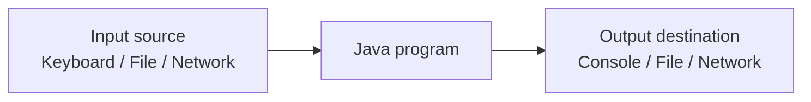
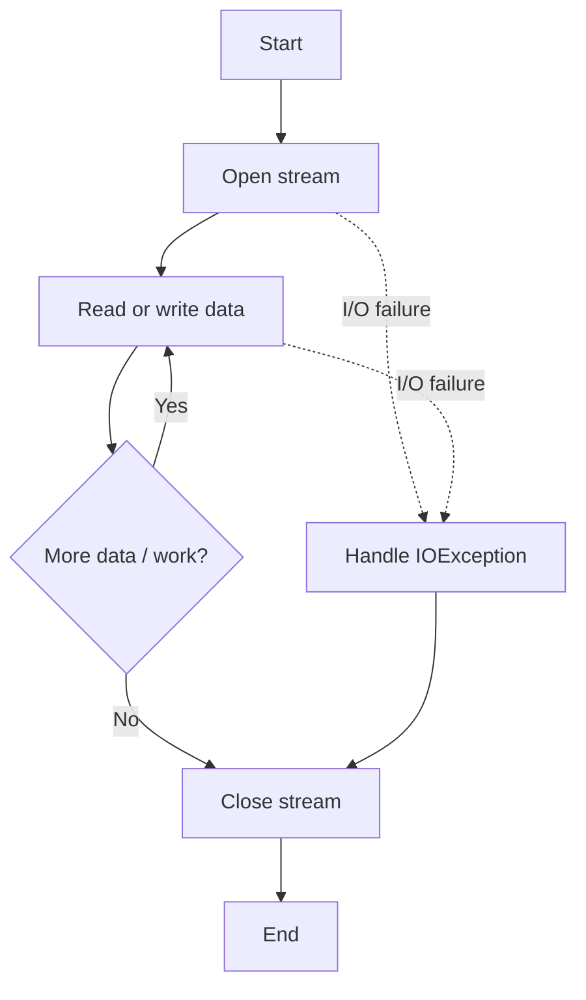
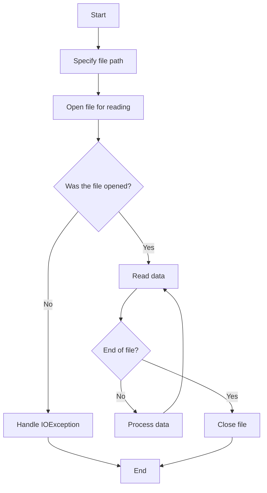
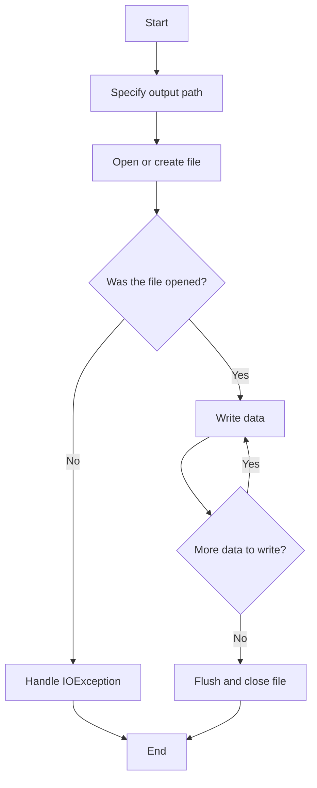

# Java I/O — Detailed Notes

## 1. Introduction to Input/Output (I/O)

**Input/Output (I/O)** is the process through which a program receives data from an external source and sends data to an external destination.

- **Input** brings data into a program. Examples: keyboard input, a file, a network connection.
- **Output** sends data out of a program. Examples: console display, writing to a file, sending data over a network.

Java provides I/O APIs primarily through the `java.io` package. Modern Java also provides file-system operations through `java.nio.file`, especially the `Path` and `Files` classes.

### Basic I/O flow



### Why I/O is important

Programs commonly need to: 
1. Read user input. 
2. Load configuration and data from files. 
3. Save results and application state. 
4. Process text, images, audio, and other binary data. 
5. Exchange information with other programs or systems.

### I/O and exceptions

I/O operations can fail for reasons such as a missing file, insufficient permissions, a disconnected device, or a full disk. Many methods in `java.io` declare `IOException`, so the caller must handle or propagate it.

```java
import java.io.IOException;

public class ExceptionExample {
    public static void main(String[] args) {
        try {
            // An operation that may fail
            System.out.println("Performing I/O");
        } catch (Exception e) {
            System.out.println("Operation failed: " + e.getMessage());
        }
    }
}
```

For actual I/O code, catch the relevant exception type (often `IOException`) rather than using a broad `Exception` catch without a reason.

------------------------------------------------------------------------

## 2. Streams in Java

A **stream** is an abstraction representing a flow of data between a source and a destination. Java I/O streams are commonly divided into byte streams and character streams.

### 2.1 Byte streams

Byte streams process raw 8-bit bytes. They are suitable for binary data such as images, audio, video, PDFs, and other files whose contents should not be interpreted as text.

Main abstract classes:

- `InputStream` — reads bytes.
- `OutputStream` — writes bytes.

Common subclasses include:

| Class                   | Purpose                                                  |
|:------------------------|:---------------------------------------------------------|
| `FileInputStream`       | Reads bytes from a file                                  |
| `FileOutputStream`      | Writes bytes to a file                                   |
| `BufferedInputStream`   | Buffers byte input to reduce underlying read operations  |
| `BufferedOutputStream`  | Buffers byte output                                      |
| `ByteArrayInputStream`  | Reads bytes from a byte array                            |
| `ByteArrayOutputStream` | Writes bytes to an in-memory byte array                  |
| `DataInputStream`       | Reads Java primitive values in a portable binary format  |
| `DataOutputStream`      | Writes Java primitive values in a portable binary format |
| `ObjectInputStream`     | Reads serialized Java objects                            |
| `ObjectOutputStream`    | Writes serialized Java objects                           |

Example:

```java
import java.io.FileInputStream;
import java.io.IOException;

public class ByteReadExample {
    public static void main(String[] args) {
        try (FileInputStream in = new FileInputStream("data.bin")) {
            int value;

            while ((value = in.read()) != -1) {
                System.out.println(value);
            }
        } catch (IOException e) {
            System.out.println("I/O error: " + e.getMessage());
        }
    }
}
```

`read()` returns an integer from 0 to 255 for a byte, or `-1` when the end of the stream is reached. The return type is `int` so that `-1` can represent end-of-stream without conflicting with any byte value.

### 2.2 Character streams

Character streams process text as characters. They use readers and writers, with character encoding and decoding handled at the byte/character boundary.

Main abstract classes:

- `Reader` — reads characters.
- `Writer` — writes characters.

Common subclasses include:

| Class                | Purpose                                                                    |
|:---------------------|:---------------------------------------------------------------------------|
| `FileReader`         | Reads text from a file                                                     |
| `FileWriter`         | Writes text to a file                                                      |
| `BufferedReader`     | Buffers character input; provides `readLine()`                             |
| `BufferedWriter`     | Buffers character output                                                   |
| `InputStreamReader`  | Converts bytes from an input stream into characters using a charset        |
| `OutputStreamWriter` | Converts characters into bytes using a charset                             |
| `StringReader`       | Reads characters from a string                                             |
| `StringWriter`       | Writes characters into a string buffer                                     |
| `PrintWriter`        | Provides convenient methods such as `print()`, `println()`, and `printf()` |

Example:

```java
import java.io.FileReader;
import java.io.IOException;

public class CharacterReadExample {
    public static void main(String[] args) {
        try (FileReader reader = new FileReader("notes.txt")) {
            int ch;

            while ((ch = reader.read()) != -1) {
                System.out.print((char) ch);
            }
        } catch (IOException e) {
            System.out.println("I/O error: " + e.getMessage());
        }
    }
}
```

For predictable text encoding, prefer explicitly specifying a charset, such as UTF-8, with `Files`, `InputStreamReader`, or `OutputStreamWriter`.

### 2.3 Byte streams vs. character streams

| Byte streams                                    | Character streams                           |
|:------------------------------------------------|:--------------------------------------------|
| Process bytes                                   | Process characters                          |
| Use `InputStream` and `OutputStream`            | Use `Reader` and `Writer`                   |
| Suitable for binary and raw data                | Suitable for text                           |
| Do not themselves decode text                   | Decode and encode text at stream boundaries |
| Examples: `FileInputStream`, `FileOutputStream` | Examples: `FileReader`, `FileWriter`        |

### 2.4 Stream processing pattern

A typical input stream is opened, read until end-of-stream, and then closed. A typical output stream is opened, written to, and closed.



Use **try-with-resources** so streams are closed automatically, including when an exception occurs.

```java
try (var input = new java.io.FileInputStream("input.bin")) {
    // Read from input
}
```

------------------------------------------------------------------------

## 3. Standard Console Input and Output

Java provides three standard streams through the `System` class:

| Stream       | Type          | Purpose                                     |
|:-------------|:--------------|:--------------------------------------------|
| `System.in`  | `InputStream` | Standard input, commonly the keyboard       |
| `System.out` | `PrintStream` | Standard output, commonly the console       |
| `System.err` | `PrintStream` | Standard error output, commonly the console |

### 3.1 Writing to the console

The most commonly used methods are:

- `print()` — prints without automatically adding a line break.
- `println()` — prints and then adds a line break.
- `printf()` — prints formatted output.

```java
public class ConsoleOutput {
    public static void main(String[] args) {
        String name = "Asha";
        int age = 20;
        double marks = 87.5;

        System.out.print("Name: ");
        System.out.println(name);
        System.out.printf("Age: %d%n", age);
        System.out.printf("Marks: %.2f%n", marks);

        System.err.println("Example error message");
    }
}
```

Common format specifiers:

| Specifier | Meaning                                                       |
|:----------|:--------------------------------------------------------------|
| `%s`      | String                                                        |
| `%d`      | Integer                                                       |
| `%f`      | Floating-point number                                         |
| `%.2f`    | Floating-point number with two digits after the decimal point |
| `%c`      | Character                                                     |
| `%b`      | Boolean                                                       |
| `%n`      | Platform-specific line separator                              |

### 3.2 Reading console input with `Scanner`

`Scanner` is a convenient class for reading tokens and values from standard input.

```java
import java.util.Scanner;

public class ScannerExample {
    public static void main(String[] args) {
        Scanner scanner = new Scanner(System.in);

        System.out.print("Enter your name: ");
        String name = scanner.nextLine();

        System.out.print("Enter your age: ");
        int age = scanner.nextInt();

        System.out.println("Hello, " + name);
        System.out.println("Age: " + age);

        scanner.close();
    }
}
```

**Important:** Closing a `Scanner` that wraps `System.in` also closes `System.in`. In a larger application, avoid closing a shared standard input stream until the application is finished using it.

#### `next()` vs. `nextLine()`

- `next()` reads the next token and stops at whitespace.
- `nextLine()` reads the remainder of the current line, including spaces, and consumes the line separator.

A common issue occurs when `nextInt()` is followed by `nextLine()`. `nextInt()` reads the number but leaves the line separator in the input, so the next `nextLine()` may return an empty string.

```java
Scanner scanner = new Scanner(System.in);

System.out.print("Enter age: ");
int age = scanner.nextInt();
scanner.nextLine(); // Consume the rest of the line

System.out.print("Enter full name: ");
String name = scanner.nextLine();

System.out.println(name + " is " + age);
```

### 3.3 Reading console input with `BufferedReader`

`BufferedReader` reads text efficiently and provides `readLine()` to read an entire line.

```java
import java.io.BufferedReader;
import java.io.IOException;
import java.io.InputStreamReader;

public class BufferedReaderExample {
    public static void main(String[] args) {
        BufferedReader reader =
            new BufferedReader(new InputStreamReader(System.in));

        try {
            System.out.print("Enter your name: ");
            String name = reader.readLine();

            System.out.print("Enter your age: ");
            int age = Integer.parseInt(reader.readLine());

            System.out.println("Name: " + name);
            System.out.println("Age: " + age);
        } catch (IOException e) {
            System.out.println("Input error: " + e.getMessage());
        } catch (NumberFormatException e) {
            System.out.println("Please enter a valid integer.");
        }
    }
}
```

`InputStreamReader` bridges a byte stream (`System.in`) to a character reader. To specify UTF-8 explicitly:

```java
import java.io.BufferedReader;
import java.io.InputStreamReader;
import java.nio.charset.StandardCharsets;

BufferedReader reader = new BufferedReader(
    new InputStreamReader(System.in, StandardCharsets.UTF_8)
);
```

### 3.4 Reading input with `Console`

`System.console()` can provide a console object in an interactive terminal environment.

```java
import java.io.Console;

public class ConsoleExample {
    public static void main(String[] args) {
        Console console = System.console();

        if (console == null) {
            System.out.println("No interactive console is available.");
            return;
        }

        String username = console.readLine("Username: ");
        char[] password = console.readPassword("Password: ");

        console.printf("Welcome, %s%n", username);

        // Clear the password characters when no longer needed.
        java.util.Arrays.fill(password, ' ');
    }
}
```

`System.console()` may return `null` when the application is run from some IDEs or environments without an attached terminal. `readPassword()` avoids displaying the entered characters, but applications should still handle password data carefully.

### 3.5 Choosing a console input method

| Method           | Best suited for                                                    |
|:-----------------|:-------------------------------------------------------------------|
| `Scanner`        | Simple programs that read tokens and primitive values              |
| `BufferedReader` | Efficient line-oriented input                                      |
| `Console`        | Interactive terminal applications, including hidden password input |

------------------------------------------------------------------------

## 4. Reading and Writing Files

A **file** stores data on persistent storage. Java can read and write files using both the older `java.io` classes and the modern `java.nio.file` API.

### 4.1 Important file-related classes

| Class                                          | Purpose                                                                       |
|:-----------------------------------------------|:------------------------------------------------------------------------------|
| `File`                                         | Represents a file or directory path and provides basic file-system operations |
| `FileInputStream`                              | Reads raw bytes from a file                                                   |
| `FileOutputStream`                             | Writes raw bytes to a file                                                    |
| `FileReader`                                   | Reads text characters from a file                                             |
| `FileWriter`                                   | Writes text characters to a file                                              |
| `BufferedInputStream` / `BufferedOutputStream` | Buffered byte I/O                                                             |
| `BufferedReader` / `BufferedWriter`            | Buffered character I/O                                                        |
| `PrintWriter`                                  | Convenient text output                                                        |
| `Path`                                         | Represents a file-system path                                                 |
| `Files`                                        | Provides static methods for file operations                                   |

### 4.2 Reading a text file using `FileReader`

```java
import java.io.FileReader;
import java.io.IOException;

public class ReadFileExample {
    public static void main(String[] args) {
        try (FileReader reader = new FileReader("input.txt")) {
            int character;

            while ((character = reader.read()) != -1) {
                System.out.print((char) character);
            }
        } catch (IOException e) {
            System.out.println("Could not read file: " + e.getMessage());
        }
    }
}
```

This reads one character at a time. For larger text files, buffering and line-based reading are often more convenient.

### 4.3 Reading a text file using `BufferedReader`

```java
import java.io.BufferedReader;
import java.io.FileReader;
import java.io.IOException;

public class ReadLinesExample {
    public static void main(String[] args) {
        try (BufferedReader reader =
                 new BufferedReader(new FileReader("input.txt"))) {

            String line;

            while ((line = reader.readLine()) != null) {
                System.out.println(line);
            }
        } catch (IOException e) {
            System.out.println("Could not read file: " + e.getMessage());
        }
    }
}
```

`readLine()` returns `null` when the end of the file is reached. It does not include the line separator in the returned string.

### 4.4 Writing a text file using `FileWriter`

```java
import java.io.FileWriter;
import java.io.IOException;

public class WriteFileExample {
    public static void main(String[] args) {
        try (FileWriter writer = new FileWriter("output.txt")) {
            writer.write("Hello, Java I/O!\n");
            writer.write("This is a text file.");
        } catch (IOException e) {
            System.out.println("Could not write file: " + e.getMessage());
        }
    }
}
```

By default, `FileWriter` creates the file if it does not exist and overwrites an existing file. To append rather than overwrite:

```java
try (FileWriter writer = new FileWriter("output.txt", true)) {
    writer.write("This line is appended.\n");
}
```

For explicit encoding, use `Files.newBufferedWriter()` or an `OutputStreamWriter` with a specified charset.

### 4.5 Writing with `BufferedWriter`

```java
import java.io.BufferedWriter;
import java.io.FileWriter;
import java.io.IOException;

public class BufferedWriteExample {
    public static void main(String[] args) {
        try (BufferedWriter writer =
                 new BufferedWriter(new FileWriter("output.txt"))) {

            writer.write("First line");
            writer.newLine();
            writer.write("Second line");
            writer.newLine();
        } catch (IOException e) {
            System.out.println("Write error: " + e.getMessage());
        }
    }
}
```

Buffering reduces the number of interactions with the underlying destination. Closing the writer flushes buffered characters and releases the resource.

### 4.6 Reading and writing binary files

Use byte streams when the file contains binary data or must be copied without text decoding.

```java
import java.io.FileInputStream;
import java.io.FileOutputStream;
import java.io.IOException;

public class CopyBinaryFile {
    public static void main(String[] args) {
        try (FileInputStream input = new FileInputStream("source.bin");
             FileOutputStream output = new FileOutputStream("copy.bin")) {

            byte[] buffer = new byte[8192];
            int bytesRead;

            while ((bytesRead = input.read(buffer)) != -1) {
                output.write(buffer, 0, bytesRead);
            }

            System.out.println("File copied successfully.");
        } catch (IOException e) {
            System.out.println("Copy failed: " + e.getMessage());
        }
    }
}
```

The buffer allows many bytes to be read and written per operation rather than processing each byte separately.

### 4.7 Reading and writing with `Files` and `Path` (modern approach)

For many common file tasks, `java.nio.file.Files` is concise and clear.

#### Read all text

```java
import java.io.IOException;
import java.nio.charset.StandardCharsets;
import java.nio.file.Files;
import java.nio.file.Path;

public class ReadAllText {
    public static void main(String[] args) {
        Path path = Path.of("input.txt");

        try {
            String content = Files.readString(path, StandardCharsets.UTF_8);
            System.out.println(content);
        } catch (IOException e) {
            System.out.println("Read error: " + e.getMessage());
        }
    }
}
```

#### Write text

```java
import java.io.IOException;
import java.nio.charset.StandardCharsets;
import java.nio.file.Files;
import java.nio.file.Path;

public class WriteAllText {
    public static void main(String[] args) {
        Path path = Path.of("output.txt");
        String content = "First line\nSecond line\n";

        try {
            Files.writeString(path, content, StandardCharsets.UTF_8);
            System.out.println("File written.");
        } catch (IOException e) {
            System.out.println("Write error: " + e.getMessage());
        }
    }
}
```

`Files.writeString()` creates the file if necessary and replaces its existing content by default. To append:

```java
import java.nio.file.StandardOpenOption;

Files.writeString(
    Path.of("output.txt"),
    "Appended line\n",
    StandardCharsets.UTF_8,
    StandardOpenOption.CREATE,
    StandardOpenOption.APPEND
);
```

#### Read all lines

```java
import java.io.IOException;
import java.nio.file.Files;
import java.nio.file.Path;
import java.util.List;

List<String> lines = Files.readAllLines(
    Path.of("input.txt"),
    StandardCharsets.UTF_8
);
```

`readAllLines()` loads all lines into memory. For very large files, use a buffered reader or `Files.lines()` and process the stream carefully.

#### Check whether a file exists

```java
Path path = Path.of("input.txt");

if (Files.exists(path)) {
    System.out.println("File exists.");
} else {
    System.out.println("File does not exist.");
}
```

A file may exist but still be unreadable. Check permissions or handle the exception from the actual operation.

### 4.8 Creating directories and deleting files

```java
import java.io.IOException;
import java.nio.file.Files;
import java.nio.file.Path;

public class FileOperations {
    public static void main(String[] args) {
        Path directory = Path.of("documents");
        Path file = directory.resolve("notes.txt");

        try {
            Files.createDirectories(directory);
            Files.writeString(file, "Sample notes");
            System.out.println("Created: " + file.toAbsolutePath());

            // Delete only if it exists.
            Files.deleteIfExists(file);
        } catch (IOException e) {
            System.out.println("File operation failed: " + e.getMessage());
        }
    }
}
```

`Path.resolve()` builds a child path without manually concatenating path separators. `Files.deleteIfExists()` deletes the specified file or empty directory if present; it does not recursively delete a non-empty directory.

### 4.9 File reading flowchart



### 4.10 File writing flowchart



------------------------------------------------------------------------

## 5. File Handling Concepts to Remember

### 5.1 Overwrite vs. append

| Operation                                       | Behavior                                        |
|:------------------------------------------------|:------------------------------------------------|
| `new FileWriter("file.txt")`                    | Creates or overwrites the file                  |
| `new FileWriter("file.txt", true)`              | Creates or appends to the file                  |
| `Files.writeString(path, text)`                 | Creates or replaces the file content by default |
| `Files.writeString(path, text, CREATE, APPEND)` | Creates if needed and appends                   |

### 5.2 Buffering

A buffer is a temporary memory area used to collect data before reading from or writing to the underlying resource.

Benefits: - Reduces the number of low-level I/O operations. - Often improves performance for repeated small reads or writes. - Provides convenient methods such as `BufferedReader.readLine()`.

### 5.3 Flushing

`flush()` forces buffered output to be passed to the underlying destination as far as the stream implementation can ensure.

- Use it when output needs to be pushed before the stream is closed.
- Closing a writer or output stream normally flushes it first.
- Flushing does not necessarily guarantee that data has been physically committed to storage hardware.

### 5.4 Closing resources

Always close files and streams after use. The recommended approach is try-with-resources:

```java
try (var reader = Files.newBufferedReader(
        Path.of("input.txt"),
        StandardCharsets.UTF_8)) {
    // Process file
}
```

Resources declared in the parentheses are closed automatically when the block ends, even if an exception occurs. This works for objects that implement `AutoCloseable`.

### 5.5 Character encoding

Text is stored as bytes, but Java programs work with characters. A **charset** defines how characters are encoded into bytes and decoded back.

UTF-8 is a widely used choice:

```java
Files.writeString(
    Path.of("message.txt"),
    "Hello",
    StandardCharsets.UTF_8
);
```

When reading a file, use the same encoding that was used to write it. Using the wrong charset can produce corrupted or incorrect characters.

### 5.6 Relative and absolute paths

- A **relative path**, such as `data/input.txt`, is interpreted relative to the program’s current working directory.
- An **absolute path** identifies a location from the file-system root, such as `C:\\data\\input.txt` on Windows or `/home/user/data/input.txt` on Linux.

To inspect the current working directory:

```java
System.out.println(System.getProperty("user.dir"));
```

For portable code, prefer `Path.of(...)` and `Path.resolve(...)` over manually assembling paths with slash characters.

------------------------------------------------------------------------

## 6. Choosing the Right Java I/O API

| Requirement                                   | Suitable API                                         |
|:----------------------------------------------|:-----------------------------------------------------|
| Read a few values from the keyboard           | `Scanner`                                            |
| Read console input line by line               | `BufferedReader`                                     |
| Read hidden password input in a terminal      | `Console.readPassword()`                             |
| Print formatted console output                | `System.out.printf()`                                |
| Read text using a known encoding              | `Files.readString()` or `Files.newBufferedReader()`  |
| Write text using a known encoding             | `Files.writeString()` or `Files.newBufferedWriter()` |
| Process a large text file line by line        | `BufferedReader` or `Files.lines()`                  |
| Copy a binary file                            | `InputStream` and `OutputStream`                     |
| Perform basic path and file-system operations | `Path` and `Files`                                   |
| Work with primitive values in binary format   | `DataInputStream` and `DataOutputStream`             |

### Older `java.io.File` vs. modern `Path`

`File` is still useful and widely encountered, but `Path` and `Files` generally provide a more complete and flexible API for modern file-system operations.

```java
import java.nio.file.Files;
import java.nio.file.Path;

Path path = Path.of("report.txt");

System.out.println("Name: " + path.getFileName());
System.out.println("Absolute path: " + path.toAbsolutePath());
System.out.println("Exists: " + Files.exists(path));
```

------------------------------------------------------------------------

## 7. Common Errors and Best Practices

### Common errors

1.  **`FileNotFoundException`:** The file does not exist, the path is incorrect, or the file cannot be opened.
2.  **`IOException`:** A general input/output operation failed.
3.  **`NumberFormatException`:** Text cannot be converted into the requested numeric type.
4.  **`NullPointerException` after `readLine()`:** Code tried to use the result after end-of-file, when `readLine()` returned `null`.
5.  **Unexpected empty input:** A token-reading method such as `nextInt()` was followed by `nextLine()` without consuming the remaining line separator.
6.  **Garbage characters:** The program used an incorrect character encoding.
7.  **Lost output:** Buffered output was not flushed or the resource was not closed correctly.
8.  **Overwritten data:** An output API was opened in overwrite mode when append mode was intended.

### Best practices

- Use try-with-resources for files and streams.
- Prefer `Path` and `Files` for modern file operations.
- Specify a charset such as UTF-8 when reading or writing text.
- Use byte streams for binary data and character streams for text.
- Use buffering for repeated or large I/O operations.
- Check end-of-file conditions correctly (`-1` for many stream `read()` methods and `null` for `BufferedReader.readLine()`).
- Handle expected exceptions with useful error messages.
- Avoid closing `System.in`, `System.out`, or `System.err` unless the application deliberately owns their lifecycle.
- Do not load an entire large file into memory when it can be processed incrementally.
- Validate user-provided paths and avoid assuming that a file exists or is writable.

------------------------------------------------------------------------

## 8. Quick Revision

| Term               | Meaning                                           |
|:-------------------|:--------------------------------------------------|
| Input              | Data received by a program                        |
| Output             | Data sent by a program                            |
| Stream             | Flow of data between a source and destination     |
| `InputStream`      | Abstract base class for byte input                |
| `OutputStream`     | Abstract base class for byte output               |
| `Reader`           | Abstract base class for character input           |
| `Writer`           | Abstract base class for character output          |
| `System.in`        | Standard input stream                             |
| `System.out`       | Standard output stream                            |
| `System.err`       | Standard error stream                             |
| `Scanner`          | Reads and parses tokens and values                |
| `BufferedReader`   | Efficient character input, including line reading |
| `FileInputStream`  | Reads bytes from a file                           |
| `FileOutputStream` | Writes bytes to a file                            |
| `FileReader`       | Reads characters from a file                      |
| `FileWriter`       | Writes characters to a file                       |
| `Path`             | Represents a file-system path                     |
| `Files`            | Utility methods for file operations               |
| Buffer             | Temporary memory used to improve I/O efficiency   |
| `flush()`          | Pushes buffered output toward the destination     |
| Charset            | Defines character-to-byte encoding and decoding   |
| Try-with-resources | Automatically closes supported resources          |

------------------------------------------------------------------------

## 9. Key Takeaways

- Java I/O allows programs to communicate with the console, files, and other data sources.
- Streams represent the flow of data.
- Byte streams are appropriate for raw binary data; character streams are appropriate for text.
- `System.in`, `System.out`, and `System.err` are Java’s standard console streams.
- `Scanner` and `BufferedReader` are common ways to read console input.
- Java can read and write files using `java.io` classes or the modern `Path` and `Files` APIs.
- Use buffering for efficient repeated I/O and try-with-resources to close resources reliably.
- Specify the correct charset, preferably UTF-8, when working with text.
- Handle I/O exceptions and end-of-file conditions explicitly.
