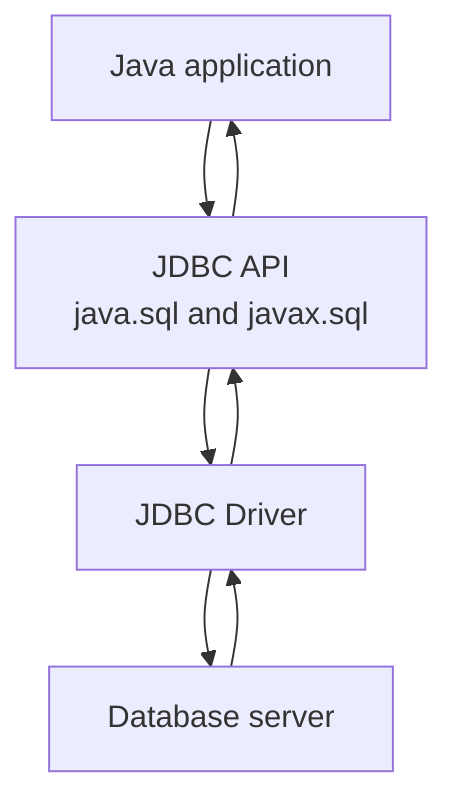
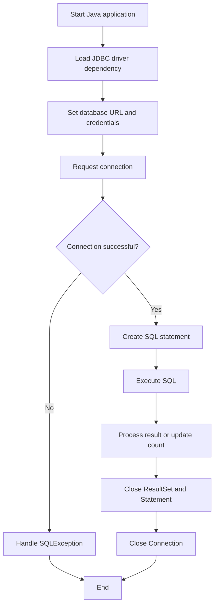
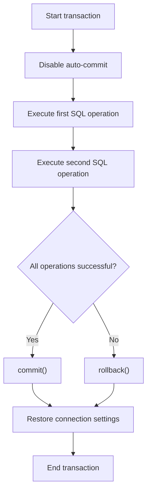
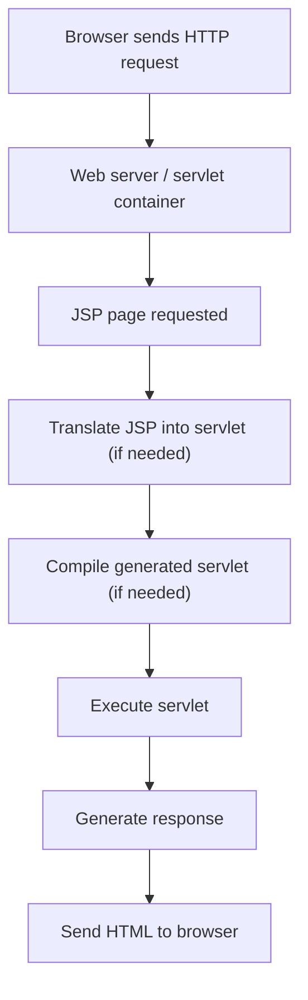
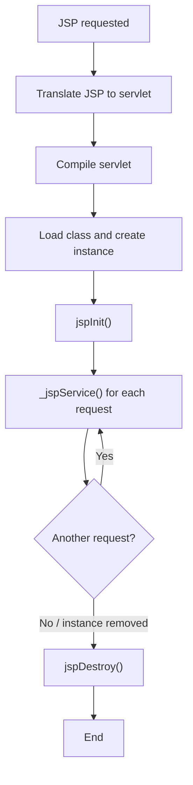
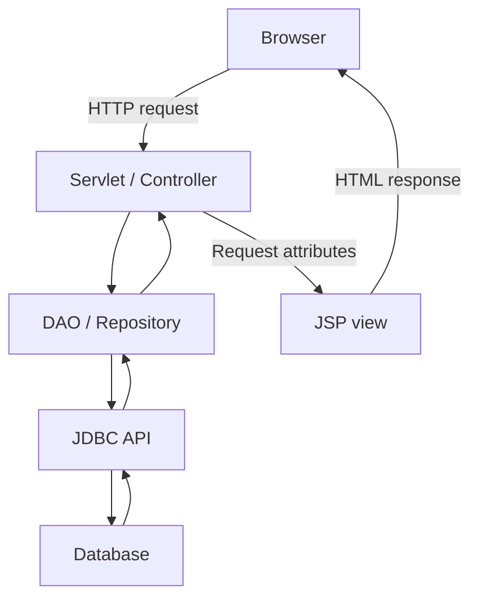

# Java JDBC Programming and JavaServer Pages (JSP) — Detailed Notes

## 1. Introduction to JDBC

**JDBC (Java Database Connectivity)** is a Java API that allows Java applications to communicate with relational databases. It provides standard interfaces for establishing connections, executing SQL statements, retrieving query results, and handling database errors.

A Java application can use JDBC to work with databases such as MySQL, PostgreSQL, Oracle Database, and Microsoft SQL Server, provided a suitable JDBC driver is available.

### Why JDBC is used

- Connects Java applications to relational databases.
- Executes SQL commands such as `SELECT`, `INSERT`, `UPDATE`, and `DELETE`.
- Retrieves and processes records returned by queries.
- Supports transactions.
- Provides a common programming interface across different database vendors.

### Basic JDBC architecture



The application uses JDBC interfaces. A database-specific driver implements the communication with the database server.

### JDBC driver

A **JDBC driver** is a library that enables Java code to communicate with a particular database. The driver usually comes from the database vendor or an established driver project.

For example, the MySQL Connector/J driver allows Java applications to communicate with MySQL.

The driver must be available on the application’s classpath or module path. Modern JDBC drivers are generally discovered automatically through the service-provider mechanism, so explicitly calling `Class.forName()` is usually unnecessary.

------------------------------------------------------------------------

## 2. Commonly Used Classes and Interfaces in `java.sql`

The `java.sql` package contains the core JDBC classes and interfaces.

### 2.1 `DriverManager` class

`DriverManager` manages JDBC drivers and provides a method to establish a database connection.

Common method:

```java
Connection getConnection(String url, String user, String password)
```

Example:

```java
Connection connection = DriverManager.getConnection(
    "jdbc:mysql://localhost:3306/college",
    "root",
    "password"
);
```

The URL above is an example for MySQL. Use the URL format and driver appropriate for the database being used.

### 2.2 `Connection` interface

A `Connection` represents an active session with a database.

Common methods:

| Method                         | Purpose                                           |
|:-------------------------------|:--------------------------------------------------|
| `createStatement()`            | Creates a `Statement` object                      |
| `prepareStatement(String sql)` | Creates a `PreparedStatement`                     |
| `prepareCall(String sql)`      | Creates a `CallableStatement`                     |
| `setAutoCommit(boolean)`       | Enables or disables automatic transaction commits |
| `commit()`                     | Commits the current transaction                   |
| `rollback()`                   | Rolls back the current transaction                |
| `close()`                      | Releases the connection                           |
| `isClosed()`                   | Checks whether the connection is closed           |

Example:

```java
connection.setAutoCommit(false);
// Execute related database operations
connection.commit();
```

If an operation fails, a transaction can be rolled back.

### 2.3 `Statement` interface

`Statement` executes ordinary SQL statements that do not require parameter placeholders.

Important methods:

| Method                      | Purpose                                                                             |
|:----------------------------|:------------------------------------------------------------------------------------|
| `executeQuery(String sql)`  | Executes a query that returns a result set, commonly `SELECT`                       |
| `executeUpdate(String sql)` | Executes an insert, update, delete, or other statement that returns an update count |
| `execute(String sql)`       | Executes SQL that may produce different kinds of results                            |
| `close()`                   | Releases the statement                                                              |

Example:

```java
Statement statement = connection.createStatement();

ResultSet result = statement.executeQuery(
    "SELECT id, name FROM students"
);
```

Avoid constructing SQL by concatenating untrusted user input. This can introduce SQL injection vulnerabilities. Use `PreparedStatement` for values supplied by users.

### 2.4 `PreparedStatement` interface

`PreparedStatement` represents a precompiled or prepared SQL statement with parameter placeholders (`?`).

Advantages:

- Separates SQL structure from input values.
- Helps prevent SQL injection when values are bound correctly.
- Makes it convenient to execute the same SQL with different values.
- Often improves performance when a statement is reused, depending on the driver and database.

Example:

```java
PreparedStatement ps = connection.prepareStatement(
    "SELECT * FROM students WHERE id = ?"
);

ps.setInt(1, 10);

ResultSet rs = ps.executeQuery();
```

The parameter index starts at `1`, not `0`.

### 2.5 `CallableStatement` interface

`CallableStatement` is used to call stored procedures in a database.

Example:

```java
CallableStatement cs =
    connection.prepareCall("{call get_student(?)}");

cs.setInt(1, 10);
ResultSet rs = cs.executeQuery();
```

Stored procedure syntax and result behavior depend on the database.

### 2.6 `ResultSet` interface

`ResultSet` represents the table-like data returned by a query. Its cursor initially points before the first row. Calling `next()` moves it to the next row.

Common methods:

| Method                     | Purpose                        |
|:---------------------------|:-------------------------------|
| `next()`                   | Moves to the next row          |
| `getInt(String column)`    | Retrieves an integer value     |
| `getString(String column)` | Retrieves a string value       |
| `getDouble(String column)` | Retrieves a double value       |
| `getDate(String column)`   | Retrieves a SQL date           |
| `getObject(String column)` | Retrieves a value as an object |
| `close()`                  | Releases the result set        |

Example:

```java
while (rs.next()) {
    int id = rs.getInt("id");
    String name = rs.getString("name");

    System.out.println(id + " " + name);
}
```

### 2.7 `SQLException` class

`SQLException` represents errors that occur while accessing a database.

Useful methods:

| Method               | Purpose                                           |
|:---------------------|:--------------------------------------------------|
| `getMessage()`       | Returns the error message                         |
| `getSQLState()`      | Returns the SQL state code                        |
| `getErrorCode()`     | Returns the database-specific error code          |
| `getNextException()` | Returns the next exception in the exception chain |

Example:

```java
try {
    // JDBC operation
} catch (SQLException e) {
    System.out.println("Database error: " + e.getMessage());
    System.out.println("SQL State: " + e.getSQLState());
}
```

### 2.8 `Types` class

`java.sql.Types` defines constants that identify SQL data types. It is especially useful when setting or retrieving typed values.

Examples include:

- `Types.INTEGER`
- `Types.VARCHAR`
- `Types.DATE`
- `Types.DECIMAL`
- `Types.TIMESTAMP`
- `Types.BOOLEAN`

### 2.9 `DatabaseMetaData` interface

`DatabaseMetaData` provides information about the database and JDBC driver.

It can be used to inspect: - Database product name and version. - Driver name and version. - Supported SQL features. - Tables and schemas. - Transaction support.

Example:

```java
DatabaseMetaData metadata = connection.getMetaData();

System.out.println(metadata.getDatabaseProductName());
System.out.println(metadata.getDatabaseProductVersion());
```

### 2.10 `ResultSetMetaData` interface

`ResultSetMetaData` provides information about the columns in a `ResultSet`.

Example:

```java
ResultSetMetaData metadata = rs.getMetaData();

int columnCount = metadata.getColumnCount();

for (int i = 1; i <= columnCount; i++) {
    System.out.println(metadata.getColumnName(i));
}
```

### 2.11 `DataSource` interface (`javax.sql`)

Although the core JDBC API is in `java.sql`, the `DataSource` interface is in `javax.sql`.

A `DataSource` is a preferred abstraction for obtaining database connections in many enterprise applications. It supports connection pooling and external configuration more naturally than directly using `DriverManager`.

Example concept:

```java
Connection connection = dataSource.getConnection();
```

A framework or application server commonly configures and supplies the `DataSource`.

### JDBC classes and interfaces summary

| Class / interface   | Package     | Main role                              |
|:--------------------|:------------|:---------------------------------------|
| `DriverManager`     | `java.sql`  | Obtains connections                    |
| `Connection`        | `java.sql`  | Represents a database connection       |
| `Statement`         | `java.sql`  | Executes ordinary SQL                  |
| `PreparedStatement` | `java.sql`  | Executes parameterized SQL             |
| `CallableStatement` | `java.sql`  | Calls stored procedures                |
| `ResultSet`         | `java.sql`  | Holds query results                    |
| `SQLException`      | `java.sql`  | Represents database errors             |
| `Types`             | `java.sql`  | Defines SQL type constants             |
| `DatabaseMetaData`  | `java.sql`  | Describes database and driver          |
| `ResultSetMetaData` | `java.sql`  | Describes result columns               |
| `DataSource`        | `javax.sql` | Connection factory, often with pooling |

------------------------------------------------------------------------

## 3. Connecting a Java Application to a Database

A Java application generally follows these steps to use JDBC:

1.  Add the appropriate JDBC driver dependency.
2.  Obtain a database connection.
3.  Create a statement or prepared statement.
4.  Execute SQL.
5.  Process the result, if one is returned.
6.  Close database resources.

### 3.1 Example database table

Assume a MySQL database named `college` contains this table:

```sql
CREATE DATABASE college;

USE college;

CREATE TABLE students (
    id INT PRIMARY KEY,
    name VARCHAR(100),
    age INT
);

INSERT INTO students (id, name, age)
VALUES
    (1, 'Aman', 20),
    (2, 'Neha', 21);
```

The SQL above creates a database and a sample table. Run it in the database environment before running the Java example.

### 3.2 JDBC URL

A JDBC URL identifies the database and connection details. A typical MySQL URL is:

```text
jdbc:mysql://localhost:3306/college
```

Parts:

- `jdbc` — identifies the JDBC protocol.
- `mysql` — identifies the database driver type.
- `localhost` — database host.
- `3306` — common default MySQL port.
- `college` — database name.

A URL may also contain connection properties, such as timezone or SSL settings. Use secure, environment-appropriate configuration.

### 3.3 Add the JDBC driver

For MySQL, add the MySQL Connector/J dependency to the project. With Maven, a dependency declaration has this general form (use a current compatible version in the project):

```xml
<dependency>
    <groupId>com.mysql</groupId>
    <artifactId>mysql-connector-j</artifactId>
    <version>YOUR_COMPATIBLE_VERSION</version>
</dependency>
```

The driver JAR must be available at runtime. Do not copy a placeholder version literally; select a version compatible with the database and Java runtime.

### 3.4 Basic connection example

```java
import java.sql.Connection;
import java.sql.DriverManager;
import java.sql.SQLException;

public class DatabaseConnection {
    public static void main(String[] args) {
        String url = "jdbc:mysql://localhost:3306/college";
        String username = System.getenv("DB_USER");
        String password = System.getenv("DB_PASSWORD");

        try (Connection connection =
                 DriverManager.getConnection(url, username, password)) {

            System.out.println("Database connected successfully.");

        } catch (SQLException e) {
            System.out.println("Connection failed: " + e.getMessage());
        }
    }
}
```

This example reads credentials from environment variables rather than hard-coding them in source code. Set `DB_USER` and `DB_PASSWORD` in the runtime environment before executing it.

### 3.5 JDBC connection flowchart



### 3.6 Reading database records

```java
import java.sql.Connection;
import java.sql.DriverManager;
import java.sql.ResultSet;
import java.sql.SQLException;
import java.sql.Statement;

public class ReadStudents {
    public static void main(String[] args) {
        String url = "jdbc:mysql://localhost:3306/college";
        String username = System.getenv("DB_USER");
        String password = System.getenv("DB_PASSWORD");

        String sql = "SELECT id, name, age FROM students";

        try (Connection connection =
                 DriverManager.getConnection(url, username, password);
             Statement statement = connection.createStatement();
             ResultSet rs = statement.executeQuery(sql)) {

            while (rs.next()) {
                int id = rs.getInt("id");
                String name = rs.getString("name");
                int age = rs.getInt("age");

                System.out.println(id + " | " + name + " | " + age);
            }

        } catch (SQLException e) {
            System.out.println("Database error: " + e.getMessage());
        }
    }
}
```

Try-with-resources closes the `ResultSet`, `Statement`, and `Connection` automatically. Resources are closed in reverse order of their declaration.

### 3.7 Inserting a record

```java
import java.sql.Connection;
import java.sql.DriverManager;
import java.sql.PreparedStatement;
import java.sql.SQLException;

public class InsertStudent {
    public static void main(String[] args) {
        String url = "jdbc:mysql://localhost:3306/college";
        String username = System.getenv("DB_USER");
        String password = System.getenv("DB_PASSWORD");

        String sql =
            "INSERT INTO students (id, name, age) VALUES (?, ?, ?)";

        try (Connection connection =
                 DriverManager.getConnection(url, username, password);
             PreparedStatement ps = connection.prepareStatement(sql)) {

            ps.setInt(1, 3);
            ps.setString(2, "Ravi");
            ps.setInt(3, 22);

            int rows = ps.executeUpdate();
            System.out.println(rows + " row(s) inserted.");

        } catch (SQLException e) {
            System.out.println("Insert failed: " + e.getMessage());
        }
    }
}
```

### 3.8 Updating a record

```java
String sql = "UPDATE students SET age = ? WHERE id = ?";

try (PreparedStatement ps = connection.prepareStatement(sql)) {
    ps.setInt(1, 23);
    ps.setInt(2, 3);

    int rows = ps.executeUpdate();
    System.out.println(rows + " row(s) updated.");
}
```

### 3.9 Deleting a record

```java
String sql = "DELETE FROM students WHERE id = ?";

try (PreparedStatement ps = connection.prepareStatement(sql)) {
    ps.setInt(1, 3);

    int rows = ps.executeUpdate();
    System.out.println(rows + " row(s) deleted.");
}
```

### `executeQuery()` vs. `executeUpdate()` vs. `execute()`

| Method            | Typical use                                           | Return value                                                   |
|:------------------|:------------------------------------------------------|:---------------------------------------------------------------|
| `executeQuery()`  | `SELECT` queries                                      | `ResultSet`                                                    |
| `executeUpdate()` | `INSERT`, `UPDATE`, `DELETE`, and some DDL statements | Number of affected rows, or 0 for statements with no row count |
| `execute()`       | SQL that may produce a result set or update count     | Boolean indicating whether the first result is a `ResultSet`   |

------------------------------------------------------------------------

## 4. Prepared Statements

A **PreparedStatement** is a JDBC interface used to execute parameterized SQL statements.

It uses question marks (`?`) as placeholders for values. The application binds values to these placeholders using setter methods.

### 4.1 Why use PreparedStatement?

1.  **Security:** Binding values prevents user input from being interpreted as SQL syntax, helping prevent SQL injection.
2.  **Readability:** SQL structure is separated from parameter values.
3.  **Reusability:** The same prepared statement can be executed multiple times with different parameter values.
4.  **Potential performance benefits:** The database or driver may reuse a prepared execution plan, depending on implementation.

### 4.2 Basic syntax

```java
String sql = "SELECT * FROM students WHERE id = ?";

PreparedStatement ps = connection.prepareStatement(sql);
ps.setInt(1, 10);

ResultSet rs = ps.executeQuery();
```

The parameter index is one-based. The first `?` is parameter `1`, the second is parameter `2`, and so on.

### 4.3 Common setter methods

| Method                       | Purpose                                   |
|:-----------------------------|:------------------------------------------|
| `setInt(index, value)`       | Sets an integer                           |
| `setString(index, value)`    | Sets a string                             |
| `setDouble(index, value)`    | Sets a double                             |
| `setFloat(index, value)`     | Sets a float                              |
| `setLong(index, value)`      | Sets a long                               |
| `setBoolean(index, value)`   | Sets a boolean                            |
| `setDate(index, value)`      | Sets a SQL date                           |
| `setTimestamp(index, value)` | Sets a SQL timestamp                      |
| `setNull(index, sqlType)`    | Sets SQL `NULL` with a specified SQL type |
| `setObject(index, value)`    | Sets a value using an object              |

### 4.4 Example: searching by ID

```java
String sql = "SELECT id, name, age FROM students WHERE id = ?";

try (PreparedStatement ps = connection.prepareStatement(sql)) {
    ps.setInt(1, 2);

    try (ResultSet rs = ps.executeQuery()) {
        while (rs.next()) {
            System.out.println(rs.getString("name"));
        }
    }
}
```

### 4.5 Example: inserting with user-provided values

```java
import java.sql.Connection;
import java.sql.PreparedStatement;
import java.sql.SQLException;
import java.util.Scanner;

public class SafeInsert {
    public static void insertStudent(
            Connection connection, int id, String name, int age)
            throws SQLException {

        String sql =
            "INSERT INTO students (id, name, age) VALUES (?, ?, ?)";

        try (PreparedStatement ps = connection.prepareStatement(sql)) {
            ps.setInt(1, id);
            ps.setString(2, name);
            ps.setInt(3, age);

            ps.executeUpdate();
        }
    }

    public static void main(String[] args) {
        // Obtain a Connection before calling insertStudent().
        // This example focuses on parameter binding.
    }
}
```

The SQL statement structure is fixed. The values are sent separately through parameter binding.

### 4.6 SQL injection and PreparedStatement

Unsafe SQL construction:

```java
String sql = "SELECT * FROM students WHERE name = '" + userInput + "'";
```

If `userInput` contains SQL syntax, concatenating it into the query can change the meaning of the statement.

Safer approach:

```java
String sql = "SELECT * FROM students WHERE name = ?";

try (PreparedStatement ps = connection.prepareStatement(sql)) {
    ps.setString(1, userInput);

    try (ResultSet rs = ps.executeQuery()) {
        while (rs.next()) {
            System.out.println(rs.getString("name"));
        }
    }
}
```

The bound value is treated as data, not as part of the SQL statement.

**Important limitation:** Prepared-statement placeholders represent values, not SQL identifiers or keywords. For example, a placeholder cannot safely stand for a table name or an `ORDER BY` column. If a query must choose an identifier dynamically, select it from a strict allowlist and insert only that trusted identifier into the SQL text.

### 4.7 Reusing a PreparedStatement

```java
String sql =
    "INSERT INTO students (id, name, age) VALUES (?, ?, ?)";

try (PreparedStatement ps = connection.prepareStatement(sql)) {
    ps.setInt(1, 10);
    ps.setString(2, "Asha");
    ps.setInt(3, 20);
    ps.executeUpdate();

    ps.setInt(1, 11);
    ps.setString(2, "Karan");
    ps.setInt(3, 21);
    ps.executeUpdate();
}
```

Each execution uses the parameter values most recently assigned to the placeholders. Set every parameter required by the statement before executing it.

### 4.8 Batch processing

Batch processing can reduce the overhead of sending many similar statements individually.

```java
String sql =
    "INSERT INTO students (id, name, age) VALUES (?, ?, ?)";

try (PreparedStatement ps = connection.prepareStatement(sql)) {
    ps.setInt(1, 20);
    ps.setString(2, "Meera");
    ps.setInt(3, 19);
    ps.addBatch();

    ps.setInt(1, 21);
    ps.setString(2, "Dev");
    ps.setInt(3, 20);
    ps.addBatch();

    int[] results = ps.executeBatch();
    System.out.println("Batch entries: " + results.length);
}
```

Batch support and the meaning of returned update counts can vary by driver.

------------------------------------------------------------------------

## 5. JDBC Transactions

A **transaction** is a group of database operations treated as a logical unit. Transactions help maintain data consistency.

The ACID properties describe common transaction guarantees:

- **Atomicity:** All operations in a transaction succeed, or the transaction is rolled back.
- **Consistency:** A transaction moves the database from one valid state to another, preserving defined constraints.
- **Isolation:** Concurrent transactions are isolated according to the chosen isolation level.
- **Durability:** Committed changes persist according to the database’s durability guarantees.

### Transaction example

Imagine transferring money between two bank accounts. The debit and credit should both succeed, or neither should be committed.

```java
import java.sql.Connection;
import java.sql.PreparedStatement;
import java.sql.SQLException;

public class TransferExample {
    public static void transfer(
            Connection connection,
            int fromAccount,
            int toAccount,
            double amount) throws SQLException {

        String debit =
            "UPDATE accounts SET balance = balance - ? WHERE id = ?";
        String credit =
            "UPDATE accounts SET balance = balance + ? WHERE id = ?";

        try {
            connection.setAutoCommit(false);

            try (PreparedStatement debitPs =
                     connection.prepareStatement(debit);
                 PreparedStatement creditPs =
                     connection.prepareStatement(credit)) {

                debitPs.setDouble(1, amount);
                debitPs.setInt(2, fromAccount);
                int debited = debitPs.executeUpdate();

                creditPs.setDouble(1, amount);
                creditPs.setInt(2, toAccount);
                int credited = creditPs.executeUpdate();

                if (debited != 1 || credited != 1) {
                    throw new SQLException("Account not found");
                }

                connection.commit();
            } catch (SQLException e) {
                connection.rollback();
                throw e;
            }
        } finally {
            connection.setAutoCommit(true);
        }
    }
}
```

This is an illustrative transaction pattern. A production implementation should validate the amount, check balances and account rules, use a suitable numeric type such as `DECIMAL` for money, and carefully manage connection ownership and rollback failures.

### Transaction flowchart



------------------------------------------------------------------------

## 6. JavaServer Pages (JSP)

**JavaServer Pages (JSP)** is a server-side Java technology used to generate dynamic web pages. A JSP page combines HTML with JSP elements and, historically, Java code.

A JSP page is translated by a JSP container into a servlet, compiled, and executed on the server. The generated response (often HTML) is sent to the client’s browser.

### Why JSP is used

- Generates dynamic HTML pages.
- Displays data produced by Java server-side code.
- Integrates with Java web application technologies.
- Supports expression language (EL), tag libraries, and JavaBeans.
- Can work with servlets and other application layers.

### JSP request-processing flowchart



The translation and compilation steps commonly occur the first time a JSP is requested or after the JSP changes. They are not necessarily repeated for every request.

### JSP vs. Servlet

| JSP                                           | Servlet                                                   |
|:----------------------------------------------|:----------------------------------------------------------|
| Page-oriented server-side technology          | Java class handling web requests                          |
| Convenient for generating views               | Convenient for request processing and control logic       |
| Translated into a servlet by the container    | Written directly as a Java servlet                        |
| Supports template-like HTML with JSP features | Generates output through Java code or delegates to a view |

A common design is to use a servlet or controller for request handling and business logic, then forward to a JSP for presentation.

------------------------------------------------------------------------

## 7. JSP Life Cycle

A JSP page is managed by the web container. Its life cycle is closely related to the servlet life cycle.

### Main phases

1.  **Translation**
    - The JSP source is translated into a servlet source file.
2.  **Compilation**
    - The generated servlet source is compiled into a Java class.
3.  **Class loading and instantiation**
    - The container loads the generated servlet class and creates an instance.
4.  **Initialization**
    - The container calls `jspInit()` once for that JSP servlet instance.
5.  **Request processing**
    - The container calls `_jspService(request, response)` to process requests.
    - This method is generated by the container and should not be implemented directly in a JSP page.
6.  **Destruction**
    - Before removing the JSP servlet instance, the container calls `jspDestroy()`.

### JSP life-cycle flowchart



### JSP life-cycle methods

| Method                           | Purpose                                                         |
|:---------------------------------|:----------------------------------------------------------------|
| `jspInit()`                      | Initializes the JSP servlet instance                            |
| `_jspService(request, response)` | Handles each request; generated by the container                |
| `jspDestroy()`                   | Releases resources before the JSP servlet instance is destroyed |

------------------------------------------------------------------------

## 8. JSP Syntax and Elements

JSP provides several types of elements.

### 8.1 Directives

Directives provide instructions to the JSP container. A directive uses this syntax:

```jsp
<%@ directive attribute="value" %>
```

Common directives:

**Page directive**

```jsp
<%@ page contentType="text/html; charset=UTF-8" pageEncoding="UTF-8" %>
```

Controls page-level settings such as content type, imports, and error-page configuration.

**Include directive**

```jsp
<%@ include file="header.jsp" %>
```

Includes another file’s contents during translation.

**Taglib directive**

```jsp
<%@ taglib prefix="c" uri="jakarta.tags.core" %>
```

Declares a tag library. The exact URI and library dependency depend on the JSP/Jakarta Tags version used by the application.

### 8.2 Declarations

Declarations define fields or methods in the generated servlet class.

```jsp
<%!
    int count = 0;

    String greet(String name) {
        return "Hello, " + name;
    }
%>
```

Declarations are rarely needed in modern JSP applications. Shared mutable instance fields can cause concurrency problems because one JSP servlet instance may handle multiple requests.

### 8.3 Scriptlets

Scriptlets contain Java statements executed as part of request processing.

```jsp
<%
    String name = request.getParameter("name");
%>
```

Scriptlets are a legacy JSP feature and are discouraged in modern development. Prefer Expression Language, JSTL/tag libraries, and servlet/controller code.

### 8.4 Expressions

A JSP expression evaluates an expression and writes its result to the response.

```jsp
<%= "Welcome to JSP" %>
```

For modern JSP views, prefer EL:

```jsp
${user.name}
```

### JSP elements summary

| Element       | Syntax       | Purpose                                |
|:--------------|:-------------|:---------------------------------------|
| Directive     | `<%@ ... %>` | Provides translation-time instructions |
| Declaration   | `<%! ... %>` | Declares class-level fields or methods |
| Scriptlet     | `<% ... %>`  | Executes Java statements               |
| Expression    | `<%= ... %>` | Evaluates and writes a value           |
| EL expression | `${...}`     | Reads values and evaluates expressions |
| Action        | `<jsp:...>`  | Performs standard JSP actions          |

------------------------------------------------------------------------

## 9. JSP Implicit Objects

JSP provides predefined objects that can be used without declaring them explicitly.

| Object        | Type / role                  | Purpose                                                     |
|:--------------|:-----------------------------|:------------------------------------------------------------|
| `request`     | `HttpServletRequest`         | Reads request parameters, headers, and attributes           |
| `response`    | `HttpServletResponse`        | Controls the HTTP response                                  |
| `out`         | `JspWriter`                  | Writes content to the response                              |
| `session`     | `HttpSession`                | Stores data across requests from the same session           |
| `application` | `ServletContext`             | Stores application-wide attributes                          |
| `config`      | `ServletConfig`              | Provides JSP servlet configuration                          |
| `pageContext` | `PageContext`                | Provides access to JSP scopes and related objects           |
| `page`        | Current JSP servlet instance | Refers to the generated servlet object                      |
| `exception`   | `Throwable`                  | Available on JSP error pages when configured as error pages |

### Example using implicit objects

```jsp
<%@ page contentType="text/html; charset=UTF-8" %>
<html>
<body>
    <%
        String username = request.getParameter("username");

        if (username == null || username.isBlank()) {
            username = "Guest";
        }
    %>

    <h2>Welcome, <%= username %></h2>
</body>
</html>
```

This illustrates older scriptlet syntax. For modern applications, read and validate request data in a servlet/controller and expose the result to the JSP through request attributes.

### JSP scopes

JSP has four commonly discussed attribute scopes:

| Scope       | Lifetime / visibility                                   |
|:------------|:--------------------------------------------------------|
| Page        | During processing of the current JSP page               |
| Request     | During the current HTTP request, including forwards     |
| Session     | Across requests associated with the same HTTP session   |
| Application | Across the web application while its context is running |

Example:

```jsp
<%
    request.setAttribute("message", "Hello");
    session.setAttribute("username", "Asha");
    application.setAttribute("appName", "College Portal");
%>
```

Attributes can be accessed using EL:

```jsp
${requestScope.message}
${sessionScope.username}
${applicationScope.appName}
```

------------------------------------------------------------------------

## 10. JSP Directives and Standard Actions

### 10.1 Page directive

The page directive configures a JSP page.

Example:

```jsp
<%@ page
    contentType="text/html; charset=UTF-8"
    pageEncoding="UTF-8"
    import="java.time.LocalDate"
%>
```

Common attributes include: - `contentType` - `pageEncoding` - `import` - `session` - `errorPage` - `isErrorPage` - `isELIgnored`

### 10.2 Include directive

The include directive inserts another file at translation time.

```jsp
<%@ include file="header.jsp" %>
```

This is a static include.

### 10.3 Standard include action

The JSP include action includes the output of another resource at request time:

```jsp
<jsp:include page="header.jsp" />
```

### Include directive vs. include action

| Include directive                                 | Include action                                       |
|:--------------------------------------------------|:-----------------------------------------------------|
| `<%@ include file="..." %>`                       | `<jsp:include page="..." />`                         |
| Translation-time inclusion                        | Request-time inclusion                               |
| Source content is included during JSP translation | Included resource is processed when the request runs |
| Useful for static shared fragments                | Useful for dynamically generated content             |

### 10.4 Forward action

The forward action transfers request processing to another resource:

```jsp
<jsp:forward page="result.jsp" />
```

A forward should happen before the response is committed. Once response output has been committed, forwarding may fail.

### 10.5 Param action

The param action passes a parameter to an included or forwarded resource:

```jsp
<jsp:include page="profile.jsp">
    <jsp:param name="userId" value="10" />
</jsp:include>
```

------------------------------------------------------------------------

## 11. Connecting JSP with JDBC

A JSP page can technically execute JDBC code, but placing database access directly inside JSP scriptlets is discouraged. It mixes presentation and business logic, makes testing harder, and can create resource-management and security problems.

A better architecture is:

1.  The browser sends a request.
2.  A servlet/controller receives and validates the request.
3.  A DAO or repository class performs database operations using JDBC.
4.  The controller places the results in request attributes.
5.  The controller forwards to a JSP.
6.  The JSP displays the data using EL and tag libraries.

### Recommended JSP + JDBC architecture



### 11.1 Example DAO class

```java
import java.sql.Connection;
import java.sql.PreparedStatement;
import java.sql.ResultSet;
import java.sql.SQLException;
import java.util.ArrayList;
import java.util.List;

public class StudentDAO {
    private final javax.sql.DataSource dataSource;

    public StudentDAO(javax.sql.DataSource dataSource) {
        this.dataSource = dataSource;
    }

    public List<Student> findAll() throws SQLException {
        String sql = "SELECT id, name, age FROM students";
        List<Student> students = new ArrayList<>();

        try (Connection connection = dataSource.getConnection();
             PreparedStatement ps = connection.prepareStatement(sql);
             ResultSet rs = ps.executeQuery()) {

            while (rs.next()) {
                Student student = new Student(
                    rs.getInt("id"),
                    rs.getString("name"),
                    rs.getInt("age")
                );
                students.add(student);
            }
        }

        return students;
    }
}
```

This example assumes that a `DataSource` has been configured by the application server or application framework.

### 11.2 Example model class

```java
public class Student {
    private final int id;
    private final String name;
    private final int age;

    public Student(int id, String name, int age) {
        this.id = id;
        this.name = name;
        this.age = age;
    }

    public int getId() {
        return id;
    }

    public String getName() {
        return name;
    }

    public int getAge() {
        return age;
    }
}
```

### 11.3 Example servlet/controller

The following example uses Jakarta Servlet APIs. Older Java EE applications may use the `javax.servlet` package instead of `jakarta.servlet`.

```java
import jakarta.servlet.ServletException;
import jakarta.servlet.annotation.WebServlet;
import jakarta.servlet.http.HttpServlet;
import jakarta.servlet.http.HttpServletRequest;
import jakarta.servlet.http.HttpServletResponse;
import java.io.IOException;
import java.sql.SQLException;
import java.util.List;

@WebServlet("/students")
public class StudentServlet extends HttpServlet {
    private StudentDAO studentDAO;

    @Override
    public void init() throws ServletException {
        // Obtain a configured DataSource using the application's
        // server/framework configuration, then create StudentDAO.
    }

    @Override
    protected void doGet(
            HttpServletRequest request,
            HttpServletResponse response)
            throws ServletException, IOException {

        try {
            List<Student> students = studentDAO.findAll();
            request.setAttribute("students", students);
            request.getRequestDispatcher("/WEB-INF/students.jsp")
                   .forward(request, response);
        } catch (SQLException e) {
            throw new ServletException("Unable to load students", e);
        }
    }
}
```

The `init()` method is intentionally left as a configuration point because obtaining a `DataSource` depends on the server or framework. A real application must initialize `studentDAO` before serving requests.

### 11.4 Example JSP view

For a modern JSP application with Jakarta Tags (JSTL), the view can use a loop rather than Java scriptlets:

```jsp
<%@ page contentType="text/html; charset=UTF-8" %>
<%@ taglib prefix="c" uri="jakarta.tags.core" %>

<!DOCTYPE html>
<html>
<head>
    <meta charset="UTF-8">
    <title>Students</title>
</head>
<body>
    <h1>Student List</h1>

    <table border="1">
        <tr>
            <th>ID</th>
            <th>Name</th>
            <th>Age</th>
        </tr>

        <c:forEach var="student" items="${students}">
            <tr>
                <td><c:out value="${student.id}" /></td>
                <td><c:out value="${student.name}" /></td>
                <td><c:out value="${student.age}" /></td>
            </tr>
        </c:forEach>
    </table>
</body>
</html>
```

The exact Jakarta Tags dependency and tag-library URI should match the JSP container and library version. `<c:out>` escapes XML/HTML-sensitive characters by default, helping reduce cross-site scripting risks when displaying untrusted text.

### Important security practices

- Never place database passwords in JSP pages or source control.
- Use a configured `DataSource` and connection pooling in server applications.
- Use `PreparedStatement` for values derived from user input.
- Validate input on the server.
- Escape untrusted output when rendering HTML.
- Keep database access out of JSP presentation code.
- Do not expose stack traces or database details to end users.
- Use least-privilege database accounts.
- Use HTTPS for sensitive web application traffic.
- Protect state-changing requests against CSRF where appropriate.

------------------------------------------------------------------------

## 12. JDBC vs. JSP

JDBC and JSP serve different purposes.

| JDBC                                          | JSP                                      |
|:----------------------------------------------|:-----------------------------------------|
| Database connectivity API                     | Server-side page technology              |
| Executes SQL and retrieves database records   | Generates dynamic web content            |
| Uses connections, statements, and result sets | Uses JSP elements, EL, and tag libraries |
| Belongs mainly to `java.sql` and `javax.sql`  | Runs through a JSP/Servlet container     |
| Used in DAO/repository or service layers      | Used mainly in the presentation layer    |

They can be used together in a Java web application, but a clean design keeps JDBC operations in a separate data-access layer and uses JSP to display prepared data.

------------------------------------------------------------------------

## 13. Common Errors and Best Practices

### Common JDBC errors

1.  **`SQLException`:** A database operation failed.
2.  **Connection refused:** The database server may not be running, or the host/port may be incorrect.
3.  **Authentication failure:** The username or password may be wrong, or the account may lack permission.
4.  **Driver not found:** The JDBC driver dependency may be missing from the runtime classpath.
5.  **Wrong JDBC URL:** The URL may not match the database vendor or connection configuration.
6.  **Invalid parameter index:** Prepared-statement parameter indexes begin at `1`.
7.  **Unclosed resources:** Connections, statements, and result sets should be closed.
8.  **SQL injection:** Concatenating untrusted values into SQL can allow attackers to alter a query.
9.  **Transaction left open:** A transaction may remain uncommitted or unrolled back after an error.

### JDBC best practices

- Use `PreparedStatement` for parameterized SQL.
- Use try-with-resources to close JDBC resources.
- Store credentials outside source code.
- Use a `DataSource` and connection pooling in server applications.
- Use transactions for related database operations.
- Validate input and handle errors appropriately.
- Avoid sharing a single JDBC `Connection` concurrently across unrelated request threads.
- Use appropriate SQL data types; for currency, prefer `DECIMAL` rather than floating-point types.
- Close or consume result sets before reusing their associated statements.

### Common JSP errors

1.  **JSP compilation error:** Invalid JSP syntax or missing dependencies.
2.  **HTTP 404:** Requested JSP or servlet mapping cannot be found.
3.  **HTTP 500:** An exception occurred during server-side processing.
4.  **Missing request attribute:** The controller did not set an attribute expected by the JSP.
5.  **Null value:** A request parameter or object was not supplied.
6.  **Wrong tag-library URI:** The JSP page’s tag-library declaration does not match the installed library.
7.  **Database logic in JSP:** Mixing presentation and database access makes maintenance difficult.

### JSP best practices

- Use JSP primarily as a view.
- Prefer EL and JSTL/Jakarta Tags over scriptlets.
- Put request handling in servlets/controllers.
- Put SQL operations in DAO/repository classes.
- Use request scope for data needed only by the current request.
- Avoid storing sensitive or large objects in session scope without a clear reason.
- Escape untrusted output.
- Keep application configuration and secrets outside public web resources.

------------------------------------------------------------------------

## 14. Quick Revision Tables

### Important JDBC methods

| Method                          | Purpose                                       |
|:--------------------------------|:----------------------------------------------|
| `DriverManager.getConnection()` | Establishes a connection                      |
| `Connection.createStatement()`  | Creates a statement                           |
| `Connection.prepareStatement()` | Creates a prepared statement                  |
| `Statement.executeQuery()`      | Executes a query returning a result set       |
| `Statement.executeUpdate()`     | Executes an update or data-changing statement |
| `ResultSet.next()`              | Moves to the next result row                  |
| `ResultSet.getString()`         | Retrieves a string column                     |
| `ResultSet.getInt()`            | Retrieves an integer column                   |
| `Connection.commit()`           | Commits a transaction                         |
| `Connection.rollback()`         | Rolls back a transaction                      |
| `Connection.close()`            | Closes the connection                         |

### Statement comparison

| Statement                            | PreparedStatement                  | CallableStatement                            |
|:-------------------------------------|:-----------------------------------|:---------------------------------------------|
| Executes ordinary SQL                | Executes parameterized SQL         | Calls stored procedures                      |
| SQL often supplied at execution      | SQL supplied when prepared         | Procedure call syntax supplied when prepared |
| No built-in parameter binding        | Supports `?` placeholders          | Supports parameters and output parameters    |
| Suitable for fixed/simple statements | Preferred for user-supplied values | Suitable for stored procedures               |

### JSP life-cycle summary

| Phase / method  | Purpose                        |
|:----------------|:-------------------------------|
| Translation     | Converts JSP to servlet source |
| Compilation     | Compiles generated servlet     |
| `jspInit()`     | Initializes JSP servlet        |
| `_jspService()` | Handles each request           |
| `jspDestroy()`  | Cleans up before destruction   |

### JSP implicit objects

| Object        | Main purpose                |
|:--------------|:----------------------------|
| `request`     | HTTP request data           |
| `response`    | HTTP response               |
| `out`         | Output writer               |
| `session`     | Session data                |
| `application` | Application-wide data       |
| `config`      | Servlet configuration       |
| `pageContext` | JSP context and scopes      |
| `page`        | Current JSP servlet         |
| `exception`   | Error-page exception object |

### Suggested study checklist

- [ ] Define JDBC and explain its architecture.
- [ ] Explain the role of a JDBC driver.
- [ ] Describe `DriverManager`, `Connection`, `Statement`, and `ResultSet`.
- [ ] Explain `PreparedStatement` and its advantages.
- [ ] Write Java code to connect to a database.
- [ ] Execute `SELECT`, `INSERT`, `UPDATE`, and `DELETE` statements.
- [ ] Explain SQL injection and how parameter binding helps prevent it.
- [ ] Describe JDBC transactions and ACID properties.
- [ ] Define JSP and explain how a JSP page is processed.
- [ ] Explain the JSP life cycle.
- [ ] Identify JSP directives, declarations, scriptlets, expressions, and actions.
- [ ] List JSP implicit objects and scopes.
- [ ] Explain how a servlet, DAO, JDBC, and JSP work together.
- [ ] Describe JDBC and JSP security best practices.

------------------------------------------------------------------------

## 15. Key Takeaways

- JDBC is Java’s standard API for communicating with relational databases.
- The main JDBC interfaces include `Connection`, `Statement`, `PreparedStatement`, `CallableStatement`, and `ResultSet`.
- `DriverManager` can obtain a connection, while `DataSource` is commonly preferred in server applications.
- `PreparedStatement` separates SQL values from SQL structure and helps prevent SQL injection.
- Use transactions to group related database operations and maintain consistency.
- JSP is a server-side technology that is translated into a servlet by the web container.
- JSP provides directives, actions, EL, tag libraries, and implicit objects.
- Use servlets/controllers for request processing, DAO/repository classes for database access, and JSP for presentation.
- Keep credentials secret, validate input, close resources, and escape untrusted output.
- For modern Java web development, use maintained Jakarta EE or Spring-based technologies and follow the versions supported by the chosen server.
