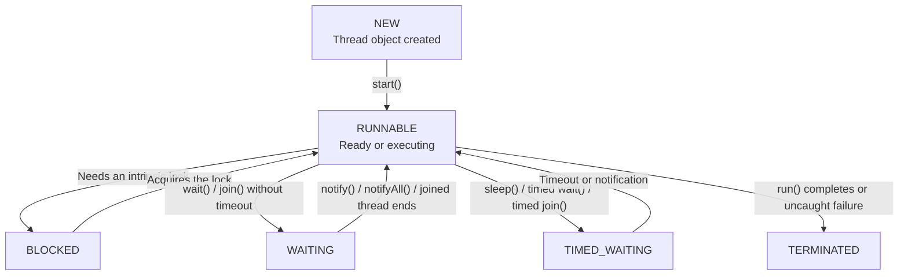
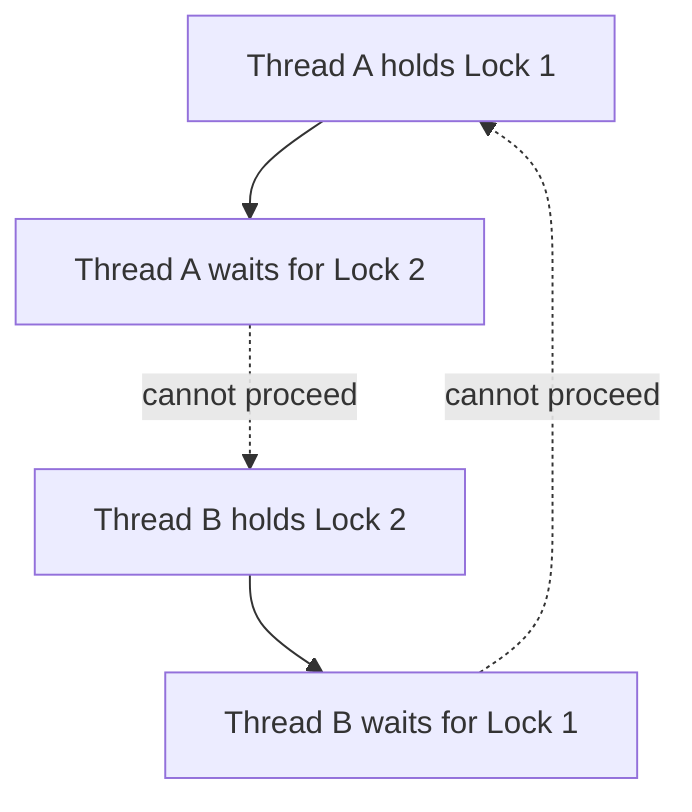
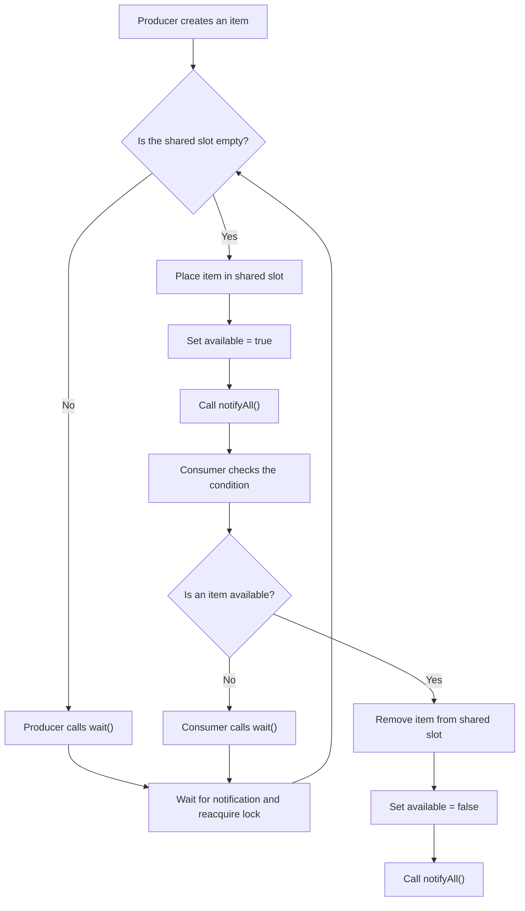

# Java Multithreading — Detailed Notes

## 1. Introduction to Multithreading

**Multithreading** is the ability of a program to execute multiple threads concurrently. A *thread* is a lightweight unit of execution within a process. Threads in the same process share memory and resources (such as heap objects and open files), while each thread has its own call stack and program counter.

A Java application starts with at least one thread: the **main thread**, which executes `main()`.

### Process vs. thread

| Process                                                 | Thread                                                             |
|:--------------------------------------------------------|:-------------------------------------------------------------------|
| An independent program in execution                     | A path of execution inside a process                               |
| Has its own address space                               | Shares the process address space                                   |
| Usually has higher creation and context-switch overhead | Usually has lower overhead                                         |
| Communicates with other processes using IPC mechanisms  | Can communicate through shared objects and coordination mechanisms |

### Concurrency and parallelism

- **Concurrency** means multiple tasks make progress over overlapping periods. A processor may switch rapidly between threads.
- **Parallelism** means multiple tasks literally execute at the same instant, usually on different CPU cores.
- Multithreaded code can be concurrent without being parallel.

### Why use multithreading?

1.  **Responsiveness:** A user interface can remain responsive while work runs in the background.
2.  **Resource sharing:** Threads can share data and objects within the same process.
3.  **Throughput:** Independent tasks may make progress together.
4.  **CPU utilization:** Work can use multiple cores where the workload and environment allow it.
5.  **Separation of tasks:** Different activities can be represented by separate execution paths.

### Costs and risks

Threads introduce scheduling overhead and coordination complexity. Incorrectly shared mutable data can cause race conditions, visibility problems, deadlocks, and inconsistent results. More threads do not automatically make a program faster.

------------------------------------------------------------------------

## 2. Multithreaded Programming in Java

Java supports multithreading through the `Thread` class, the `Runnable` interface, synchronization primitives, and higher-level concurrency utilities.

There are two common ways to define a task:

1.  Extend `Thread`.
2.  Implement `Runnable`.

### Method 1: Extending the `Thread` class

Override `run()` with the work the thread should perform, create an instance, and call `start()`.

```java
class MyThread extends Thread {
    @Override
    public void run() {
        for (int i = 1; i <= 5; i++) {
            System.out.println(getName() + ": " + i);
        }
    }
}

public class ThreadExample {
    public static void main(String[] args) {
        MyThread worker = new MyThread();
        worker.setName("Worker-1");
        worker.start(); // Starts a new thread; the JVM calls run().
    }
}
```

**Important:** Calling `run()` directly is an ordinary method call on the current thread. Calling `start()` asks the JVM to start a new thread, which then executes `run()`.

A `Thread` object can be started only once. Attempting to start it again throws `IllegalThreadStateException`.

### Method 2: Implementing the `Runnable` interface

`Runnable` represents a task whose `run()` method contains the work. Pass an instance to a `Thread`, then start that thread.

```java
class PrintTask implements Runnable {
    @Override
    public void run() {
        for (int i = 1; i <= 5; i++) {
            System.out.println(
                Thread.currentThread().getName() + ": " + i
            );
        }
    }
}

public class RunnableExample {
    public static void main(String[] args) {
        PrintTask task = new PrintTask();
        Thread worker = new Thread(task, "Runnable-Worker");
        worker.start();
    }
}
```

A lambda can be used because `Runnable` is a functional interface:

```java
Thread worker = new Thread(() -> {
    System.out.println("Task running");
});
worker.start();
```

### `Thread` vs. `Runnable`

| Extending `Thread`                                                    | Implementing `Runnable`                                    |
|:----------------------------------------------------------------------|:-----------------------------------------------------------|
| The class becomes a thread subclass                                   | The class describes a task                                 |
| Cannot extend another class because Java has single class inheritance | Can still extend another class                             |
| Task and thread-control object are tightly coupled                    | Task can be passed to different execution mechanisms       |
| Useful for learning or specialized `Thread` behavior                  | Usually preferred for separating task logic from execution |

For production applications, `ExecutorService` and other `java.util.concurrent` utilities are often preferable to manually creating many threads.

### Example: Running two threads

```java
public class TwoThreads {
    public static void main(String[] args) {
        Runnable firstTask = () -> {
            for (int i = 1; i <= 3; i++) {
                System.out.println("First: " + i);
            }
        };

        Runnable secondTask = () -> {
            for (int i = 1; i <= 3; i++) {
                System.out.println("Second: " + i);
            }
        };

        Thread first = new Thread(firstTask);
        Thread second = new Thread(secondTask);

        first.start();
        second.start();
    }
}
```

The order of the output is not guaranteed. The scheduler decides when runnable threads receive CPU time.

------------------------------------------------------------------------

## 3. Thread Life Cycle

A Java thread moves through states during its lifetime. The official states are defined by `Thread.State`.

### The six Java thread states

1.  **NEW:** A `Thread` object has been created, but `start()` has not been called.
2.  **RUNNABLE:** The thread is eligible to run or is running. Java combines the operating-system notions of ready and running into this state.
3.  **BLOCKED:** The thread is waiting to acquire an intrinsic monitor lock so it can enter a `synchronized` method or block.
4.  **WAITING:** The thread is waiting indefinitely for another thread to perform an action. Examples include `Object.wait()` without a timeout and `Thread.join()` without a timeout.
5.  **TIMED_WAITING:** The thread is waiting for a specified maximum time. Examples include `Thread.sleep()`, timed `Object.wait()`, and timed `join()`.
6.  **TERMINATED:** The thread has completed its `run()` method or terminated because of an uncaught error.

### Thread life-cycle flowchart



The diagram is conceptual: a notified thread may need to reacquire a monitor before it can continue, and a thread can terminate from its execution path after an uncaught exception.

### State transition example

```java
public class LifeCycleExample {
    public static void main(String[] args) throws InterruptedException {
        Thread worker = new Thread(() -> {
            try {
                Thread.sleep(500); // TIMED_WAITING
            } catch (InterruptedException e) {
                Thread.currentThread().interrupt();
            }
        });

        System.out.println(worker.getState()); // NEW
        worker.start();

        Thread.sleep(100); // Give worker time to enter sleep
        System.out.println(worker.getState()); // Usually TIMED_WAITING

        worker.join(); // Wait for worker to finish
        System.out.println(worker.getState()); // TERMINATED
    }
}
```

The exact state observed at a particular instant is timing-dependent. A short delay does not guarantee that another thread has reached a specific state.

### Important distinctions

- `start()` causes a new thread of execution to begin; `run()` alone does not.
- `sleep()` pauses the current thread but does **not** release any monitor lock it holds.
- `wait()` releases the monitor on which it is called and waits for notification, interruption, or timeout.
- A thread in `BLOCKED` is waiting to acquire a monitor. A thread in `WAITING` or `TIMED_WAITING` is waiting for a different condition.
- A terminated thread cannot be restarted.

------------------------------------------------------------------------

## 4. Thread Priorities

Every Java thread has a priority value from **1 to 10**.

The constants are:

| Constant               | Value | Meaning          |
|:-----------------------|------:|:-----------------|
| `Thread.MIN_PRIORITY`  |     1 | Minimum priority |
| `Thread.NORM_PRIORITY` |     5 | Default priority |
| `Thread.MAX_PRIORITY`  |    10 | Maximum priority |

Use `setPriority()` to request a priority and `getPriority()` to read it.

```java
Thread worker = new Thread(() -> System.out.println("Working"));

worker.setPriority(Thread.MAX_PRIORITY);
System.out.println(worker.getPriority());

worker.start();
```

### Rules and limitations

- A newly created thread normally inherits the priority of its parent thread.
- A priority must be in the range 1–10; otherwise `setPriority()` throws `IllegalArgumentException`.
- A thread’s priority cannot exceed the maximum priority permitted by its thread group.
- Priority is a **scheduling hint**, not a guarantee of execution order or CPU time.
- Behavior can vary by operating system, JVM, and runtime configuration.
- Do not use priorities as a correctness mechanism or to coordinate threads.

------------------------------------------------------------------------

## 5. Synchronization

**Synchronization** coordinates access to shared resources so that multiple threads do not perform conflicting operations at the same time.

### The race-condition problem

Consider a shared counter:

```java
class Counter {
    int count = 0;

    void increment() {
        count++;
    }
}
```

Although `count++` looks like one operation, it involves reading the value, adding one, and writing the result. Two threads can interleave these steps and overwrite each other’s updates. This is a **race condition**.

### Using a synchronized method

```java
class SafeCounter {
    private int count = 0;

    public synchronized void increment() {
        count++;
    }

    public synchronized int getCount() {
        return count;
    }
}
```

For an instance `synchronized` method, a thread must acquire that object’s intrinsic lock (monitor) before entering the method. Only one thread at a time can hold that same object’s monitor.

### Using a synchronized block

A synchronized block protects only the critical section:

```java
class SafeCounter {
    private int count = 0;
    private final Object lock = new Object();

    public void increment() {
        synchronized (lock) {
            count++;
        }
    }

    public int getCount() {
        synchronized (lock) {
            return count;
        }
    }
}
```

The lock object should be private and shared by every code path that accesses the protected state. Synchronizing on unrelated lock objects does not coordinate access.

### Instance lock vs. class lock

- An instance `synchronized` method locks `this`.
- A `static synchronized` method locks the associated `Class` object.
- Synchronizing on one instance does not automatically block synchronized methods on a different instance of the same class.

```java
class Example {
    public synchronized void instanceMethod() {
        // Locks this object
    }

    public static synchronized void staticMethod() {
        // Locks Example.class
    }
}
```

### What synchronization provides

1.  **Mutual exclusion:** Only one thread at a time can execute code protected by the same monitor.
2.  **Visibility:** Releasing a monitor happens-before a subsequent acquisition of that same monitor. Changes made before unlock become visible to the thread that later locks it.
3.  **Ordering:** The happens-before relationship constrains memory operations across synchronized sections.

### Deadlock

A deadlock occurs when threads wait forever for locks held by one another.



**Ways to reduce deadlock risk:**

- Acquire multiple locks in a consistent global order.
- Keep synchronized sections small.
- Avoid calling unknown or external code while holding a lock.
- Prefer higher-level concurrency utilities where appropriate.
- Use timed lock acquisition, such as `tryLock()`, where its failure can be handled safely.

### `volatile` is not a replacement for synchronization

A `volatile` field provides visibility and ordering guarantees for reads and writes to that field. It does not make compound operations such as `count++` atomic. Use synchronization, atomic classes such as `AtomicInteger`, or another suitable concurrency mechanism for compound updates.

------------------------------------------------------------------------

## 6. Inter-Thread Communication

**Inter-thread communication** allows threads to coordinate their work. Java’s intrinsic monitor mechanism provides `wait()`, `notify()`, and `notifyAll()` through the `Object` class.

These methods must be called by a thread that currently owns the monitor of the object on which the method is invoked. Otherwise, Java throws `IllegalMonitorStateException`.

### The three methods

| Method        | Purpose                                                                                    |
|:--------------|:-------------------------------------------------------------------------------------------|
| `wait()`      | Releases the object’s monitor and waits until notified, interrupted, or otherwise awakened |
| `notify()`    | Wakes one thread waiting on that object’s monitor; the chosen thread is not specified      |
| `notifyAll()` | Wakes all threads waiting on that object’s monitor; they compete to reacquire it           |

A notified thread does not immediately take over the monitor. It must wait until the notifying thread releases the lock.

### Correct use of `wait()` and `notifyAll()`

Always test the condition in a loop, not an `if` statement. A thread can wake without the condition becoming true (a *spurious wakeup*), or another thread can consume the condition first.

```java
class SharedBox {
    private String message;
    private boolean available = false;

    public synchronized void put(String value)
            throws InterruptedException {
        while (available) {
            wait();
        }

        message = value;
        available = true;
        notifyAll();
    }

    public synchronized String take()
            throws InterruptedException {
        while (!available) {
            wait();
        }

        String result = message;
        available = false;
        notifyAll();
        return result;
    }
}
```

Example use:

```java
public class CommunicationExample {
    public static void main(String[] args) {
        SharedBox box = new SharedBox();

        Thread producer = new Thread(() -> {
            try {
                box.put("Hello from producer");
            } catch (InterruptedException e) {
                Thread.currentThread().interrupt();
            }
        });

        Thread consumer = new Thread(() -> {
            try {
                System.out.println(box.take());
            } catch (InterruptedException e) {
                Thread.currentThread().interrupt();
            }
        });

        consumer.start();
        producer.start();
    }
}
```

The `while` loops protect the condition. `notifyAll()` is used here because either a producer or consumer may be waiting on the same monitor.

### Producer-consumer flowchart



### `wait()` vs. `sleep()`

| `wait()`                                                                                   | `sleep()`                                           |
|:-------------------------------------------------------------------------------------------|:----------------------------------------------------|
| Declared in `Object`                                                                       | Static method in `Thread`                           |
| Must be called while owning the object’s monitor                                           | Can be called without owning a monitor              |
| Releases the monitor of the object on which it is called                                   | Does not release monitors                           |
| Normally resumes after notification, interruption, or timeout, then reacquires the monitor | Resumes after the time expires or it is interrupted |
| Used for coordination based on a condition                                                 | Used to pause execution for a period                |

### Higher-level communication tools

For real applications, consider `BlockingQueue`, `CountDownLatch`, `Semaphore`, `Condition`, and other utilities in `java.util.concurrent`. They often provide safer and clearer coordination than manually combining `wait()` and `notify()`.

------------------------------------------------------------------------

## 7. Important Methods of the `Thread` Class

The following are commonly used methods. Some are instance methods and some are static methods.

| Method                               | Description                                                                                             |
|:-------------------------------------|:--------------------------------------------------------------------------------------------------------|
| `start()`                            | Starts a new thread of execution; the JVM invokes its `run()` method                                    |
| `run()`                              | Contains the thread’s task; calling it directly does not start a new thread                             |
| `sleep(long millis)`                 | Static method that pauses the current thread for at least the requested time, subject to scheduling     |
| `join()`                             | Makes the calling thread wait until the target thread terminates                                        |
| `join(long millis)`                  | Waits up to the specified time for the target thread to terminate                                       |
| `yield()`                            | Static hint that the scheduler may let other runnable threads execute                                   |
| `currentThread()`                    | Static method returning the currently executing thread                                                  |
| `getName()` / `setName(String)`      | Gets or changes a thread’s name                                                                         |
| `getPriority()` / `setPriority(int)` | Gets or requests a thread priority                                                                      |
| `isAlive()`                          | Returns `true` if the thread has been started and has not terminated                                    |
| `getState()`                         | Returns the thread’s current state                                                                      |
| `interrupt()`                        | Sets the thread’s interrupt status; certain blocking methods respond by throwing `InterruptedException` |
| `isInterrupted()`                    | Checks a thread’s interrupt status without clearing it                                                  |
| `interrupted()`                      | Static method that checks and clears the current thread’s interrupt status                              |
| `setDaemon(boolean)`                 | Marks a thread as daemon or non-daemon; must be called before it is started                             |
| `isDaemon()`                         | Checks whether the thread is a daemon thread                                                            |

### Examples

**`sleep()`**

```java
try {
    Thread.sleep(1000); // Pause current thread for about one second
} catch (InterruptedException e) {
    Thread.currentThread().interrupt();
}
```

**`join()`**

```java
Thread worker = new Thread(() -> {
    System.out.println("Worker finished its task");
});

worker.start();
worker.join(); // Main thread waits for worker to terminate
System.out.println("Main continues");
```

**`currentThread()` and naming**

```java
Thread current = Thread.currentThread();
System.out.println("Current thread: " + current.getName());
```

**Interruption**

```java
class Worker implements Runnable {
    @Override
    public void run() {
        while (!Thread.currentThread().isInterrupted()) {
            // Perform a small unit of work
        }
        System.out.println("Worker stopping");
    }
}

public class InterruptExample {
    public static void main(String[] args) throws InterruptedException {
        Thread worker = new Thread(new Worker());
        worker.start();

        Thread.sleep(100);
        worker.interrupt();
        worker.join();
    }
}
```

Interruption is a cooperative cancellation signal. Code should respond to it and stop safely. If a method throws `InterruptedException`, the interrupt status is cleared when the exception is thrown; if the method cannot propagate the exception, it is common to restore the status with `Thread.currentThread().interrupt()`.

### Deprecated thread-control methods

`stop()`, `suspend()`, and `resume()` are deprecated and should not be used. They can leave shared data in inconsistent states or cause deadlocks. Use interruption, flags, locks, and higher-level concurrency utilities for controlled cancellation and coordination.

------------------------------------------------------------------------

## 8. The `Runnable` Interface

`Runnable` is in the `java.lang` package. It represents a task that can be executed by a thread.

Its central method is:

```java
@FunctionalInterface
public interface Runnable {
    void run();
}
```

The method has no return value and does not declare checked exceptions. A task that needs to return a result or report an exception can use `Callable<V>` with an executor instead.

### Creating and executing a `Runnable`

```java
class DownloadTask implements Runnable {
    @Override
    public void run() {
        System.out.println(
            "Download task running on " +
            Thread.currentThread().getName()
        );
    }
}

public class RunnableDemo {
    public static void main(String[] args) {
        Runnable task = new DownloadTask();
        Thread thread = new Thread(task, "Download-Thread");
        thread.start();
    }
}
```

### Using a lambda

```java
Runnable task = () -> System.out.println("Task executed");
new Thread(task).start();
```

### Reusing a task

A `Runnable` describes work separately from the thread that executes it. The same task object can be submitted to an executor, which manages a pool of worker threads:

```java
import java.util.concurrent.ExecutorService;
import java.util.concurrent.Executors;

public class ExecutorExample {
    public static void main(String[] args) {
        ExecutorService pool = Executors.newFixedThreadPool(2);

        pool.submit(() -> System.out.println("Task A"));
        pool.submit(() -> System.out.println("Task B"));

        pool.shutdown();
    }
}
```

An executor is generally preferable when an application needs to manage multiple tasks, limit thread creation, or reuse worker threads.

### Advantages of `Runnable`

- Separates the task from the thread that runs it.
- Allows the task class to extend another class.
- Works with both manually created threads and executor services.
- Supports lambda expressions.
- Encourages reusable task-oriented design.

------------------------------------------------------------------------

## 9. Quick Comparison and Revision

### Core concepts

| Concept         | Main idea                                                    |
|:----------------|:-------------------------------------------------------------|
| Multithreading  | Multiple execution paths within one process                  |
| `Thread`        | Java object that represents and controls a thread            |
| `Runnable`      | Interface representing a task                                |
| `start()`       | Starts a new thread of execution                             |
| `run()`         | Task body executed by the thread                             |
| Thread priority | Scheduling hint from 1 to 10                                 |
| Synchronization | Coordinates access to shared state using locks               |
| Race condition  | Result depends on unpredictable thread interleaving          |
| Deadlock        | Threads wait indefinitely for locks held by one another      |
| `wait()`        | Releases a monitor and waits for a condition/notification    |
| `notify()`      | Wakes one thread waiting on an object’s monitor              |
| `notifyAll()`   | Wakes all threads waiting on an object’s monitor             |
| `sleep()`       | Pauses the current thread without releasing its monitors     |
| `join()`        | Waits for another thread to terminate                        |
| `interrupt()`   | Requests that a thread stop or change its work cooperatively |

### Common mistakes to avoid

1.  Calling `run()` when the intention is to start a new thread.
2.  Starting the same `Thread` instance more than once.
3.  Assuming thread priorities guarantee execution order.
4.  Accessing mutable shared data without a suitable synchronization strategy.
5.  Assuming `count++` is atomic.
6.  Calling `wait()`, `notify()`, or `notifyAll()` without owning the relevant monitor.
7.  Using `if` instead of `while` to guard a condition around `wait()`.
8.  Assuming `sleep()` releases a lock.
9.  Swallowing `InterruptedException` without restoring the interrupt status or otherwise handling cancellation.
10. Using deprecated methods such as `stop()`, `suspend()`, or `resume()`.

------------------------------------------------------------------------

## 10. Key Takeaways

- A Java thread is an independent path of execution within a process.
- Use `Runnable` to represent work and `Thread` or an executor to run it.
- `start()` starts a new thread; directly invoking `run()` does not.
- Java defines six thread states: `NEW`, `RUNNABLE`, `BLOCKED`, `WAITING`, `TIMED_WAITING`, and `TERMINATED`.
- Priorities are hints, not guarantees.
- Protect shared mutable state with an appropriate synchronization mechanism.
- Use `wait()` and notification for monitor-based coordination, always checking conditions in a loop.
- Prefer modern concurrency utilities for larger applications.
