# Distributed Databases and Client-Server Architecture
## Detailed DBMS Exam Notes

---

# 1. Introduction to Distributed Databases

## 1.1 What is a Distributed Database?

A **distributed database** is a collection of logically related data that is physically stored at multiple locations connected through a computer network.

The data may be stored on different:

- Computers
- Servers
- Sites
- Geographical locations

However, to users, the distributed database should ideally appear as a **single logical database**.

### Example

Suppose a bank has branches in:

- Ludhiana
- Delhi
- Mumbai
- Bengaluru

Each branch may store information about its local customers and accounts, while the entire banking organization operates as one database system.

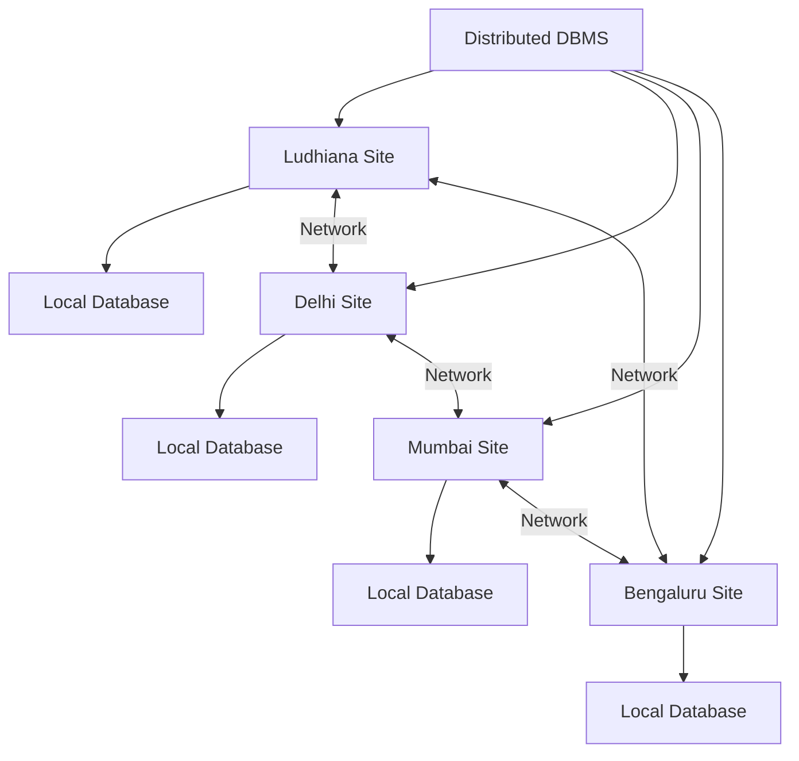

The individual databases are physically distributed, but they collectively form one logical database environment.

---

# 2. What is a Distributed DBMS?

A **Distributed Database Management System (DDBMS)** is a DBMS that manages a distributed database and makes the distribution of data largely transparent to users.

A DDBMS provides facilities for:

- Managing data at multiple sites.
- Processing distributed queries.
- Coordinating distributed transactions.
- Maintaining consistency among replicated data.
- Handling communication between sites.
- Recovering from site or network failures.
- Managing distributed security and authorization.

### Important distinction

**Distributed database:**

> The data is physically distributed across multiple sites.

**Distributed DBMS:**

> The software system manages that distributed data as an integrated database system.

---

# 3. Characteristics of Distributed Databases

A good distributed database system generally has the following characteristics.

## 3.1 Data is Distributed

Data is stored at multiple network-connected sites.

```text
Site A → Customer data
Site B → Order data
Site C → Inventory data
```

## 3.2 Logical Integration

Although data is physically distributed, users should be able to interact with it as one database.

For example:

```sql
SELECT *
FROM Customer
WHERE City = 'Delhi';
```

The user should not necessarily need to know which site stores the relevant records.

## 3.3 Location Transparency

**Location transparency** means users do not need to know the physical location of data.

Example:

```text
Customer table
```

could be distributed across several sites, but the user can query it without explicitly specifying the site.

## 3.4 Replication Transparency

Users should ideally not need to know whether multiple copies of data exist.

For example:

```text
CUSTOMER data
     |
 ┌───┼───┐
 ↓   ↓   ↓
Site A B  C
```

The DDBMS decides which copy to access.

## 3.5 Fragmentation Transparency

Users should not need to know whether a relation has been divided into fragments.

For example:

```text
CUSTOMER
   |
   +-- North Customers
   |
   +-- South Customers
```

The DDBMS can reconstruct the logical relation when necessary.

---

# 4. Advantages of Distributed Databases

## 4.1 Improved Availability

If one site fails, other sites may continue operating.

For example:

```text
Site A → FAILED
Site B → AVAILABLE
Site C → AVAILABLE
```

The whole system may not necessarily become unavailable.

## 4.2 Better Performance

Data can be placed close to the users who frequently access it.

This can reduce:

- Network traffic.
- Communication delay.
- Query response time.

## 4.3 Scalability

New sites can be added as an organization grows.

## 4.4 Local Autonomy

Individual sites can have some control over their local data and operations.

## 4.5 Parallel Processing

Different sites can process different parts of a query simultaneously.

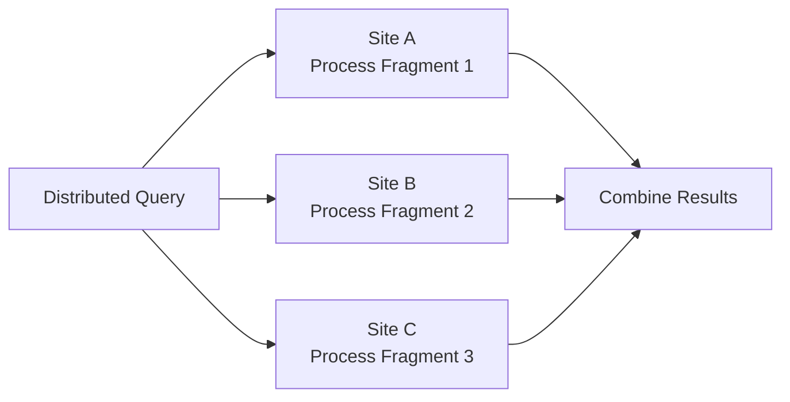

---

# 5. Disadvantages of Distributed Databases

Distributed databases also introduce additional complexity.

## 5.1 Network Dependency

Sites must communicate through a network.

Network failures can affect query processing and transactions.

## 5.2 Complex Transaction Management

A transaction may involve multiple sites.

The system must ensure that all participating sites reach a consistent result.

## 5.3 Distributed Concurrency Control

Concurrent operations may occur at different sites, making locking and synchronization more complicated.

## 5.4 Security Complexity

Security must be managed across:

- Multiple servers.
- Networks.
- Users.
- Sites.

## 5.5 Higher Design Complexity

The database designer must decide:

- How to fragment data.
- Where fragments should be stored.
- Whether data should be replicated.
- How many replicas should exist.

## 5.6 Higher Recovery Complexity

A failure at one site or a network partition may affect a distributed transaction.

---

# 6. Goals of Distributed Database Design

A distributed database should ideally provide:

1. **Performance**
2. **Availability**
3. **Reliability**
4. **Scalability**
5. **Data consistency**
6. **Efficient resource utilization**
7. **Transparency**
8. **Local autonomy where appropriate**

A central design challenge is:

> Where should each piece of data be stored so that performance, availability, cost, and consistency are balanced?

This leads to the concepts of **fragmentation, replication, and allocation**.

---

# 7. Client-Server Architecture

## 7.1 What is Client-Server Architecture?

**Client-server architecture** is a computing architecture in which clients request services or data, and servers provide those services or data.

A **client** is typically an application or computer that sends requests.

A **server** is a system that processes requests and provides resources or services.

In database systems:

```text
Client
  |
  | SQL Request
  ↓
Database Server
  |
  | Query Processing
  ↓
Database
  |
  | Result
  ↓
Client
```

---

# 8. Basic Client-Server Database Architecture

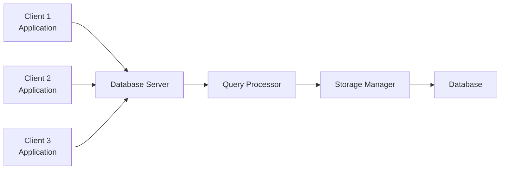

The clients generally:

- Provide the user interface.
- Send database requests.
- Display results.

The database server generally:

- Receives requests.
- Processes SQL.
- Checks authorization.
- Executes queries.
- Manages transactions.
- Accesses stored data.
- Returns results.

---

# 9. Two-Tier Client-Server Architecture

In a **two-tier architecture**, the client communicates directly with the database server.

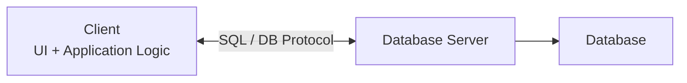

### Tier 1: Client

The client may contain:

- User interface.
- Some business/application logic.
- Database connectivity code.

### Tier 2: Database Server

The server handles:

- Database management.
- Query processing.
- Transactions.
- Storage.
- Security.

### Example

A desktop application connects directly to a MySQL or PostgreSQL database server.

---

# 10. Three-Tier Client-Server Architecture

In a **three-tier architecture**, an application server is placed between the client and database server.

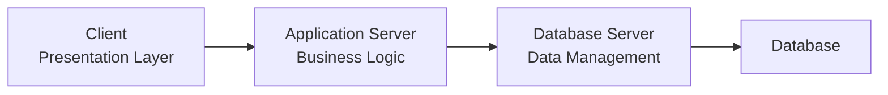

The three layers are:

### 1. Presentation Layer

Responsible for:

- User interface.
- Input.
- Displaying output.

### 2. Application/Business Logic Layer

Responsible for:

- Business rules.
- Validation.
- Authentication.
- Application logic.
- Coordinating database operations.

### 3. Database Layer

Responsible for:

- Data storage.
- SQL processing.
- Transactions.
- Database integrity.

### Advantages of Three-Tier Architecture

- Better security.
- Easier maintenance.
- Centralized business logic.
- Better scalability.
- Clients do not directly access the database.
- Easier integration with web/mobile applications.

---

# 11. Client-Server vs Distributed DBMS

These concepts are related but not identical.

| Client-Server | Distributed DBMS |
|---|---|
| Describes how clients and servers interact | Describes how a database is distributed and managed |
| Can use one database server | Can involve many database sites |
| Focuses on request/service architecture | Focuses on distributed data management |
| Common in web and enterprise systems | Common when data is geographically or organizationally distributed |

A distributed database system may use a client-server architecture.

---

# 12. Data Fragmentation

**Fragmentation** is the process of dividing a logical database relation into smaller pieces called **fragments**.

The objective is to place data close to the sites where it is most frequently used.

Example:

```text
CUSTOMER
   |
   +---- North customers
   |
   +---- South customers
   |
   +---- West customers
```

The original relation can potentially be reconstructed from its fragments.

---

# 13. Why Fragmentation is Used

Fragmentation can provide:

- Better query performance.
- Reduced network traffic.
- Better local autonomy.
- Parallel query execution.
- Improved security.
- Better resource utilization.

For example, if a Delhi office frequently accesses Delhi customers, storing the Delhi customer fragment near that office can reduce unnecessary network communication.

---

# 14. Types of Fragmentation

The three important types are:

1. **Horizontal fragmentation**
2. **Vertical fragmentation**
3. **Hybrid fragmentation**

---

# 15. Horizontal Fragmentation

In **horizontal fragmentation**, a relation is divided according to its **rows/tuples**.

Suppose:

```text
EMPLOYEE(Emp_ID, Name, Department, Salary)
```

We can divide employees according to department.

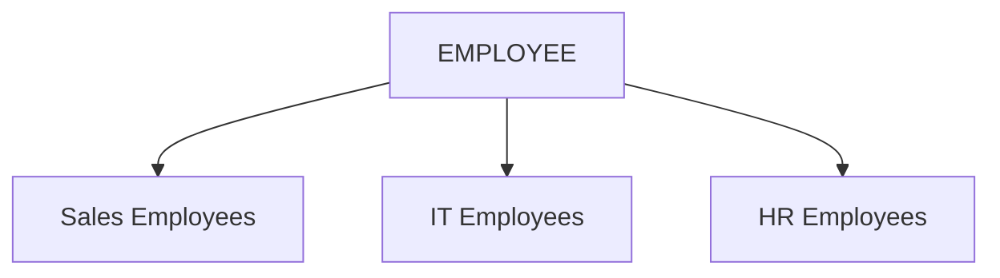

For example:

```text
EMPLOYEE_SALES = rows where Department = 'Sales'

EMPLOYEE_IT = rows where Department = 'IT'

EMPLOYEE_HR = rows where Department = 'HR'
```

### Reconstruction

Horizontal fragments can usually be reconstructed using **UNION**.

```text
EMPLOYEE
=
EMPLOYEE_SALES
UNION
EMPLOYEE_IT
UNION
EMPLOYEE_HR
```

### Key point

> Horizontal fragmentation divides **rows**.

---

# 16. Vertical Fragmentation

In **vertical fragmentation**, a relation is divided according to its **columns/attributes**.

Suppose:

```text
EMPLOYEE(Emp_ID, Name, Address, Department, Salary)
```

We could create:

```text
EMPLOYEE_BASIC(Emp_ID, Name, Address)

EMPLOYEE_JOB(Emp_ID, Department, Salary)
```

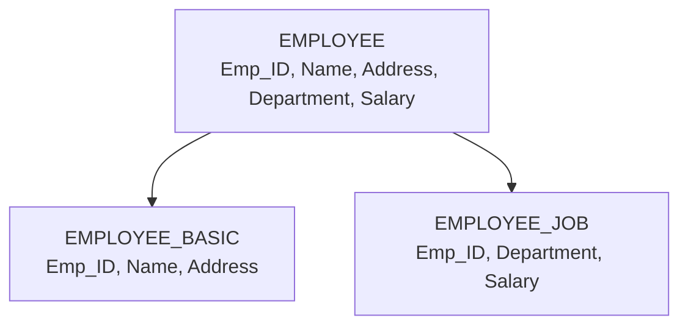

The primary key `Emp_ID` is included in each vertical fragment so that the original relation can be reconstructed.

### Reconstruction

Vertical fragments can usually be reconstructed using a **JOIN** on the common key.

```text
EMPLOYEE
=
EMPLOYEE_BASIC
JOIN
EMPLOYEE_JOB
```

### Key point

> Vertical fragmentation divides **columns**.

---

# 17. Hybrid Fragmentation

**Hybrid fragmentation** combines horizontal and vertical fragmentation.

Example:

```text
EMPLOYEE
   |
   | Horizontal
   ↓
EMPLOYEE_IT
   |
   | Vertical
   ↓
IT_BASIC + IT_JOB
```

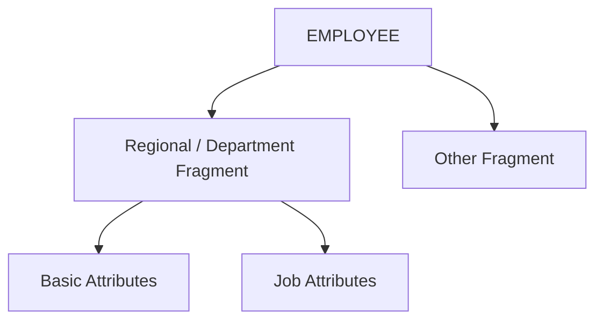

Hybrid fragmentation is useful when both:

- Different sites need different rows.
- Different sites need different attributes.

---

# 18. Correctness Conditions for Fragmentation

A fragmentation scheme should satisfy important correctness properties.

## 18.1 Completeness

Every data item in the original relation should appear in at least one appropriate fragment.

In simple terms:

> Fragmentation should not accidentally lose data.

For horizontal fragmentation, all required tuples should be represented.

For vertical fragmentation, all required attributes should be represented.

## 18.2 Reconstruction

It should be possible to reconstruct the original relation from its fragments.

Examples:

```text
Horizontal → UNION
Vertical → JOIN
```

## 18.3 Disjointness

Fragments should ideally not unnecessarily duplicate data.

For horizontal fragmentation, fragments are commonly designed to be disjoint.

For vertical fragmentation, the primary key is intentionally repeated so that fragments can be joined.

---

# 19. Fragmentation Rules

Fragmentation should be based on actual access patterns.

Consider:

```text
CUSTOMER(Customer_ID, Name, City, Balance)
```

If a site mostly accesses customers from Delhi:

```text
CUSTOMER_DELHI
```

may be stored near that site.

The design should consider:

- Query frequency.
- Update frequency.
- Communication cost.
- Storage cost.
- Security requirements.
- Availability requirements.

---

# 20. Data Replication

**Replication** means maintaining multiple copies of the same data at different sites.

Example:

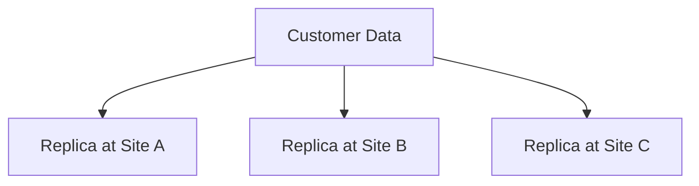

If a user at Site A needs the data, the local replica may be used instead of retrieving it from a remote site.

---

# 21. Why Replication is Used

Replication can improve:

### 21.1 Availability

If one site fails, another replica may still be available.

### 21.2 Read Performance

Users can access a nearby copy.

### 21.3 Reliability

Multiple copies reduce dependence on a single physical location.

### 21.4 Reduced Network Traffic

Frequently accessed data can be kept near users.

---

# 22. Disadvantages of Replication

Replication has costs.

## 22.1 Storage Cost

Multiple copies require additional storage.

## 22.2 Update Cost

When replicated data changes, the system may need to update multiple copies.

```text
Update
  |
  +--> Replica A
  +--> Replica B
  +--> Replica C
```

## 22.3 Consistency Problems

If one copy is updated but another is not, the replicas may temporarily or permanently disagree.

Therefore:

> More replication can improve availability and read performance, but it generally increases update and consistency-management costs.

---

# 23. Types of Replication

## 23.1 Full Replication

The complete database or complete relevant relation is replicated at every site.

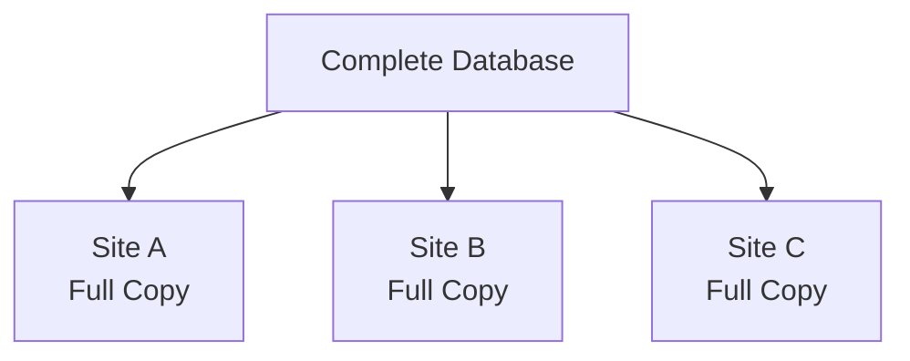

### Advantages

- Very high availability.
- Local access to data.
- Reduced remote reads.

### Disadvantages

- High storage requirement.
- Expensive updates.
- Greater consistency-management overhead.

---

## 23.2 Partial Replication

Only selected relations or fragments are replicated.

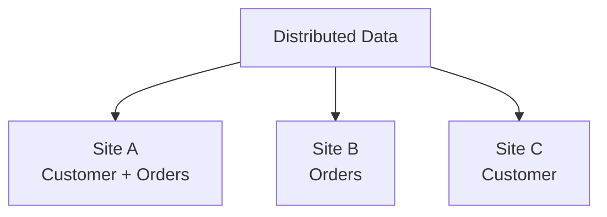

This is often more practical than full replication.

---

## 23.3 No Replication

Each data fragment has only one primary storage location.

```text
Fragment A → Site 1
Fragment B → Site 2
Fragment C → Site 3
```

This reduces update overhead but can reduce availability if a site becomes unavailable.

---

# 24. Synchronous and Asynchronous Replication

Another way to classify replication is by **when replicas are updated**.

## Synchronous Replication

Copies are updated as part of the same coordinated operation.

Conceptually:

```text
Write
  |
  +--> Replica A
  +--> Replica B
  +--> Replica C
       |
       ↓
   Commit
```

The system aims to keep replicas synchronized before completing the operation.

### Advantage

Stronger consistency.

### Disadvantage

Higher communication and coordination cost.

---

## Asynchronous Replication

The primary operation may complete before all replicas have received the update.

```text
Write
  |
  ↓
Primary
  |
  +---- later ----> Replica B
  |
  +---- later ----> Replica C
```

### Advantage

Lower latency and potentially better availability.

### Disadvantage

Replicas may temporarily contain stale data.

---

# 25. Data Allocation

**Data allocation** is the process of deciding **where fragments and replicas should be physically stored**.

After fragmentation and replication decisions are made, the designer must determine:

> Which fragment should be stored at which site?

Example:

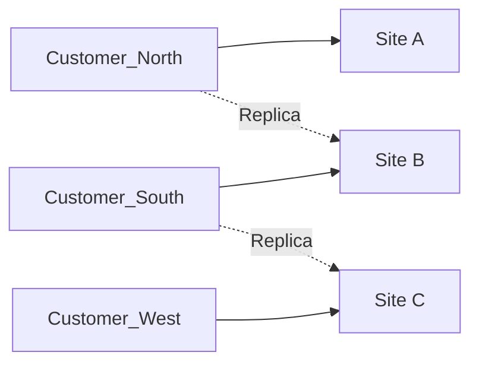

---

# 26. Allocation Objectives

A good allocation strategy attempts to optimize:

- Query response time.
- Communication cost.
- Storage cost.
- Update cost.
- Availability.
- Reliability.
- Load balancing.

There is usually no single allocation that minimizes every cost.

---

# 27. Factors Affecting Allocation

## 27.1 Data Access Frequency

If Site A frequently accesses Fragment X:

```text
High access from A
        ↓
Store X near A
```

## 27.2 Update Frequency

Highly updated data may not be replicated widely because each update can become expensive.

## 27.3 Communication Cost

If transferring data between two sites is expensive, local storage may be preferred.

## 27.4 Storage Capacity

A site with limited storage may not be suitable for many replicas.

## 27.5 Reliability Requirements

Critical data may be replicated at multiple sites.

---

# 28. Fragmentation + Replication + Allocation

These concepts work together.

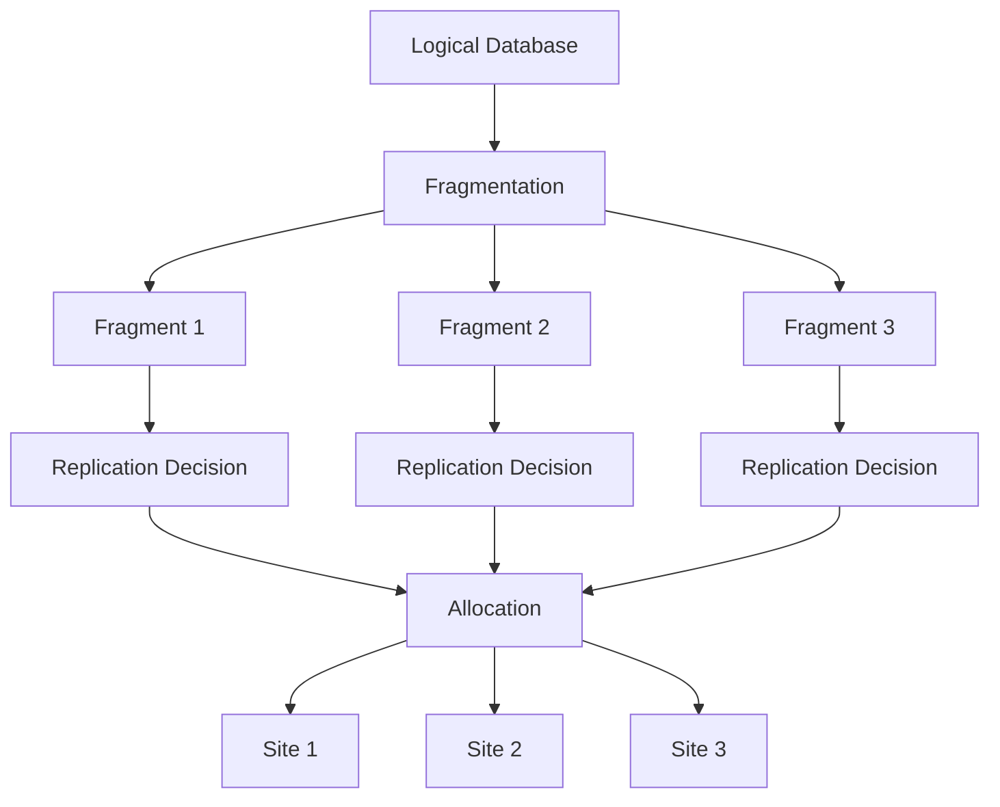

### Simple memory sequence

> **Fragment → Replicate → Allocate**

1. Decide how to divide data.
2. Decide which pieces need multiple copies.
3. Decide where each copy should be stored.

---

# 29. Types of Distributed Database Systems

Distributed database systems can be classified in several ways.

The most important classifications for exams are based on:

1. **Homogeneity**
2. **Autonomy**
3. **Integration**

---

# 30. Homogeneous Distributed Database System

A **homogeneous DDBMS** uses the same or compatible DBMS software and generally follows the same data model at all sites.

Example:

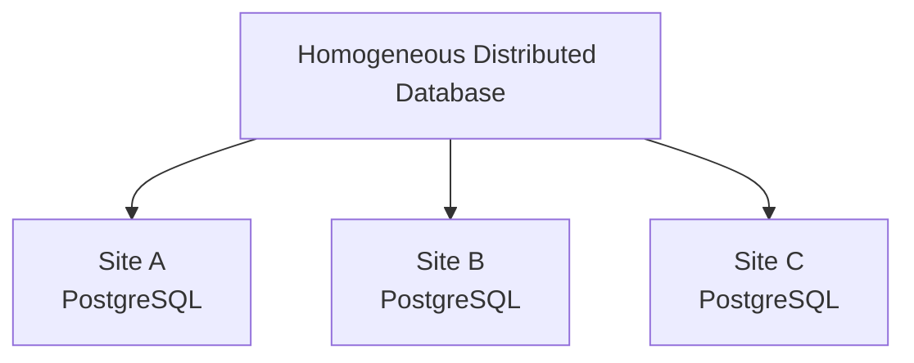

The sites may use the same:

- DBMS.
- Data model.
- Query language.
- Database schema conventions.

### Advantages

- Easier integration.
- Easier query processing.
- Easier transaction management.
- Easier administration.

---

# 31. Heterogeneous Distributed Database System

A **heterogeneous DDBMS** contains sites that may use different:

- DBMS products.
- Data models.
- Schemas.
- Query languages.
- Operating environments.

Example:

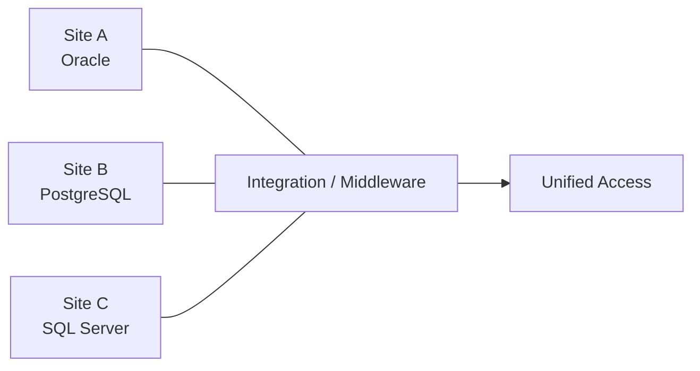

The system needs mechanisms for integrating the different systems.

### Main challenges

- Schema integration.
- Data-model differences.
- Query translation.
- Data-type conversion.
- Transaction coordination.
- Security differences.

---

# 32. Federated Database System

A **federated database system** integrates multiple autonomous databases while allowing them to retain some degree of local control.

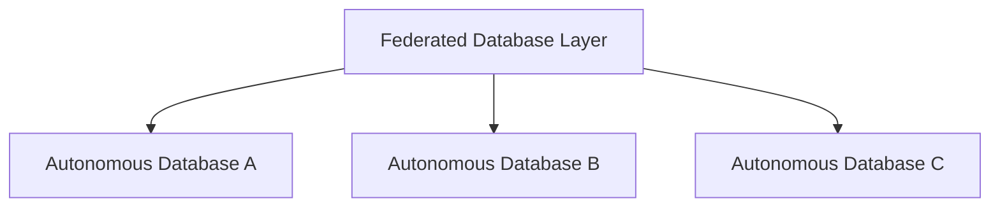

### Key idea

The participating databases cooperate, but they may retain considerable **local autonomy**.

This is useful when different departments or organizations already have independent database systems.

---

# 33. Non-Federated / Tightly Integrated Distributed System

In a tightly integrated distributed system:

- The sites cooperate under a more unified DDBMS.
- Data is presented as one integrated database.
- Distribution is largely hidden from users.

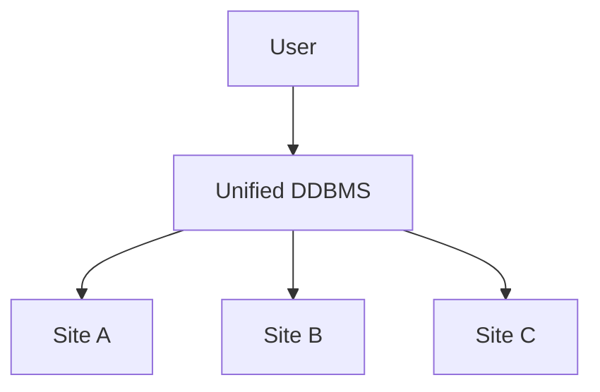

The DDBMS centrally coordinates distributed data management, even though the data itself is physically distributed.

---

# 34. Autonomous Database Systems

A distributed environment may also be classified according to how much independence each site has.

### Tight integration

The distributed DBMS controls the participating sites relatively strongly.

### Semiautonomous systems

Sites retain significant local control but cooperate with the distributed system.

### Fully autonomous systems

Individual databases operate independently and cooperate only when necessary.

A simplified view:


As autonomy increases:

- Local control increases.
- Integration becomes harder.
- Global coordination becomes more difficult.

---

# 35. Homogeneous vs Heterogeneous DDBMS

| Feature | Homogeneous | Heterogeneous |
|---|---|---|
| DBMS software | Same/similar | Different possible |
| Data model | Usually same | May differ |
| Schema | More uniform | May differ |
| Integration | Easier | More difficult |
| Query processing | Simpler | Requires translation/integration |
| Administration | Easier | More complex |
| Example | Same DBMS at all sites | Oracle + PostgreSQL + SQL Server |

---

# 36. Distributed Database Design Process

A simplified distributed database design process is:

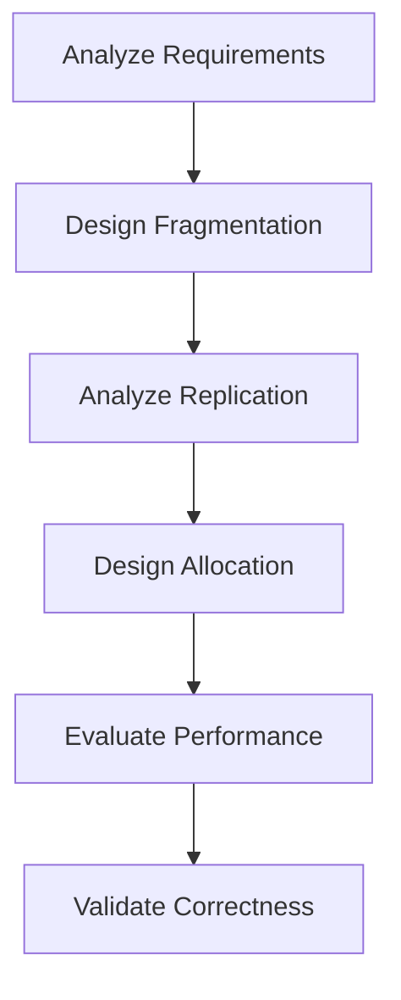

## Step 1: Analyze Requirements

Determine:

- Which users access which data?
- From which sites?
- How frequently?
- Which operations are reads?
- Which operations are updates?

## Step 2: Fragment the Database

Choose:

- Horizontal fragmentation.
- Vertical fragmentation.
- Hybrid fragmentation.

## Step 3: Decide Replication

Determine:

- Which fragments need copies?
- How many copies?
- Full or partial replication?
- Synchronous or asynchronous behavior?

## Step 4: Allocate Data

Determine where each fragment/replica should be stored.

## Step 5: Evaluate

Compare:

- Query cost.
- Communication cost.
- Storage cost.
- Update cost.
- Availability.
- Reliability.

---

# 37. Example of Distributed Database Design

Consider an online retail company with:

```text
Sites:
Delhi
Mumbai
Bengaluru
```

Relations:

```text
CUSTOMER
ORDER
PRODUCT
```

### Requirement

Delhi primarily handles Delhi customers.

Mumbai primarily handles western-region orders.

Product information is accessed by all sites.

### Possible design

#### Fragmentation

```text
CUSTOMER → Regional horizontal fragments
ORDER → Regional horizontal fragments
PRODUCT → No fragmentation or selected replication
```

#### Replication

```text
PRODUCT → replicated at all sites
```

#### Allocation

```text
Delhi customers → Delhi site
Mumbai customers → Mumbai site
Bengaluru customers → Bengaluru site

Product replica → Delhi
Product replica → Mumbai
Product replica → Bengaluru
```

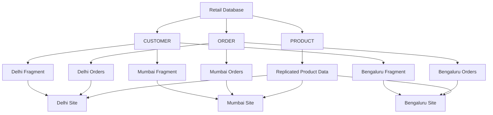

This design can reduce local query costs while making product information widely available.

---

# 38. Distributed Query Processing

A **distributed query** accesses data stored at multiple sites.

Example:

```sql
SELECT C.Name, O.Order_ID
FROM CUSTOMER C
JOIN ORDER O
ON C.Customer_ID = O.Customer_ID;
```

If `CUSTOMER` and `ORDER` are stored at different sites, the DDBMS must decide:

- Which sites should participate?
- Where should joins occur?
- Should data be transferred?
- Can filtering happen locally first?
- Which execution plan minimizes communication?

### Important idea

In distributed databases, **communication cost** can be a major part of query cost.

Therefore, query optimization tries to reduce unnecessary data transfer.

---

# 39. Local vs Distributed Query

### Local query

Data needed by the query exists at one site.

```text
Client → Site A → Result
```

### Distributed query

Data is required from multiple sites.

```text
Client
  |
  ↓
DDBMS
 ├── Site A
 ├── Site B
 └── Site C
  |
  ↓
Combined Result
```

---

# 40. Distributed Transactions

A **distributed transaction** is a transaction that accesses or modifies data at more than one site.

Example:

```text
Transfer ₹10,000

Account A at Site 1
        ↓
    - ₹10,000

Account B at Site 2
        ↓
    + ₹10,000
```

Both operations must be coordinated.

The system must avoid a situation such as:

```text
Site 1 → debit successful
Site 2 → credit failed
```

because this would violate transaction correctness.

A distributed DBMS therefore requires mechanisms for:

- Distributed transaction management.
- Concurrency control.
- Recovery.
- Commit coordination.

---

# 41. Transparency in Distributed Databases

Transparency means hiding unnecessary details of distribution from users.

Important types include:

## Location Transparency

Users do not need to know where data is stored.

## Fragmentation Transparency

Users do not need to know that a relation has been fragmented.

## Replication Transparency

Users do not need to know that multiple copies exist.

## Transaction Transparency

Users can execute transactions without having to manually coordinate individual sites.

### Memory trick

> **Location = Where?**  
> **Fragmentation = How divided?**  
> **Replication = How many copies?**

---

# 42. Important Comparison: Fragmentation vs Replication vs Allocation

| Concept | Main Question | Example |
|---|---|---|
| Fragmentation | How should data be divided? | CUSTOMER by region |
| Replication | How many copies should exist? | PRODUCT at all sites |
| Allocation | Where should copies/fragments be stored? | Product at Delhi, Mumbai, Bengaluru |
| Combination | How should the complete distributed design look? | Regional customers + replicated products |

---

# 43. Advantages and Disadvantages Summary

| Feature | Advantage | Possible Disadvantage |
|---|---|---|
| Fragmentation | Local access, lower communication | Complex reconstruction |
| Replication | Availability, faster reads | Higher update/consistency cost |
| Allocation | Places data near users | Requires careful optimization |
| Distributed processing | Parallelism | Coordination overhead |
| Client-server | Clear separation of responsibilities | Network dependency |
| Three-tier architecture | Security and maintainability | More infrastructure |
| Homogeneous DDBMS | Easier integration | Less flexibility across different systems |
| Heterogeneous DDBMS | Integrates existing systems | More complex integration |

---

# 44. Important Exam Definitions

### Distributed Database

> A logically integrated database whose data is physically stored at multiple network-connected sites.

### DDBMS

> A DBMS that manages a distributed database and provides integrated access to distributed data.

### Client-Server Architecture

> An architecture in which clients request services and servers process those requests and provide the required resources or results.

### Data Fragmentation

> The process of dividing a logical relation into smaller fragments for distributed storage and processing.

### Horizontal Fragmentation

> Dividing a relation by rows.

### Vertical Fragmentation

> Dividing a relation by columns, normally retaining the key in each fragment for reconstruction.

### Hybrid Fragmentation

> A combination of horizontal and vertical fragmentation.

### Replication

> Maintaining multiple copies of data at different sites.

### Allocation

> Deciding the physical sites at which fragments or replicas are stored.

### Homogeneous DDBMS

> A distributed database system in which participating sites use the same or compatible DBMS/data-model environment.

### Heterogeneous DDBMS

> A distributed database system containing different DBMSs, data models, or schemas that require integration.

### Federated Database System

> A system that integrates multiple autonomous databases while allowing them to retain some degree of local control.

---

# 45. High-Value Exam Differences

## Horizontal vs Vertical Fragmentation

| Horizontal | Vertical |
|---|---|
| Divides rows | Divides columns |
| Selection-like operation | Projection-like operation |
| Reconstructed using UNION | Reconstructed using JOIN |
| Example: customers by city | Example: employee basic vs salary information |

---

## Full vs Partial Replication

**Full replication:**

> Complete relevant data is copied to every site.

**Partial replication:**

> Only selected fragments/data are copied to selected sites.

---

## Synchronous vs Asynchronous Replication

**Synchronous:**

> Replicas are coordinated as part of the update before completion.

**Asynchronous:**

> Replica updates may occur after the primary operation completes, so temporary stale copies may exist.

---

## Two-Tier vs Three-Tier Architecture

| Two-Tier | Three-Tier |
|---|---|
| Client directly communicates with DB server | Client communicates through application server |
| Simpler | More layered |
| More database responsibility on client | Business logic centralized in application server |
| Suitable for some desktop applications | Common for web/enterprise applications |

---

## Homogeneous vs Heterogeneous Distributed Systems

**Homogeneous:**

```text
Same/similar DBMS environment
→ Easier integration
```

**Heterogeneous:**

```text
Different DBMS environments
→ More complex integration
```

---

# 46. Last-Minute Revision Map

```mermaid
mindmap
  root((Distributed DBMS))
    Distributed Database
      Multiple Sites
      Logical Integration
      Transparency
      Availability
      Scalability
    Client-Server
      Two Tier
        Client
        Database Server
      Three Tier
        Presentation
        Application
        Database
    Fragmentation
      Horizontal
        Rows
        UNION
      Vertical
        Columns
        JOIN
      Hybrid
        Horizontal + Vertical
      Correctness
        Completeness
        Reconstruction
        Disjointness
    Replication
      Full
      Partial
      Synchronous
      Asynchronous
      Benefits
        Availability
        Read Performance
      Costs
        Storage
        Updates
        Consistency
    Allocation
      Where to store
      Access frequency
      Communication cost
      Storage capacity
      Reliability
    Types
      Homogeneous
      Heterogeneous
      Federated
      Autonomous
```

---

# 47. Final Exam Memory Tricks

### Distributed Database

> **Many physical sites, one logical database.**

### Fragmentation

> **Break the data.**

### Replication

> **Copy the data.**

### Allocation

> **Place the data.**

### Horizontal

> **Rows → UNION**

### Vertical

> **Columns → JOIN**

### Replication trade-off

> **More copies → better availability/read performance, but more update and consistency cost.**

### Two-tier

> **Client ↔ Database Server**

### Three-tier

> **Client → Application Server → Database Server**

### Homogeneous

> **Same/similar DBMS environment.**

### Heterogeneous

> **Different DBMS environments.**

### Federated

> **Multiple autonomous databases cooperating through an integration layer.**

### Distributed design sequence

> **Requirements → Fragmentation → Replication → Allocation → Evaluation**

---

# 48. Questions You Should Be Able to Answer

Before the exam, make sure you can answer these without notes:

1. What is a distributed database?
2. What is a DDBMS?
3. What are the advantages and disadvantages of distributed databases?
4. Explain client-server architecture.
5. Differentiate two-tier and three-tier architectures.
6. What is data fragmentation?
7. Explain horizontal fragmentation with an example.
8. Explain vertical fragmentation with an example.
9. What is hybrid fragmentation?
10. What are the correctness conditions of fragmentation?
11. What is data replication?
12. Explain full and partial replication.
13. Differentiate synchronous and asynchronous replication.
14. What is data allocation?
15. What factors affect data allocation?
16. Explain the relationship between fragmentation, replication, and allocation.
17. What is a homogeneous distributed database system?
18. What is a heterogeneous distributed database system?
19. What is a federated database system?
20. Explain transparency in a distributed database.
21. Why is distributed query processing more complex than local query processing?
22. What is a distributed transaction?
23. Why does replication increase consistency-management cost?
24. Compare horizontal and vertical fragmentation.
25. Explain a complete distributed database design with an example.

---

# 49. Ultra-Short Revision

```text
DDBMS
│
├── Distributed Database
│   └── Data at multiple sites
│
├── Client-Server
│   ├── 2-tier: Client ↔ DB Server
│   └── 3-tier: Client → App Server → DB Server
│
├── Fragmentation
│   ├── Horizontal → Rows → UNION
│   ├── Vertical → Columns → JOIN
│   └── Hybrid → Both
│
├── Replication
│   ├── Full
│   ├── Partial
│   ├── Synchronous
│   └── Asynchronous
│
├── Allocation
│   └── Decide where fragments/replicas live
│
└── Types
    ├── Homogeneous
    ├── Heterogeneous
    ├── Federated
    └── Autonomous
```

**Core idea to remember:**

> **Fragmentation decides how data is divided, replication decides how many copies exist, and allocation decides where those copies/fragments are stored.**
