# DBMS Exam Notes: Introduction, Architecture, and EER Model

## 1. Introduction to DBMS

### What is a Database?

A **database** is an organized collection of related data that can be stored, retrieved, updated, and managed efficiently.

**Example:** A college database may contain information about students, courses, instructors, departments, and enrollments.

### What is a DBMS?

A **Database Management System (DBMS)** is software that allows users and applications to:

- Define the structure of a database.
- Store and organize data.
- Insert, update, and delete data.
- Retrieve data using queries.
- Enforce constraints and data integrity.
- Control concurrent access.
- Provide security and authorization.
- Recover data after failures.

Examples include MySQL, PostgreSQL, Oracle Database, Microsoft SQL Server, and SQLite.

### DBMS vs. File System

| Feature               | File System                   | DBMS                         |
| --------------------- | ----------------------------- | ---------------------------- |
| Data redundancy       | Usually high                  | Can be controlled            |
| Data sharing          | Limited                       | Better support               |
| Security              | Basic                         | Fine-grained authorization   |
| Concurrent access     | Difficult                     | Built-in concurrency control |
| Backup/recovery       | Often manual                  | Systematic mechanisms        |
| Integrity constraints | Mostly application-controlled | Supported by DBMS            |
| Querying              | Requires custom programs      | SQL/query languages          |
| Data independence     | Low                           | Higher                       |

### Advantages of a DBMS

1. **Reduced redundancy:** Avoids unnecessary duplication of data.
2. **Improved consistency:** Changes can be maintained consistently.
3. **Data sharing:** Multiple users/applications can access the same database.
4. **Security:** Users can be given different privileges.
5. **Integrity:** Constraints prevent invalid data.
6. **Concurrency control:** Multiple transactions can execute safely.
7. **Backup and recovery:** DBMS can recover from failures.
8. **Data independence:** Applications can be insulated from some changes in storage or schema.

---

# 2. DBMS Architecture

DBMS architecture can be discussed at two common levels:

1. **Three-schema architecture** — describes the levels at which database data is viewed.
2. **Functional/internal DBMS architecture** — describes major components that process queries and manage storage.

## 2.1 Three-Schema Architecture

The ANSI/SPARC three-schema architecture separates the database into:

- **External level**
- **Conceptual level**
- **Internal level**

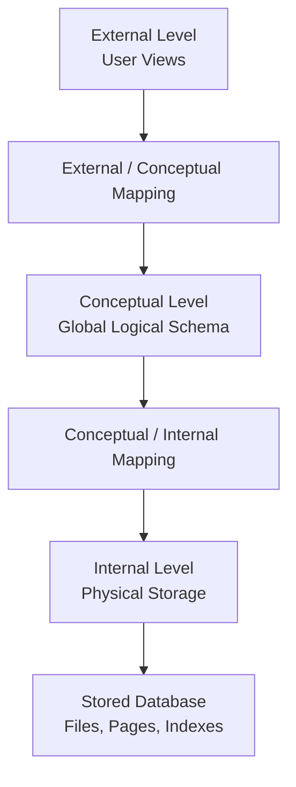

### 1. External Level

The **external level** is the user/application view of the database.

Different users may see different portions of the same database.

**Example:**

- Student sees: student ID, name, courses, grades.
- Accounts department sees: student ID, fees, payment status.
- Instructor sees: student ID, course, marks.

An external schema is also called a **view schema**.

### 2. Conceptual Level

The **conceptual level** describes the complete logical structure of the database.

It specifies:

- Entities.
- Attributes.
- Relationships.
- Constraints.

It does **not** describe exactly how data is stored on disk.

Example:

```text
STUDENT(Student_ID, Name, DOB, Department)
COURSE(Course_ID, Course_Name, Credits)
ENROLLMENT(Student_ID, Course_ID, Grade)
```

### 3. Internal Level

The **internal level** describes how data is physically stored.

It deals with things such as:

- Files.
- Pages/blocks.
- Record layouts.
- Indexes.
- Storage structures.

Users normally do not need to know these physical details.

## 2.2 Data Independence

**Data independence** means that changes at one schema level should not require changes at the next higher level.

### Physical Data Independence

Ability to change the **internal/physical schema** without changing the conceptual schema.

Example:

> Adding an index or changing the file organization should not require changing the logical database design.

### Logical Data Independence

Ability to change the **conceptual schema** without changing external views or application programs, as far as possible.

Example:

> Adding a new attribute to an entity should not necessarily require rewriting every user application.

**Exam point:** Physical data independence is generally easier to achieve than logical data independence.

---

# 3. Major Components of a DBMS

A simplified DBMS can be viewed as follows:

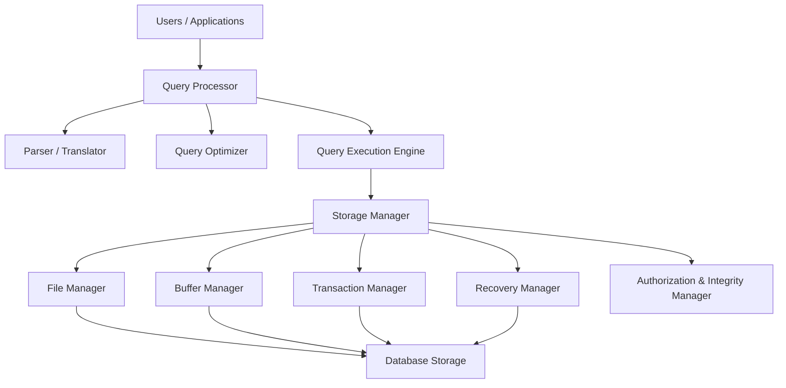

### Query Processor

Responsible for understanding and executing queries.

Main tasks include:

- Parsing SQL.
- Checking syntax and semantics.
- Translating queries into lower-level operations.
- Optimizing queries.
- Executing the selected query plan.

### Storage Manager

Acts as the interface between higher-level DBMS components and physical storage.

Important parts include:

- **File manager:** Manages files and disk-space structures.
- **Buffer manager:** Moves data between disk and main memory.
- **Transaction manager:** Helps maintain correct execution of concurrent transactions.
- **Recovery manager:** Helps restore the database after failures.
- **Authorization/integrity manager:** Enforces access control and integrity rules.

---

# 4. Enhanced-ER (EER) Model

The **Enhanced Entity-Relationship (EER) model** extends the basic ER model with additional concepts for representing more complex applications.

Important EER concepts include:

- Superclasses and subclasses.
- Specialization.
- Generalization.
- Inheritance.
- Union/category types.
- Specialization/generalization constraints.
- Hierarchies and lattices.

## 4.1 Superclass and Subclass

A **superclass** is a general entity type that contains common attributes and relationships.

A **subclass** is a specialized entity type whose members are also members of the superclass.

Example:

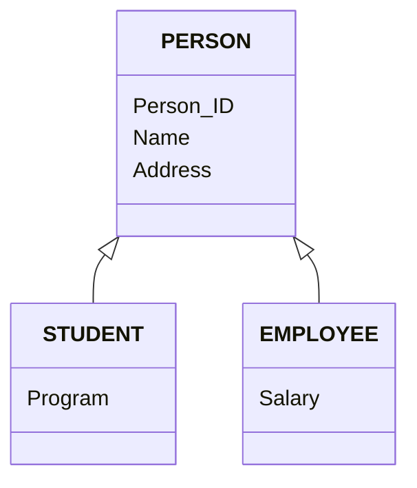

Here:

- `PERSON` is the superclass.
- `STUDENT` and `EMPLOYEE` are subclasses.
- `Name` and `Address` are inherited by both subclasses.

### Inheritance

A subclass **inherits**:

- Attributes of its superclass.
- Relationships of its superclass.

If:

```text
PERSON(Person_ID, Name, Address)
```

and `STUDENT` is a subclass, then a student automatically has:

```text
Person_ID
Name
Address
```

plus its own subclass-specific attributes.

---

# 5. Specialization

**Specialization** is a **top-down** process.

We start with a general superclass and divide it into more specific subclasses based on distinguishing characteristics.

Example:

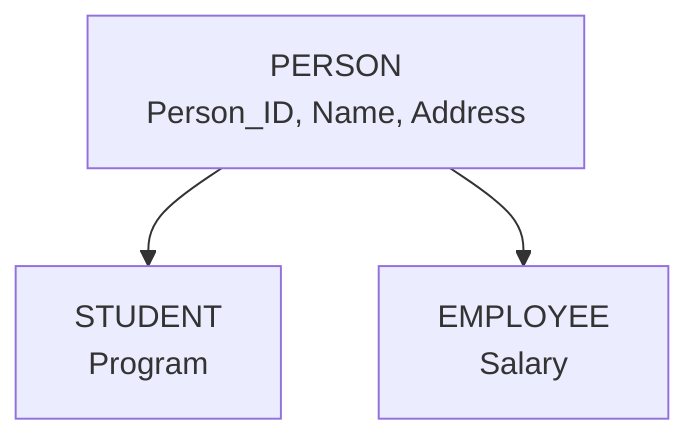

We can say:

> STUDENT IS-A PERSON  
> EMPLOYEE IS-A PERSON

### Why use specialization?

Specialization is useful when some members of an entity type have:

- Additional attributes.
- Additional relationships.
- Different roles or properties.

Example:

```text
PERSON
 ├── STUDENT
 └── EMPLOYEE
```

A student may have `Program`, while an employee may have `Salary`.

---

# 6. Generalization

**Generalization** is the reverse of specialization.

It is a **bottom-up** process in which multiple entity types with common characteristics are combined into a generalized superclass.

Example:

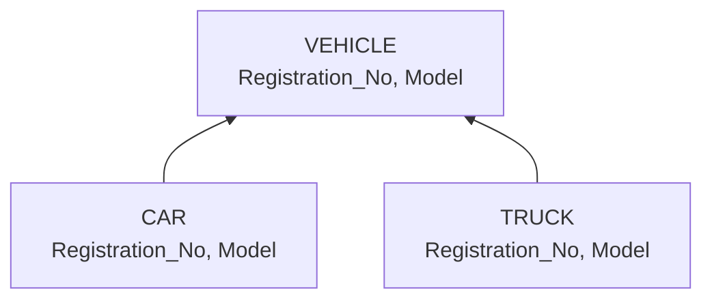

If `CAR` and `TRUCK` have common attributes, we can create a superclass `VEHICLE`.

### Specialization vs Generalization

| Specialization | Generalization |
|---|---|
| Top-down | Bottom-up |
| Starts with superclass | Starts with entity types |
| Creates subclasses | Creates superclass |
| Based on distinguishing characteristics | Based on common characteristics |
| Example: PERSON → STUDENT, EMPLOYEE | CAR + TRUCK → VEHICLE |

**Memory trick:**

> **Specialization = Split**  
> **Generalization = Combine**

---

# 7. Constraints on Specialization and Generalization

Two important constraints are:

1. **Disjointness constraint**
2. **Completeness constraint**

These can be combined to produce four common cases.

---

## 7.1 Disjointness Constraint

The disjointness constraint specifies whether an entity can belong to more than one subclass of the same specialization.

### Disjoint Specialization

In a **disjoint** specialization, an entity can belong to **at most one** subclass.

Example:

```text
PERSON
 ├── STUDENT
 └── EMPLOYEE
```

If the specialization is disjoint, one person cannot simultaneously be both a student and an employee **within that specialization**.

Symbolically:

```text
A person belongs to at most one subclass.
```

### Overlapping Specialization

In an **overlapping** specialization, an entity can belong to **more than one** subclass.

Example:

```text
PERSON
 ├── STUDENT
 └── EMPLOYEE
```

A person may be both:

```text
STUDENT + EMPLOYEE
```

For example, a university student can also work as a teaching assistant.

---

# 8. Completeness Constraint

The completeness constraint specifies whether every superclass entity must belong to at least one subclass.

### Total Specialization

In a **total** specialization, every superclass entity must belong to at least one subclass.

Example:

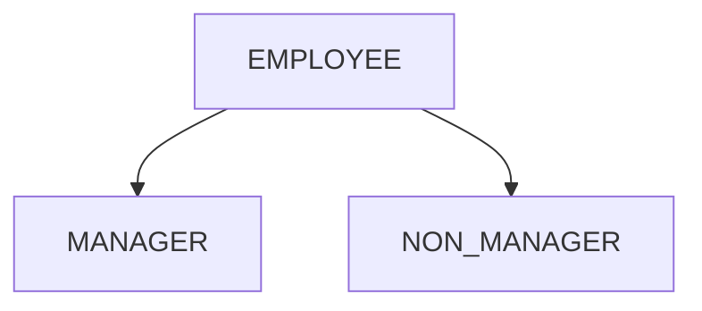

If total:

```text
Every EMPLOYEE must be either MANAGER or NON_MANAGER.
```

### Partial Specialization

In a **partial** specialization, some superclass entities may belong to no subclass.

Example:

```text
PERSON
 ├── STUDENT
 └── EMPLOYEE
```

Some persons may be neither students nor employees.

---

# 9. Four Combinations of Specialization Constraints

Disjointness and completeness are independent concepts.

| Disjointness | Completeness | Meaning |
|---|---|---|
| Disjoint | Total | Every superclass entity belongs to exactly one subclass |
| Disjoint | Partial | An entity belongs to at most one subclass, and some may belong to none |
| Overlapping | Total | Every entity belongs to at least one subclass; some may belong to multiple |
| Overlapping | Partial | An entity may belong to multiple subclasses or none |

### Easy way to remember

**Disjointness asks:**

> "Can one entity be in multiple subclasses?"

**Completeness asks:**

> "Must every superclass entity be in a subclass?"

---

# 10. Union Type / Category

A **union type**, also called a **category**, is a subclass whose members can come from **different superclasses**.

This is different from ordinary specialization, where subclasses generally have one superclass.

### Example

Suppose a university has:

```text
PERSON
COMPANY
```

and a `OWNER` can be either a person or a company.

Then:

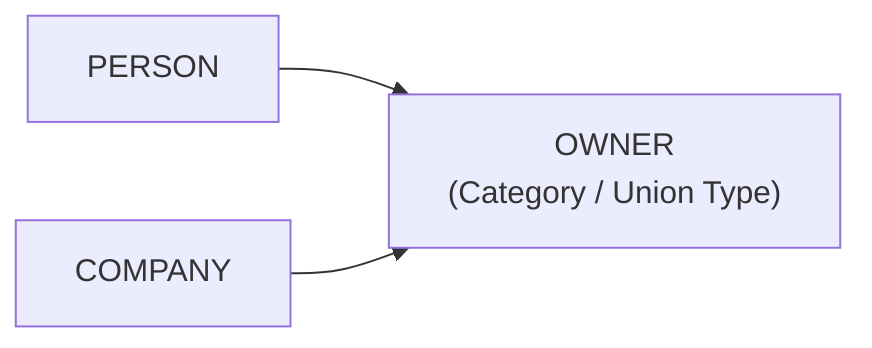

`OWNER` is a category whose members are drawn from the union:

```text
PERSON ∪ COMPANY
```

### Why is a category useful?

Suppose `PROPERTY` is owned by either:

- A person, or
- A company.

Instead of creating separate relationships:

```text
PERSON owns PROPERTY
COMPANY owns PROPERTY
```

we can define:

```text
OWNER owns PROPERTY
```

where `OWNER` is a category over `PERSON` and `COMPANY`.

### Important distinction

**Specialization:**

```text
One superclass → multiple subclasses
```

**Category / Union type:**

```text
Multiple superclasses → one subclass/category
```

---

# 11. Hierarchy

A **specialization hierarchy** is a tree-like arrangement of superclasses and subclasses.

Each subclass has only **one direct superclass** in a simple hierarchy.

Example:

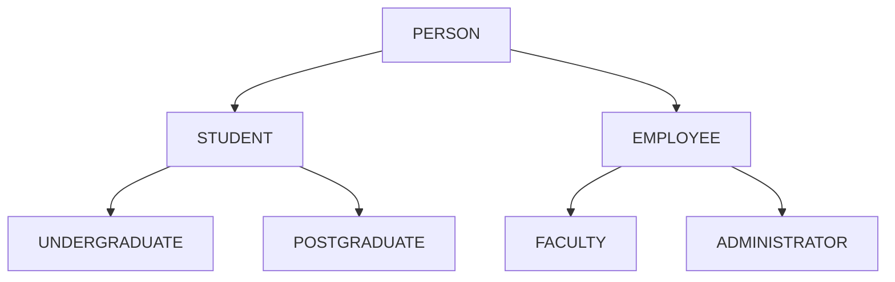

Here:

```text
PERSON
├── STUDENT
│   ├── UNDERGRADUATE
│   └── POSTGRADUATE
└── EMPLOYEE
    ├── FACULTY
    └── ADMINISTRATOR
```

### Key property

In a simple hierarchy:

> A subclass has only one direct superclass.

A class can still have ancestors at multiple levels.

For example:

```text
UNDERGRADUATE → STUDENT → PERSON
```

Therefore `UNDERGRADUATE` indirectly inherits properties from `PERSON`.

---

# 12. Lattice

A **specialization lattice** is more general than a hierarchy.

In a lattice, a subclass can have **more than one direct superclass**.

This is called **multiple inheritance**.

Example:

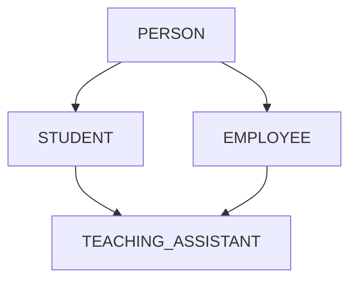

`TEACHING_ASSISTANT` is both:

- A `STUDENT`
- An `EMPLOYEE`

Therefore it has two direct superclasses.

### Hierarchy vs Lattice

| Hierarchy                          | Lattice                               |
| ---------------------------------- | ------------------------------------- |
| Tree-like                          | Graph-like                            |
| One direct superclass per subclass | Multiple direct superclasses possible |
| Single inheritance                 | Multiple inheritance possible         |
| Simpler                            | More expressive                       |

---

# 13. EER-to-Relational Mapping

EER-to-relational mapping means converting an EER conceptual design into relational database tables.

The exact mapping depends on the EER constructs being used.

## 13.1 Mapping a Regular Entity Type

For each strong/regular entity type:

> Create one relation containing all simple attributes.

Example:

```text
STUDENT
---------
Student_ID
Name
DOB
```

becomes:

```text
STUDENT(Student_ID, Name, DOB)
```

The entity's key becomes the **primary key**.

---

# 14. Mapping Composite Attributes

A composite attribute is divided into its component attributes.

Example:

```text
Name
 ├── First_Name
 └── Last_Name
```

Instead of storing:

```text
Name
```

store:

```text
First_Name
Last_Name
```

So:

```text
PERSON(Person_ID, First_Name, Last_Name)
```

---

# 15. Mapping Multivalued Attributes

For a multivalued attribute, create a separate relation.

Example:

```text
PERSON
 └── Phone_Number {multiple values}
```

Create:

```text
PERSON(Person_ID, Name)

PERSON_PHONE(Person_ID, Phone_Number)
```

Primary key:

```text
(Person_ID, Phone_Number)
```

`Person_ID` is also a foreign key referencing `PERSON`.

---

# 16. Mapping Derived Attributes

A **derived attribute** is normally not stored directly.

Example:

```text
DOB → Age
```

`Age` can be calculated from `DOB`.

Therefore:

```text
PERSON(Person_ID, Name, DOB)
```

rather than storing `Age` as a permanent attribute.

---

# 17. Mapping Binary 1:1 Relationships

For a binary **1:1 relationship**, place the primary key of one relation as a foreign key in the other relation.

Example:
PK : Primary Key
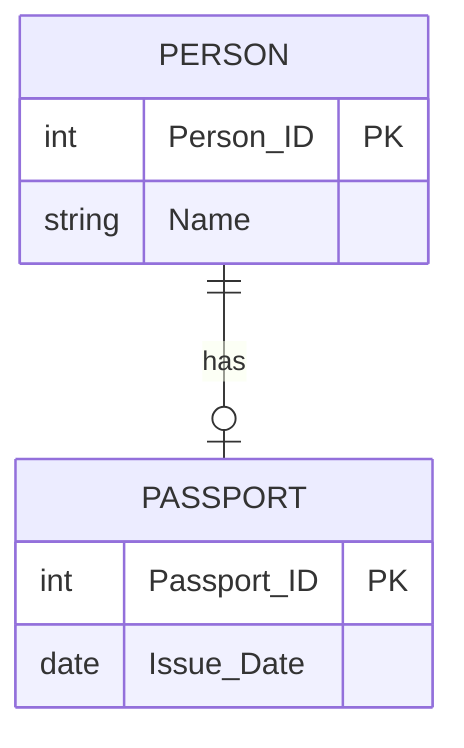

Possible relational mapping:

```text
PERSON(Person_ID, Name, Passport_ID)

PASSPORT(Passport_ID, Issue_Date)
```

`Passport_ID` can be a foreign key in `PERSON`.

**Which side should contain the foreign key?**

Prefer placing it on the side with:

- Total participation, when applicable.
- Fewer null values.
- Better semantic suitability.

---

# 18. Mapping Binary 1:N Relationships

For a binary **1:N relationship**, place the primary key of the **1-side** as a foreign key in the relation representing the **N-side**.

Example:

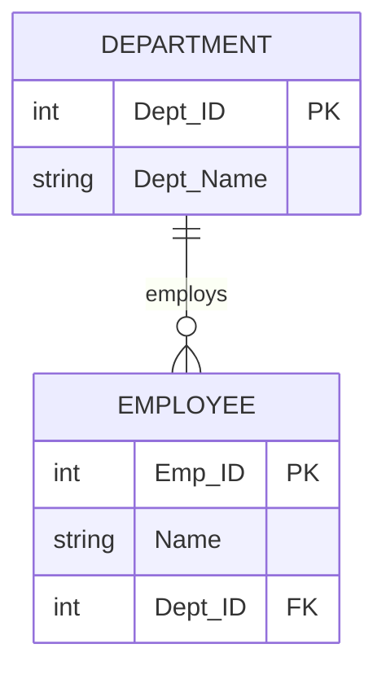

Mapping:

```text
DEPARTMENT(Dept_ID, Dept_Name)

EMPLOYEE(Emp_ID, Name, Dept_ID)
```

Here:

```text
EMPLOYEE.Dept_ID
    ↓
DEPARTMENT.Dept_ID
```

**Exam rule:**

> For 1:N, foreign key goes to the N-side.

---

# 19. Mapping Binary M:N Relationships

For a binary **M:N relationship**, create a new relation for the relationship.

Example:

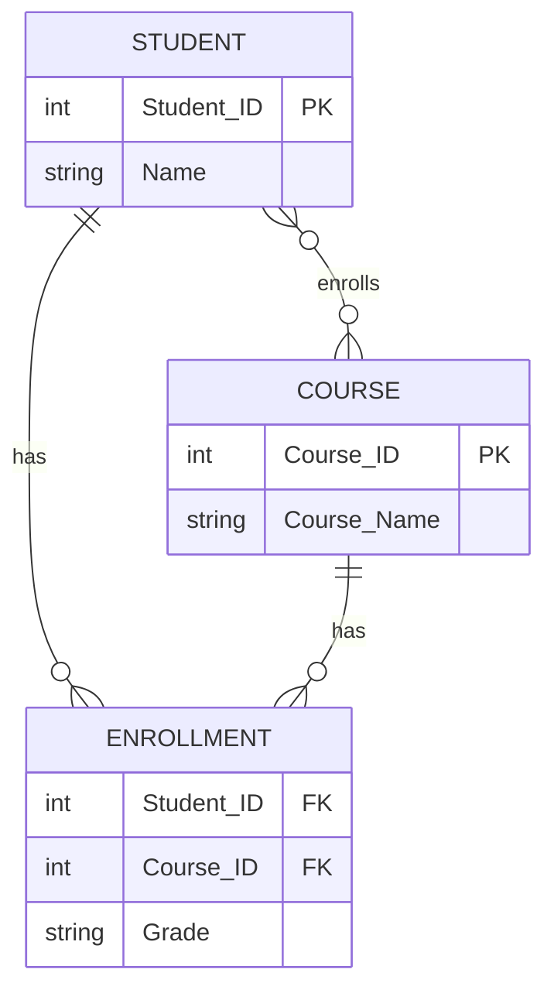

Mapping:

```text
STUDENT(Student_ID, Name)

COURSE(Course_ID, Course_Name)

ENROLLMENT(Student_ID, Course_ID, Grade)
```

Primary key of `ENROLLMENT` is usually:

```text
(Student_ID, Course_ID)
```

The relationship's attributes, such as `Grade`, are stored in the relationship relation.

---

# 20. Mapping N-ary Relationships

For an **N-ary relationship** involving three or more entity types, create a separate relation.

Example:

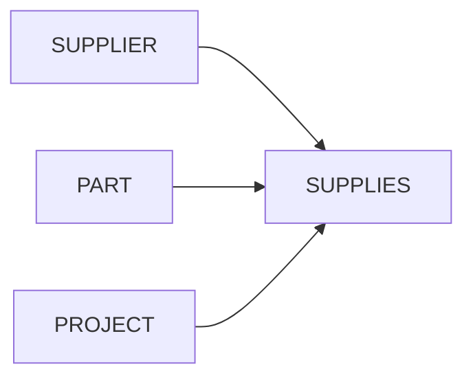

Possible mapping:

```text
SUPPLIER(Supplier_ID, Name)

PART(Part_ID, Part_Name)

PROJECT(Project_ID, Project_Name)

SUPPLIES(Supplier_ID, Part_ID, Project_ID, Quantity)
```

The relationship relation contains the primary keys of participating entities as foreign keys, plus relationship attributes.

---

# 21. Mapping Specialization and Generalization

There are several strategies for mapping a superclass/subclass structure into relations.

Consider:

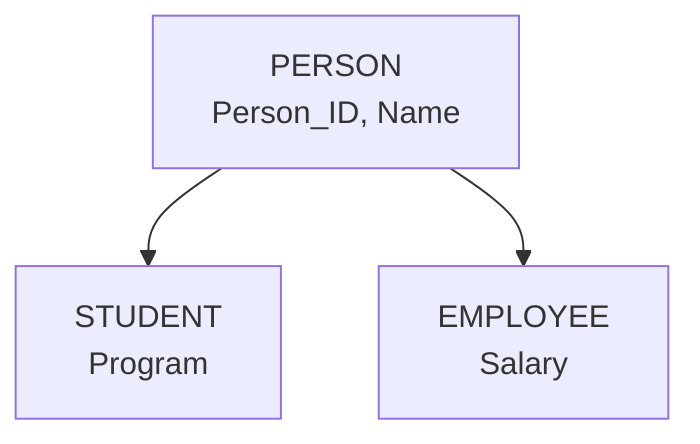

## Strategy 1: Superclass Table + Subclass Tables

Create a table for the superclass and a table for each subclass.

```text
PERSON(Person_ID, Name)

STUDENT(Person_ID, Program)

EMPLOYEE(Person_ID, Salary)
```

Here:

```text
STUDENT.Person_ID → PERSON.Person_ID
EMPLOYEE.Person_ID → PERSON.Person_ID
```

The subclass primary key is also a foreign key to the superclass.

### Advantage

Avoids repeating common superclass attributes.

### Disadvantage

Retrieving complete subclass information may require joins.

---

# 22. Strategy 2: Subclass Relations Only

Create a separate relation for each subclass and include inherited superclass attributes in each subclass.

```text
STUDENT(Person_ID, Name, Program)

EMPLOYEE(Person_ID, Name, Salary)
```

### Advantage

Queries for a specific subclass can be simpler.

### Disadvantage

Common attributes may be duplicated.

### When suitable?

This approach works particularly well when:

- The specialization is **total**.
- The specialization is **disjoint**.

Then every superclass entity belongs to exactly one subclass.

---

# 23. Strategy 3: Single Relation with Type Attribute

Create one relation containing the superclass and subclass attributes.

```text
PERSON(
    Person_ID,
    Name,
    Program,
    Salary,
    Person_Type
)
```

Example:

```text
Person_ID | Name | Program | Salary | Person_Type
-------------------------------------------------
101       | A    | BCA     | NULL   | STUDENT
102       | B    | NULL    | 50000  | EMPLOYEE
```

### Advantage

Simple structure and fewer joins.

### Disadvantages

- Many NULL values may occur.
- Less convenient for complex specialization structures.
- Can become wide as the number of subclasses increases.

---

# 24. Mapping Categories / Union Types

Suppose:

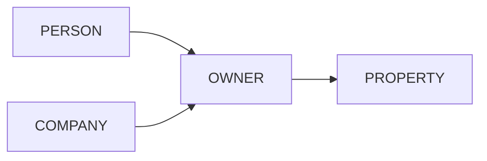

`OWNER` is a category formed from `PERSON ∪ COMPANY`.

A relational implementation can use a separate category relation containing an identifier that distinguishes the source type.

One common design is:

```text
PERSON(Person_ID, Name)

COMPANY(Company_ID, Company_Name)

OWNER(
    Owner_ID,
    Owner_Type,
    Person_ID,
    Company_ID
)
```

with a constraint that each owner row refers to the appropriate source entity.

Another practical design is to use a common supertype such as:

```text
PARTY(Party_ID, ...)

PERSON(Party_ID, ...)

COMPANY(Party_ID, ...)

OWNER(Party_ID, ...)
```

The exact implementation depends on the database requirements and the intended semantics.

**Exam point:** A category is used when the subclass/category is a subset of the **union of multiple entity types**.

---

# 25. Complete EER-to-Relational Mapping Checklist

When converting an EER diagram to relations, use this sequence:

1. **Regular entities**
   - Create one table per entity.
   - Choose the entity key as primary key.

2. **Composite attributes**
   - Store their simple components.
   - Do not store the composite attribute as one indivisible value unless specifically required.

3. **Multivalued attributes**
   - Create a separate table.
   - Include the owner's primary key and the multivalued attribute.
   - Usually use both as the composite primary key.

4. **1:1 relationships**
   - Put a foreign key in one participating table, preferably where participation/semantics make it appropriate.

5. **1:N relationships**
   - Put the 1-side primary key into the N-side table as a foreign key.

6. **M:N relationships**
   - Create a separate relationship table.
   - Include the primary keys of participating entities.
   - Add relationship attributes.

7. **N-ary relationships**
   - Create a separate relation containing participating entity keys and relationship attributes.

8. **Specialization/generalization**
   - Choose an appropriate superclass/subclass mapping strategy.
   - Preserve keys, inheritance, and applicable constraints.

9. **Categories/union types**
   - Use a relational design that represents membership in the union of multiple entity types.

10. **Constraints**
   - Translate keys, foreign keys, uniqueness, NOT NULL, and other enforceable constraints where possible.

---

# 26. High-Value Exam Differences

## Specialization vs Generalization

```text
Specialization:
Superclass
   ↓
Subclasses

Generalization:
Entity types
   ↓
Superclass
```

**Specialization = top-down**

**Generalization = bottom-up**

---

## Disjoint vs Overlapping

**Disjoint:**

```text
One entity → at most one subclass
```

**Overlapping:**

```text
One entity → can belong to multiple subclasses
```

---

## Total vs Partial

**Total:**

```text
Every superclass entity → at least one subclass
```

**Partial:**

```text
Some superclass entities → may belong to no subclass
```

---

## Hierarchy vs Lattice

**Hierarchy:**

```text
One direct superclass per subclass
```

**Lattice:**

```text
A subclass can have multiple direct superclasses
```

---

## ER vs EER

| ER Model | EER Model |
|---|---|
| Entity types | Entity types + superclass/subclass concepts |
| Relationships | Relationships |
| Attributes | Attributes + inheritance |
| Basic constraints | More specialization/generalization constraints |
| Less expressive for complex classifications | More expressive |

---

# 27. Quick Revision Sheet

### DBMS

> Software used to define, create, store, retrieve, update, secure, and manage databases.

### Three-schema architecture

```text
External → Conceptual → Internal
```

- External = user views.
- Conceptual = complete logical structure.
- Internal = physical storage.

### Data independence

- **Physical:** Change physical storage without changing logical schema.
- **Logical:** Change logical schema without requiring changes to external views/applications, as far as possible.

### Specialization

> Top-down: superclass → subclasses.

### Generalization

> Bottom-up: subclasses/entity types → superclass.

### Inheritance

> Subclass inherits attributes and relationships from superclass.

### Disjoint

> Entity belongs to at most one subclass.

### Overlapping

> Entity may belong to multiple subclasses.

### Total

> Every superclass entity must belong to at least one subclass.

### Partial

> Some superclass entities may belong to no subclass.

### Union type/category

> A subclass/category whose members come from the union of multiple superclasses/entity types.

### Hierarchy

> Tree-like specialization structure; each subclass has one direct superclass.

### Lattice

> Specialization structure allowing multiple direct superclasses.

### 1:N mapping

> Put the 1-side key in the N-side table.

### M:N mapping

> Create a new relationship table containing the participating keys.

### Multivalued attribute

> Create a separate table.

### Subclass mapping

> Common approach: superclass table + one table per subclass, with subclass PK also acting as FK to superclass.

---

# 28. Important One-Line Questions for the Exam

**Q: What is DBMS?**  
A: A software system that manages databases and provides facilities for storing, retrieving, updating, securing, and maintaining data.

**Q: What are the three levels of DBMS architecture?**  
A: External, conceptual, and internal levels.

**Q: What is specialization?**  
A: A top-down process of creating more specific subclasses from a general superclass.

**Q: What is generalization?**  
A: A bottom-up process of combining common features of entity types into a generalized superclass.

**Q: What is inheritance in EER?**  
A: A subclass automatically obtains attributes and relationships of its superclass.

**Q: What is a disjoint constraint?**  
A: It specifies that an entity can belong to at most one subclass within a specialization.

**Q: What is an overlapping constraint?**  
A: It allows an entity to belong to multiple subclasses.

**Q: What is total specialization?**  
A: Every superclass entity must belong to at least one subclass.

**Q: What is partial specialization?**  
A: Some superclass entities may belong to no subclass.

**Q: What is a category/union type?**  
A: A subclass whose members are drawn from the union of multiple entity types.

**Q: What is a specialization hierarchy?**  
A: A tree-like arrangement of superclass/subclass relationships where a subclass has one direct superclass.

**Q: What is a specialization lattice?**  
A: A specialization structure in which a subclass may have multiple direct superclasses.

**Q: How is an M:N relationship mapped to relations?**  
A: Create a separate relation containing the primary keys of the participating entities and the relationship's attributes.

**Q: Where does the foreign key go in a 1:N relationship?**  
A: Normally into the relation representing the N-side, referencing the primary key of the 1-side.

---

# 29. Last-Minute Memory Map

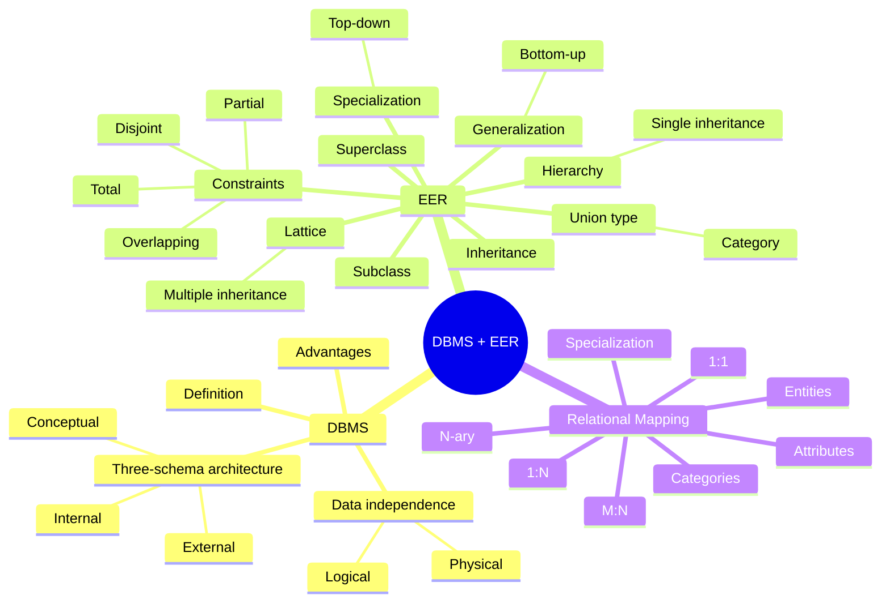

## Exam Strategy

For theory questions, answer in this order:

1. **Definition**
2. **Key characteristics**
3. **Diagram**
4. **Example**
5. **Difference/table**, if the question asks for comparison.

For EER questions, explicitly mention the important constraint terms:

> **Disjoint/Overlapping + Total/Partial**

For mapping questions, remember:

> **1:N → FK on N-side**  
> **M:N → New relation**  
> **Multivalued attribute → New relation**  
> **Subclass → PK commonly also serves as FK to superclass**
