# PL/SQL — Detailed DBMS Exam Notes
---

# 1. Introduction to PL/SQL

**PL/SQL** stands for **Procedural Language/SQL**.

It is Oracle's procedural extension to SQL. SQL is primarily used to describe **what data should be retrieved or changed**, while PL/SQL adds procedural programming features such as:

- Variables
- Conditions
- Loops
- Exceptions
- Procedures
- Functions
- Records
- Collections
- Cursors

PL/SQL allows SQL statements to be combined with procedural logic inside a **block**.

### SQL vs PL/SQL

| SQL | PL/SQL |
|---|---|
| Primarily declarative | Procedural + SQL |
| Executes individual SQL statements | Groups statements into blocks |
| Does not normally provide procedural loops/conditions | Supports loops and conditions |
| Mainly operates on database data | Can combine database operations with program logic |
| No ordinary local variable declaration mechanism like PL/SQL | Supports variables and constants |
| No stored procedure/function language by itself | Supports procedures and functions |

---

# 2. PL/SQL Block Structure

A PL/SQL program is organized into **blocks**.

A basic PL/SQL block has three sections:

1. **DECLARE** — optional
2. **BEGIN** — mandatory
3. **EXCEPTION** — optional

General structure:

```text
DECLARE
    -- declarations
BEGIN
    -- executable statements
EXCEPTION
    -- exception handlers
END;
/
```

### Diagram

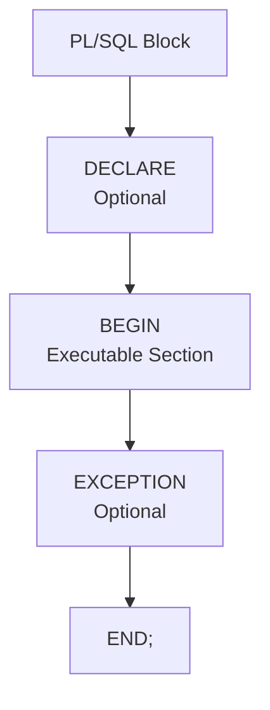

---

# 3. DECLARE Section

The `DECLARE` section is used to declare:

- Variables
- Constants
- Cursors
- Records
- Collection types
- Other local objects

Example:

```sql
DECLARE
    v_name VARCHAR2(50);
    v_salary NUMBER(10,2);
BEGIN
    v_name := 'Ravi';
    v_salary := 50000;
END;
/
```

The `DECLARE` section is optional.

---

# 4. BEGIN Section

The `BEGIN` section contains the **executable statements**.

This is the only mandatory section of a PL/SQL block.

Example:

```sql
BEGIN
    DBMS_OUTPUT.PUT_LINE('Hello PL/SQL');
END;
/
```

Executable statements can include:

- Assignments
- SQL statements
- IF statements
- Loops
- Procedure calls
- Function calls
- Cursor operations

---

# 5. EXCEPTION Section

The `EXCEPTION` section handles runtime errors.

Example:

```sql
DECLARE
    v_result NUMBER;
BEGIN
    v_result := 10 / 0;
EXCEPTION
    WHEN ZERO_DIVIDE THEN
        DBMS_OUTPUT.PUT_LINE('Cannot divide by zero');
END;
/
```

The exception section is optional.

### Block execution flow

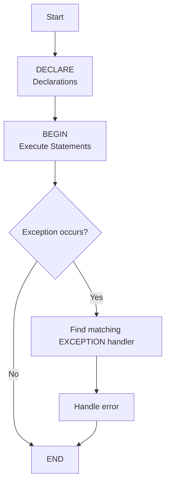

---

# 6. Example of a Complete PL/SQL Block

```sql
DECLARE
    v_name   VARCHAR2(50);
    v_salary NUMBER(10,2);
BEGIN
    v_name := 'Amit';
    v_salary := 45000;

    DBMS_OUTPUT.PUT_LINE('Name: ' || v_name);
    DBMS_OUTPUT.PUT_LINE('Salary: ' || v_salary);

EXCEPTION
    WHEN OTHERS THEN
        DBMS_OUTPUT.PUT_LINE('An error occurred');
END;
/
```

### Important points

- `DECLARE` is optional.
- `BEGIN` is mandatory.
- `EXCEPTION` is optional.
- `END;` terminates the block.
- `/` is commonly used in tools such as SQL*Plus/SQL Developer to execute the completed PL/SQL block.

---

# 7. PL/SQL Data Types

PL/SQL supports several categories of data types.

## 7.1 Scalar Data Types

A scalar value contains a single value.

Common scalar types include:

- `NUMBER`
- `VARCHAR2`
- `CHAR`
- `DATE`
- `TIMESTAMP`
- `BOOLEAN`
- `PLS_INTEGER`

### NUMBER

Used for numeric values.

```sql
v_salary NUMBER(10,2);
v_count  NUMBER;
```

### VARCHAR2

Used for variable-length character strings.

```sql
v_name VARCHAR2(50);
```

### CHAR

Used for fixed-length character data.

```sql
v_gender CHAR(1);
```

### DATE

Stores date and time information.

```sql
v_dob DATE;
```

### TIMESTAMP

Stores date and time with fractional seconds.

```sql
v_created_at TIMESTAMP;
```

### BOOLEAN

Stores:

```text
TRUE
FALSE
NULL
```

Example:

```sql
v_valid BOOLEAN := TRUE;
```

---

# 8. Composite Data Types

A composite type contains multiple values.

Main PL/SQL composite types include:

- Records
- Collections

Example:

```text
Record
 ├── Student_ID
 ├── Name
 └── Marks
```

Collections can contain multiple elements of the same declared collection type.

---

# 9. Reference Types

Reference types refer to other data or types.

Important examples include:

- `%TYPE`
- `%ROWTYPE`
- REF CURSOR types

These are especially useful for making PL/SQL programs less dependent on hard-coded database definitions.

---

# 10. `%TYPE`

`%TYPE` allows a variable to inherit the data type of a database column or another variable.

Suppose:

```text
EMPLOYEE.SALARY
```

has type `NUMBER(10,2)`.

Instead of writing the type manually:

```sql
v_salary NUMBER(10,2);
```

you can write:

```sql
v_salary employee.salary%TYPE;
```

### Advantages

- Avoids repeating column data types.
- Automatically follows compatible changes to the referenced column's type.
- Makes programs easier to maintain.

Example:

```sql
DECLARE
    v_salary employee.salary%TYPE;
BEGIN
    SELECT salary
    INTO v_salary
    FROM employee
    WHERE employee_id = 101;
END;
/
```

---

# 11. `%ROWTYPE`

`%ROWTYPE` declares a record with fields corresponding to an entire table row or cursor row.

Example:

```sql
DECLARE
    v_emp employee%ROWTYPE;
BEGIN
    SELECT *
    INTO v_emp
    FROM employee
    WHERE employee_id = 101;

    DBMS_OUTPUT.PUT_LINE(v_emp.employee_id);
    DBMS_OUTPUT.PUT_LINE(v_emp.salary);
END;
/
```

### Difference

```text
%TYPE
→ One column's data type

%ROWTYPE
→ A record representing an entire row
```

---

# 12. Creating Variables

A variable declaration generally has the form:

```text
variable_name data_type [NOT NULL] [:= initial_value];
```

Examples:

```sql
v_name VARCHAR2(50);
v_age NUMBER;
v_salary NUMBER(10,2) := 50000;
v_count PLS_INTEGER := 0;
```

---

# 13. Variable Initialization

A variable can be initialized during declaration.

```sql
DECLARE
    v_name VARCHAR2(30) := 'Rahul';
    v_count NUMBER := 10;
BEGIN
    DBMS_OUTPUT.PUT_LINE(v_name);
    DBMS_OUTPUT.PUT_LINE(v_count);
END;
/
```

The assignment operator is:

```text
:=
```

---

# 14. Assignment to Variables

Values can be assigned using `:=`.

```sql
v_salary := 50000;
```

Expressions can also be assigned:

```sql
v_total := v_salary + v_bonus;
```

Example:

```sql
DECLARE
    v_a NUMBER := 10;
    v_b NUMBER := 20;
    v_sum NUMBER;
BEGIN
    v_sum := v_a + v_b;

    DBMS_OUTPUT.PUT_LINE('Sum = ' || v_sum);
END;
/
```

---

# 15. Constants

A constant cannot normally be reassigned after initialization.

Syntax:

```sql
constant_name CONSTANT data_type := value;
```

Example:

```sql
DECLARE
    c_pi CONSTANT NUMBER := 3.14159;
BEGIN
    DBMS_OUTPUT.PUT_LINE(c_pi);
END;
/
```

### Variable vs Constant

| Variable | Constant |
|---|---|
| Value can be changed | Value should not be reassigned |
| Declared normally | Uses `CONSTANT` |
| Example: `v_count NUMBER` | Example: `c_tax CONSTANT NUMBER := 18` |

---

# 16. Scope of Variables

**Scope** is the portion of a PL/SQL program in which a variable, constant, or other identifier can be referenced.

PL/SQL uses **block-level scope**.

A variable declared in a block is normally visible within:

- That block.
- Its nested blocks, subject to name visibility/shadowing rules.

It is not normally visible outside the block in which it is declared.

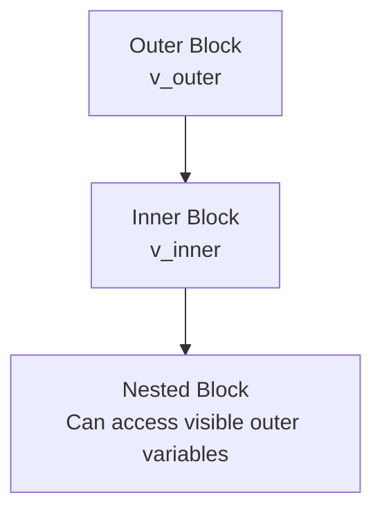

---

# 17. Scope Example

```sql
DECLARE
    v_outer NUMBER := 10;
BEGIN

    DECLARE
        v_inner NUMBER := 20;
    BEGIN
        DBMS_OUTPUT.PUT_LINE(v_outer);
        DBMS_OUTPUT.PUT_LINE(v_inner);
    END;

    DBMS_OUTPUT.PUT_LINE(v_outer);

    -- v_inner is not visible here
END;
/
```

Here:

```text
v_outer
→ visible throughout its block and nested block

v_inner
→ visible only inside the inner block
```

---

# 18. Variable Lifetime

**Lifetime** refers to how long a variable exists during execution.

A local variable generally exists while its declaring block is executing.

When the block finishes, its local variables cease to be available.

### Scope vs Lifetime

- **Scope:** Where can the variable be referenced?
- **Lifetime:** How long does the variable exist during execution?

These concepts are related but not identical.

---

# 19. Nested Blocks

A **nested block** is a PL/SQL block written inside another PL/SQL block.

Example:

```sql
DECLARE
    v_outer NUMBER := 100;
BEGIN
    DBMS_OUTPUT.PUT_LINE('Outer block');

    DECLARE
        v_inner NUMBER := 200;
    BEGIN
        DBMS_OUTPUT.PUT_LINE('Inner block');
        DBMS_OUTPUT.PUT_LINE(v_outer);
        DBMS_OUTPUT.PUT_LINE(v_inner);
    END;

END;
/
```

### Structure

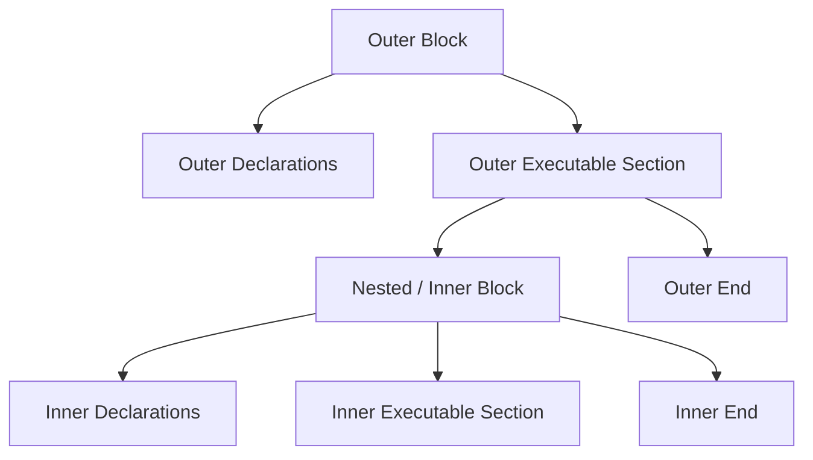

---

# 20. Variable Shadowing

An inner block can declare a variable with the same name as an outer variable.

The inner variable then **shadows** the outer variable within its scope.

Example:

```sql
DECLARE
    v_value NUMBER := 10;
BEGIN
    DBMS_OUTPUT.PUT_LINE('Outer: ' || v_value);

    DECLARE
        v_value NUMBER := 20;
    BEGIN
        DBMS_OUTPUT.PUT_LINE('Inner: ' || v_value);
    END;

    DBMS_OUTPUT.PUT_LINE('Outer again: ' || v_value);
END;
/
```

Output conceptually:

```text
Outer: 10
Inner: 20
Outer again: 10
```

---

# 21. Control Structures

PL/SQL control structures determine the order in which statements execute.

They are commonly divided into:

1. Conditional control.
2. Iterative control.
3. Sequential control.

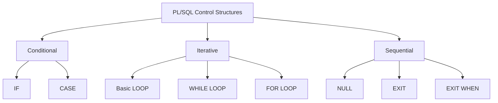

---

# 22. IF Statement

The `IF` statement executes statements when a condition is true.

Syntax:

```sql
IF condition THEN
    statements;
END IF;
```

Example:

```sql
DECLARE
    v_marks NUMBER := 75;
BEGIN
    IF v_marks >= 40 THEN
        DBMS_OUTPUT.PUT_LINE('Pass');
    END IF;
END;
/
```

---

# 23. IF-THEN-ELSE

Syntax:

```sql
IF condition THEN
    statements;
ELSE
    statements;
END IF;
```

Example:

```sql
DECLARE
    v_marks NUMBER := 35;
BEGIN
    IF v_marks >= 40 THEN
        DBMS_OUTPUT.PUT_LINE('Pass');
    ELSE
        DBMS_OUTPUT.PUT_LINE('Fail');
    END IF;
END;
/
```

---

# 24. IF-THEN-ELSIF

Used when there are multiple conditions.

```sql
IF condition1 THEN
    statements;
ELSIF condition2 THEN
    statements;
ELSE
    statements;
END IF;
```

Example:

```sql
DECLARE
    v_marks NUMBER := 82;
BEGIN
    IF v_marks >= 90 THEN
        DBMS_OUTPUT.PUT_LINE('A+');
    ELSIF v_marks >= 75 THEN
        DBMS_OUTPUT.PUT_LINE('A');
    ELSIF v_marks >= 60 THEN
        DBMS_OUTPUT.PUT_LINE('B');
    ELSE
        DBMS_OUTPUT.PUT_LINE('C');
    END IF;
END;
/
```

---

# 25. CASE Statement

`CASE` is useful when selecting among several alternatives.

Example:

```sql
DECLARE
    v_grade CHAR(1) := 'A';
BEGIN
    CASE v_grade
        WHEN 'A' THEN
            DBMS_OUTPUT.PUT_LINE('Excellent');
        WHEN 'B' THEN
            DBMS_OUTPUT.PUT_LINE('Good');
        WHEN 'C' THEN
            DBMS_OUTPUT.PUT_LINE('Average');
        ELSE
            DBMS_OUTPUT.PUT_LINE('Other');
    END CASE;
END;
/
```

There are two broad forms:

- Simple CASE.
- Searched CASE.

### Simple CASE

Compares an expression with several values.

### Searched CASE

Uses independent Boolean conditions.

Example:

```sql
CASE
    WHEN v_marks >= 90 THEN
        DBMS_OUTPUT.PUT_LINE('A+');
    WHEN v_marks >= 75 THEN
        DBMS_OUTPUT.PUT_LINE('A');
    ELSE
        DBMS_OUTPUT.PUT_LINE('Other');
END CASE;
```

---

# 26. Basic LOOP

A basic loop repeats statements until explicitly exited.

Syntax:

```sql
LOOP
    statements;

    EXIT WHEN condition;
END LOOP;
```

Example:

```sql
DECLARE
    v_counter NUMBER := 1;
BEGIN
    LOOP
        DBMS_OUTPUT.PUT_LINE(v_counter);

        v_counter := v_counter + 1;

        EXIT WHEN v_counter > 5;
    END LOOP;
END;
/
```

---

# 27. WHILE LOOP

A `WHILE` loop continues as long as the condition is true.

Syntax:

```sql
WHILE condition LOOP
    statements;
END LOOP;
```

Example:

```sql
DECLARE
    v_counter NUMBER := 1;
BEGIN
    WHILE v_counter <= 5 LOOP
        DBMS_OUTPUT.PUT_LINE(v_counter);
        v_counter := v_counter + 1;
    END LOOP;
END;
/
```

### Key point

The condition is checked **before** each iteration.

Therefore, a `WHILE` loop can execute zero times if the initial condition is false.

---

# 28. FOR LOOP

A numeric `FOR` loop automatically handles the loop counter.

Syntax:

```sql
FOR counter IN lower_bound..upper_bound LOOP
    statements;
END LOOP;
```

Example:

```sql
BEGIN
    FOR i IN 1..5 LOOP
        DBMS_OUTPUT.PUT_LINE(i);
    END LOOP;
END;
/
```

Reverse iteration:

```sql
FOR i IN REVERSE 1..5 LOOP
    DBMS_OUTPUT.PUT_LINE(i);
END LOOP;
```

The loop counter is implicitly declared by the `FOR` loop.

---

# 29. Loop Comparison

| Loop | Condition/Control | Typical Use |
|---|---|---|
| Basic LOOP | Explicit `EXIT` | When termination is controlled inside loop |
| WHILE LOOP | Condition before each iteration | Repeat while condition is true |
| FOR LOOP | Range/cursor-driven iteration | Known number/range of iterations |

### Memory trick

```text
LOOP
→ Exit manually

WHILE
→ While condition is true

FOR
→ For a range / cursor
```

---

# 30. Sequential Control

Sequential control includes statements that alter normal execution.

## EXIT

Terminates a loop.

```sql
EXIT;
```

## EXIT WHEN

Terminates a loop when a condition becomes true.

```sql
EXIT WHEN v_counter > 10;
```

## NULL

Does nothing.

It can be useful when a branch intentionally requires no action.

```sql
IF v_value IS NULL THEN
    NULL;
END IF;
```

---

# 31. Records

A **record** is a composite data structure containing multiple related fields that may have different data types.

Example:

```text
Student Record
 ├── ID
 ├── Name
 └── Marks
```

A record is similar to a row containing multiple fields.

---

# 32. User-Defined Records

A record type can be declared using `TYPE ... IS RECORD`.

Example:

```sql
DECLARE
    TYPE student_record IS RECORD (
        student_id NUMBER,
        student_name VARCHAR2(50),
        marks NUMBER
    );

    v_student student_record;
BEGIN
    v_student.student_id := 101;
    v_student.student_name := 'Ravi';
    v_student.marks := 85;

    DBMS_OUTPUT.PUT_LINE(v_student.student_name);
END;
/
```

---

# 33. Accessing Record Fields

Use:

```text
record_name.field_name
```

Example:

```sql
v_student.student_id
v_student.student_name
v_student.marks
```

---

# 34. `%ROWTYPE` Records

A table row can be represented using `%ROWTYPE`.

Example:

```sql
DECLARE
    v_emp employee%ROWTYPE;
BEGIN
    SELECT *
    INTO v_emp
    FROM employee
    WHERE employee_id = 101;

    DBMS_OUTPUT.PUT_LINE(v_emp.employee_id);
    DBMS_OUTPUT.PUT_LINE(v_emp.name);
END;
/
```

### User-defined record vs `%ROWTYPE`

| User-defined Record | `%ROWTYPE` |
|---|---|
| Programmer chooses fields | Fields correspond to a row |
| Can combine arbitrary fields | Based on table/cursor row structure |
| Declared using `TYPE ... IS RECORD` | Declared using `%ROWTYPE` |

---

# 35. Collections

A **collection** is a PL/SQL data structure that stores multiple elements of the same collection type.

Major PL/SQL collection types are:

1. Associative arrays.
2. Nested tables.
3. VARRAYs.

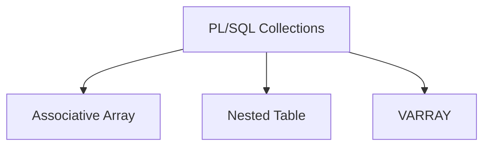

---

# 36. Associative Arrays

An **associative array** is a collection indexed by a key.

It is often useful for temporary in-memory data.

Example:

```sql
DECLARE
    TYPE name_list IS TABLE OF VARCHAR2(50)
        INDEX BY PLS_INTEGER;

    v_names name_list;
BEGIN
    v_names(1) := 'Amit';
    v_names(2) := 'Ravi';
    v_names(3) := 'Neha';

    DBMS_OUTPUT.PUT_LINE(v_names(2));
END;
/
```

Conceptually:

```text
Index → Value

1 → Amit
2 → Ravi
3 → Neha
```

---

# 37. Nested Tables

A **nested table** is an unbounded collection type that can be stored in the database and manipulated in PL/SQL.

Example:

```sql
DECLARE
    TYPE number_list IS TABLE OF NUMBER;

    v_numbers number_list := number_list(10, 20, 30);
BEGIN
    DBMS_OUTPUT.PUT_LINE(v_numbers(1));
END;
/
```

Nested tables do not have a fixed maximum size like VARRAYs.

---

# 38. VARRAY

A **VARRAY** (variable-size array) has a declared maximum size.

Example:

```sql
DECLARE
    TYPE number_array IS VARRAY(5) OF NUMBER;

    v_numbers number_array := number_array(10, 20, 30);
BEGIN
    DBMS_OUTPUT.PUT_LINE(v_numbers(1));
END;
/
```

Here the maximum number of elements is `5`.

---

# 39. Collection Comparison

| Feature | Associative Array | Nested Table | VARRAY |
|---|---|---|---|
| Index | Key/index | Integer index | Integer index |
| Maximum size | Not fixed in the same way as VARRAY | Unbounded | Fixed maximum |
| Can be stored in DB | Primarily PL/SQL in-memory structure | Yes, when defined appropriately | Yes, when defined appropriately |
| Order significance | Based on indexes/keys | Not inherently a fixed ordering when stored | Element order is maintained |
| Typical use | Temporary lookup structures | Flexible collections | Small bounded lists |

**Exam memory:**

> **Associative array = key/value style**  
> **Nested table = unbounded collection**  
> **VARRAY = bounded collection**

---

# 40. Collection Methods

PL/SQL provides methods for working with collections.

Important methods include:

- `COUNT`
- `FIRST`
- `LAST`
- `EXISTS`
- `NEXT`
- `PRIOR`
- `EXTEND`
- `TRIM`
- `DELETE`

Example:

```sql
v_numbers.COUNT
v_numbers.FIRST
v_numbers.LAST
v_numbers.EXISTS(2)
```

Some methods apply differently depending on collection type.

---

# 41. Using SQL with PL/SQL

One of the main strengths of PL/SQL is that SQL statements can be embedded inside procedural code.

PL/SQL commonly uses:

- `SELECT INTO`
- `INSERT`
- `UPDATE`
- `DELETE`
- `MERGE`
- Cursor operations

---

# 42. SELECT INTO

A `SELECT INTO` statement retrieves database data into PL/SQL variables.

Example:

```sql
DECLARE
    v_name employee.name%TYPE;
    v_salary employee.salary%TYPE;
BEGIN
    SELECT name, salary
    INTO v_name, v_salary
    FROM employee
    WHERE employee_id = 101;

    DBMS_OUTPUT.PUT_LINE(v_name);
    DBMS_OUTPUT.PUT_LINE(v_salary);
END;
/
```

### Important rule

A simple `SELECT INTO` should normally return exactly one row.

If no row is returned:

```text
NO_DATA_FOUND
```

If multiple rows are returned:

```text
TOO_MANY_ROWS
```

may occur.

For multiple rows, cursors or other multi-row techniques are used.

---

# 43. INSERT, UPDATE, DELETE in PL/SQL

DML statements can be directly used in the executable section.

Example:

```sql
BEGIN
    UPDATE employee
    SET salary = salary * 1.10
    WHERE department_id = 10;

    DELETE FROM employee
    WHERE employee_id = 999;

    INSERT INTO employee(employee_id, name, salary)
    VALUES (101, 'Ravi', 50000);
END;
/
```

Transaction control such as `COMMIT` and `ROLLBACK` can also be used where appropriate.

---

# 45. What is a Cursor?

A **cursor** is a mechanism used by PL/SQL to process the result of a SQL statement, particularly when rows need to be processed individually.

Conceptually:

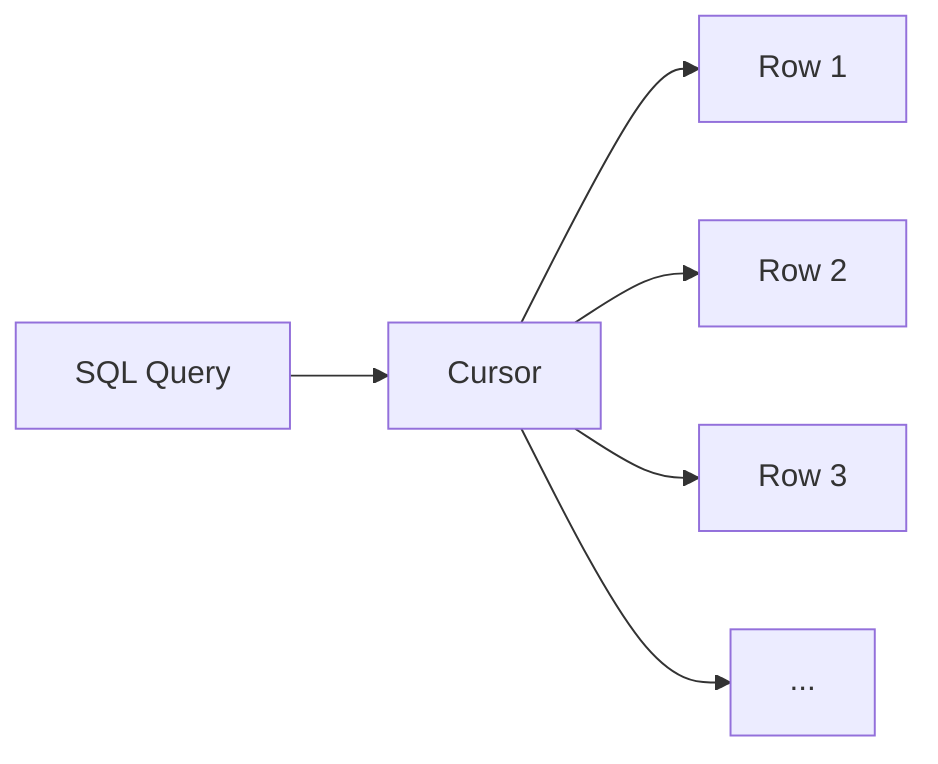

A cursor provides a way to access rows from a query result set.

---

# 46. Types of Cursors

The two major types are:

1. **Implicit cursors**
2. **Explicit cursors**

Explicit cursors can further include:

- Parameterized cursors.
- REF CURSORs.

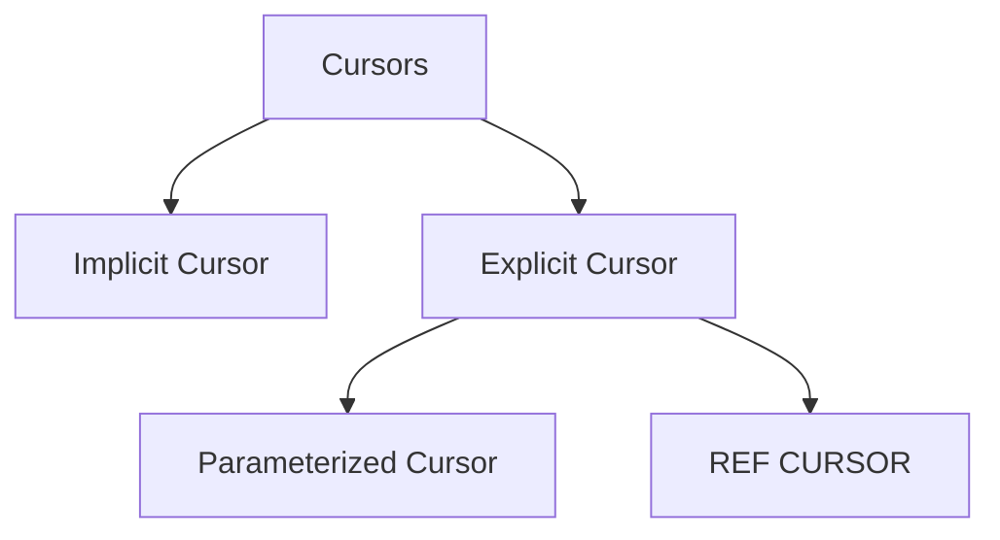

---

# 47. Implicit Cursor

Created automatically by Oracle for certain SQL statements.

Example:

```sql
BEGIN
    UPDATE employee
    SET salary = salary + 1000
    WHERE department_id = 10;

    DBMS_OUTPUT.PUT_LINE(SQL%ROWCOUNT);
END;
/
```

No cursor declaration is required.

### Common attributes

```text
SQL%FOUND
SQL%NOTFOUND
SQL%ROWCOUNT
SQL%ISOPEN
```

---

# 48. Explicit Cursor

An explicit cursor is declared by the programmer when more control is needed over a query returning multiple rows.

General lifecycle:

```text
DECLARE → OPEN → FETCH → CLOSE
```

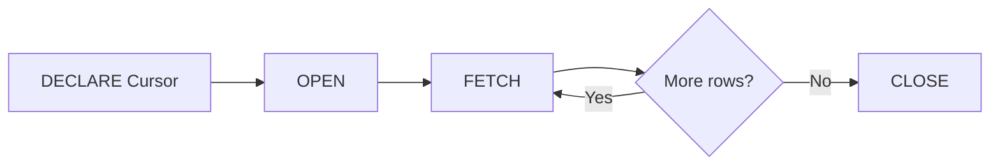

---

# 49. Explicit Cursor Example

```sql
DECLARE
    CURSOR c_emp IS
        SELECT employee_id, name, salary
        FROM employee
        WHERE department_id = 10;

    v_id employee.employee_id%TYPE;
    v_name employee.name%TYPE;
    v_salary employee.salary%TYPE;
BEGIN
    OPEN c_emp;

    LOOP
        FETCH c_emp INTO v_id, v_name, v_salary;

        EXIT WHEN c_emp%NOTFOUND;

        DBMS_OUTPUT.PUT_LINE(
            v_id || ' ' || v_name || ' ' || v_salary
        );
    END LOOP;

    CLOSE c_emp;
END;
/
```

---

# 50. Explicit Cursor Attributes

Important attributes:

### `%FOUND`

Returns TRUE if the most recent fetch returned a row.

### `%NOTFOUND`

Returns TRUE if the most recent fetch did not return a row.

### `%ROWCOUNT`

Number of rows fetched so far.

### `%ISOPEN`

TRUE if the cursor is currently open.

Example:

```sql
c_emp%ROWCOUNT
c_emp%FOUND
c_emp%NOTFOUND
c_emp%ISOPEN
```

---

# 51. Cursor FOR Loop

A cursor `FOR` loop simplifies explicit cursor processing.

Example:

```sql
DECLARE
    CURSOR c_emp IS
        SELECT employee_id, name, salary
        FROM employee;
BEGIN
    FOR r IN c_emp LOOP
        DBMS_OUTPUT.PUT_LINE(
            r.employee_id || ' ' || r.name
        );
    END LOOP;
END;
/
```

The cursor `FOR` loop automatically handles:

- Opening the cursor.
- Fetching rows.
- Detecting the end of the result set.
- Closing the cursor.

Therefore, explicit `OPEN`, `FETCH`, and `CLOSE` statements are not required in this form.

---

# 52. Parameterized Cursor

A parameterized cursor accepts parameters when opened.

Example:

```sql
DECLARE
    CURSOR c_emp(p_dept_id NUMBER) IS
        SELECT employee_id, name
        FROM employee
        WHERE department_id = p_dept_id;
BEGIN
    FOR r IN c_emp(10) LOOP
        DBMS_OUTPUT.PUT_LINE(r.name);
    END LOOP;
END;
/
```

The same cursor definition can be used with different parameter values.

---

# 53. REF CURSOR

A **REF CURSOR** is a cursor variable that can refer to different query result sets during execution.

It is useful when:

- A query is determined dynamically.
- A procedure/function needs to return a result set.
- Multiple queries may be associated with the same cursor variable.

Conceptually:

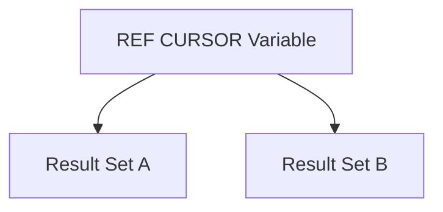

Unlike a static explicit cursor declaration, a cursor variable can be associated with a query at runtime.

---

# 54. Cursor Types Summary

| Cursor | Created by | Typical Use |
|---|---|---|
| Implicit | Oracle | Simple SQL statements and `SELECT INTO` |
| Explicit | Programmer | Controlled row-by-row processing |
| Parameterized explicit cursor | Programmer | Reuse cursor with different parameters |
| REF CURSOR | Programmer | Dynamic/result-set passing |

---

# 55. Subprograms

A **subprogram** is a named PL/SQL program unit that performs a particular task.

The two main types are:

1. **Procedure**
2. **Function**

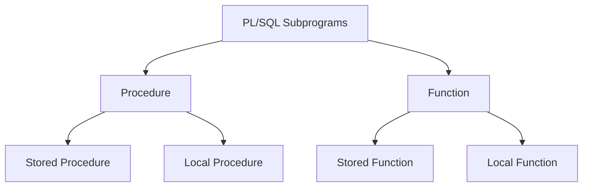

Subprograms help with:

- Modularity.
- Code reuse.
- Maintainability.
- Encapsulation.
- Testing.
- Separation of responsibilities.

---

# 56. Procedure

A **procedure** is a named PL/SQL subprogram that performs an action.

A procedure does not have to return a value through a `RETURN` expression as a function does.

Example:

```sql
CREATE OR REPLACE PROCEDURE greet_user
IS
BEGIN
    DBMS_OUTPUT.PUT_LINE('Hello');
END;
/
```

Calling it:

```sql
BEGIN
    greet_user;
END;
/
```

---

# 57. Procedure Parameters

Procedures can have parameters.

The major parameter modes are:

- `IN`
- `OUT`
- `IN OUT`

## IN

Used to pass a value into the procedure.

```sql
CREATE OR REPLACE PROCEDURE show_salary(
    p_emp_id IN NUMBER
)
IS
    v_salary NUMBER;
BEGIN
    SELECT salary
    INTO v_salary
    FROM employee
    WHERE employee_id = p_emp_id;

    DBMS_OUTPUT.PUT_LINE(v_salary);
END;
/
```

## OUT

Used to return a value through a parameter.

```sql
CREATE OR REPLACE PROCEDURE get_salary(
    p_emp_id IN NUMBER,
    p_salary OUT NUMBER
)
IS
BEGIN
    SELECT salary
    INTO p_salary
    FROM employee
    WHERE employee_id = p_emp_id;
END;
/
```

## IN OUT

The parameter can be passed into the procedure and modified so the changed value can be returned.

---

# 58. Stored Procedure

A **stored procedure** is a procedure stored in the database as a database object.

Example:

```sql
CREATE OR REPLACE PROCEDURE increase_salary(
    p_emp_id IN NUMBER,
    p_amount IN NUMBER
)
IS
BEGIN
    UPDATE employee
    SET salary = salary + p_amount
    WHERE employee_id = p_emp_id;
END;
/
```

It can be called from a PL/SQL block:

```sql
BEGIN
    increase_salary(101, 5000);
END;
/
```

### Advantages

- Reusable.
- Stored in database.
- Can be shared by multiple applications.
- Can centralize business logic.
- Can reduce repeated code.
- Can help enforce controlled access to data.

---

# 59. Local Procedure

A **local procedure** is declared inside another PL/SQL block, procedure, or function.

It is available only within the enclosing program unit's scope.

Example:

```sql
DECLARE

    PROCEDURE print_message(p_msg VARCHAR2)
    IS
    BEGIN
        DBMS_OUTPUT.PUT_LINE(p_msg);
    END;

BEGIN
    print_message('Hello from local procedure');
END;
/
```

### Key difference

```text
Stored Procedure
→ Database object
→ Can be called from appropriate external program units

Local Procedure
→ Defined inside another PL/SQL unit
→ Scope is local to that enclosing unit
```

---

# 60. Function

A **function** is a named PL/SQL subprogram designed to return a value.

General syntax:

```sql
CREATE OR REPLACE FUNCTION function_name(
    parameters
)
RETURN data_type
IS
BEGIN
    statements;
    RETURN value;
END;
/
```

Example:

```sql
CREATE OR REPLACE FUNCTION square_number(
    p_num IN NUMBER
)
RETURN NUMBER
IS
BEGIN
    RETURN p_num * p_num;
END;
/
```

Calling:

```sql
DECLARE
    v_result NUMBER;
BEGIN
    v_result := square_number(5);
    DBMS_OUTPUT.PUT_LINE(v_result);
END;
/
```

Result:

```text
25
```

---

# 61. Stored Function

A **stored function** is a function stored in the database as a database object.

Example:

```sql
CREATE OR REPLACE FUNCTION get_bonus(
    p_salary IN NUMBER
)
RETURN NUMBER
IS
BEGIN
    RETURN p_salary * 0.10;
END;
/
```

Usage:

```sql
DECLARE
    v_bonus NUMBER;
BEGIN
    v_bonus := get_bonus(50000);

    DBMS_OUTPUT.PUT_LINE(v_bonus);
END;
/
```

---

# 62. Local Function

A **local function** is declared inside another PL/SQL block, procedure, or function.

Example:

```sql
DECLARE

    FUNCTION square_number(p_num NUMBER)
    RETURN NUMBER
    IS
    BEGIN
        RETURN p_num * p_num;
    END;

    v_result NUMBER;

BEGIN
    v_result := square_number(7);

    DBMS_OUTPUT.PUT_LINE(v_result);
END;
/
```

The function is available only within its enclosing scope.

---

# 63. Stored vs Local Subprograms

| Stored Subprogram | Local Subprogram |
|---|---|
| Stored as a database object | Defined inside another PL/SQL unit |
| Can be reused by multiple callers | Scope is limited to enclosing unit |
| Created using `CREATE PROCEDURE/FUNCTION` | Declared inside a block/procedure/function |
| Suitable for reusable database-level logic | Suitable for helper logic used by one program unit |

---

# 64. Procedure vs Function

This is a very important exam question.

| Procedure | Function |
|---|---|
| Primarily performs an action | Primarily computes/returns a value |
| Does not require a return type in its declaration | Must specify a `RETURN` data type |
| Does not need a `RETURN value` statement | Must return a value on normal completion |
| Can use `OUT`/`IN OUT` parameters to communicate results | Returns a value using `RETURN` |
| Called as a statement | Can often be used in expressions, subject to Oracle's rules |
| Example: update salary | Example: calculate bonus |

### Procedure

```sql
CREATE OR REPLACE PROCEDURE increase_salary(
    p_emp_id NUMBER,
    p_amount NUMBER
)
IS
BEGIN
    UPDATE employee
    SET salary = salary + p_amount
    WHERE employee_id = p_emp_id;
END;
/
```

### Function

```sql
CREATE OR REPLACE FUNCTION calculate_bonus(
    p_salary NUMBER
)
RETURN NUMBER
IS
BEGIN
    RETURN p_salary * 0.10;
END;
/
```

---

# 65. Procedure vs Function — Exam Memory Trick

Remember:

> **Procedure = Perform an operation**

> **Function = Find/compute and return a value**

For example:

```text
Procedure:
increase_salary()

Function:
calculate_bonus()
```

---

# 66. Function Invocation

A function can generally be called as part of an expression.

Example:

```sql
v_total := calculate_bonus(v_salary) + v_salary;
```

A stored function may also be callable from SQL statements when it satisfies the applicable Oracle restrictions.

Example conceptually:

```sql
SELECT calculate_bonus(salary)
FROM employee;
```

Whether a particular PL/SQL function can be invoked from SQL depends on its implementation and Oracle's SQL-call rules.

---

# 67. Procedure and Function Parameter Modes

| Mode | Meaning |
|---|---|
| `IN` | Pass value into subprogram |
| `OUT` | Return value through parameter |
| `IN OUT` | Pass value in and return modified value |

Example:

```sql
CREATE OR REPLACE PROCEDURE process_value(
    p_in IN NUMBER,
    p_out OUT NUMBER,
    p_inout IN OUT NUMBER
)
IS
BEGIN
    p_out := p_in * 2;
    p_inout := p_inout + 10;
END;
/
```

---

# 68. Subprogram Structure

A stored procedure/function generally has:

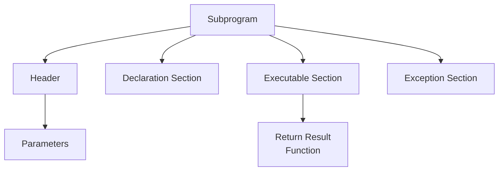

For a procedure:

```text
Header
Parameters
IS/AS
Declarations
BEGIN
Executable Statements
EXCEPTION
Exception Handlers
END;
```

For a function:

```text
Header
Parameters
RETURN data_type
IS/AS
Declarations
BEGIN
Executable Statements
RETURN value
EXCEPTION
Exception Handlers
END;
```

---

# 69. Important PL/SQL Naming Concepts

A naming convention improves readability.

Example:

```text
v_ → local variable
p_ → parameter
c_ → constant
r_ → record
c_ → cursor
```

For example:

```sql
v_salary
p_emp_id
c_tax
r_employee
```

These are conventions, not requirements.

---

# 70. Common PL/SQL Exam Errors

## Error 1: Forgetting `BEGIN`

Incorrect:

```sql
DECLARE
    v_num NUMBER := 10;
    DBMS_OUTPUT.PUT_LINE(v_num);
END;
```

Correct:

```sql
DECLARE
    v_num NUMBER := 10;
BEGIN
    DBMS_OUTPUT.PUT_LINE(v_num);
END;
/
```

## Error 2: Using `=` for assignment

PL/SQL assignment uses:

```text
:=
```

Example:

```sql
v_num := 10;
```

`=` is normally used for comparison.

## Error 3: Forgetting `RETURN` in a function

A function must return its declared return type through a `RETURN` statement on normal execution.

## Error 4: Using `SELECT` without `INTO`

Inside a PL/SQL block, a single-row `SELECT` generally needs an `INTO` clause.

Example:

```sql
SELECT salary
INTO v_salary
FROM employee
WHERE employee_id = 101;
```

For multi-row processing, use an appropriate cursor or cursor `FOR` loop.

---

# 71. Complete Example Combining Several Topics

The following example demonstrates:

- Variables.
- `%TYPE`.
- Explicit cursor.
- Loop.
- Record-like cursor row.
- Conditional control.

```sql
DECLARE
    CURSOR c_emp IS
        SELECT employee_id, name, salary
        FROM employee
        WHERE department_id = 10;

BEGIN
    FOR r IN c_emp LOOP

        IF r.salary >= 50000 THEN
            DBMS_OUTPUT.PUT_LINE(
                r.name || ' - High salary'
            );
        ELSE
            DBMS_OUTPUT.PUT_LINE(
                r.name || ' - Standard salary'
            );
        END IF;

    END LOOP;
END;
/
```

Here the cursor `FOR` loop automatically:

```text
OPEN → FETCH → PROCESS → FETCH → ... → CLOSE
```

---

# 72. Topic Relationship Map

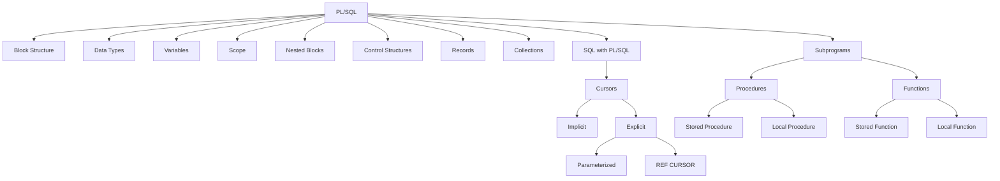

---

# 73. High-Value Exam Differences

## `%TYPE` vs `%ROWTYPE`

```text
%TYPE
→ Data type of one column/variable

%ROWTYPE
→ Record corresponding to a complete row
```

---

## Record vs Collection

| Record | Collection |
|---|---|
| Contains fields that can have different data types | Contains multiple elements of a collection type |
| Represents one logical composite value | Represents multiple values |
| Example: one employee's ID, name, salary | Example: list of employee IDs |

---

## Implicit vs Explicit Cursor

| Implicit | Explicit |
|---|---|
| Created automatically | Declared by programmer |
| Less control | More control |
| Used for common SQL operations | Useful for multi-row processing |
| No explicit OPEN/FETCH/CLOSE | Can explicitly OPEN/FETCH/CLOSE |

---

## Stored vs Local Procedure

| Stored | Local |
|---|---|
| Database object | Part of another PL/SQL unit |
| Reusable across callers | Limited scope |
| Created with `CREATE OR REPLACE PROCEDURE` | Declared inside enclosing unit |

---

## Stored vs Local Function

| Stored | Local |
|---|---|
| Database object | Local helper subprogram |
| Reusable | Limited to enclosing scope |
| Created with `CREATE OR REPLACE FUNCTION` | Declared inside block/procedure/function |

---

# 74. PL/SQL Control Structure Quick Table

| Construct | Purpose |
|---|---|
| `IF` | Conditional execution |
| `ELSIF` | Additional conditions |
| `ELSE` | Alternative branch |
| `CASE` | Multiple alternatives |
| `LOOP` | Repetition |
| `WHILE` | Repeat while condition is true |
| `FOR` | Repeat over range/cursor |
| `EXIT` | Leave loop |
| `EXIT WHEN` | Leave loop when condition is true |
| `NULL` | Perform no action |

---

# 75. Cursor Lifecycle — Most Important Sequence

For an explicit cursor:

```text
DECLARE
   ↓
OPEN
   ↓
FETCH
   ↓
Process row
   ↓
FETCH
   ↓
...
   ↓
CLOSE
```

**Remember:**

> **D-O-F-C = Declare → Open → Fetch → Close**

---

# 76. PL/SQL Block — Most Important Sequence

```text
DECLARE
   ↓
BEGIN
   ↓
EXCEPTION
   ↓
END
```

Remember:

> **Declare → Execute → Handle → End**

The `DECLARE` and `EXCEPTION` sections are optional, but `BEGIN` and `END` form the executable block.

---

# 77. Collections — Most Important Sequence

```text
Associative Array
→ Key/index-based collection

Nested Table
→ Unbounded collection

VARRAY
→ Bounded collection with maximum size
```

Remember:

> **A-N-V: Associative, Nested, VARRAY**

---

# 78. Subprograms — Most Important Sequence

```text
Subprogram
├── Procedure
│   ├── Stored
│   └── Local
│
└── Function
    ├── Stored
    └── Local
```

Remember:

> **Procedure performs; Function returns.**

---

# 79. Last-Minute Revision Sheet

### PL/SQL Block

```text
DECLARE    → declarations
BEGIN      → executable statements
EXCEPTION  → error handling
END        → termination
```

### Variables

```text
v_name VARCHAR2(50);
v_salary NUMBER;
v_salary employee.salary%TYPE;
v_emp employee%ROWTYPE;
```

### Scope

```text
Outer variable
    ↓
Visible in nested block

Inner variable
    ↓
Not visible outside inner block
```

### Conditions

```text
IF
ELSIF
ELSE
CASE
```

### Loops

```text
LOOP
WHILE
FOR
```

### Records

```text
One composite object
→ multiple named fields
```

### Collections

```text
Associative Array
Nested Table
VARRAY
```

### Cursors

```text
Implicit → automatic
Explicit → programmer-controlled
Parameterized → explicit cursor with parameters
REF CURSOR → cursor variable/result-set reference
```

### Procedures

```text
Perform operation
IN / OUT / IN OUT parameters
```

### Functions

```text
Return a value
RETURN data_type
RETURN expression
```

---

# 80. Important Questions for the Exam

You should be able to answer these without notes:

1. What is PL/SQL?
2. Explain the structure of a PL/SQL block.
3. What are the `DECLARE`, `BEGIN`, and `EXCEPTION` sections?
4. What are scalar and composite data types?
5. Explain `%TYPE` and `%ROWTYPE`.
6. How are variables and constants declared?
7. Explain scope and lifetime of variables.
8. What are nested blocks?
9. Explain variable shadowing.
10. Explain IF, IF-ELSE, and ELSIF.
11. Explain the CASE statement.
12. Explain `LOOP`, `WHILE`, and `FOR` loops.
13. What is a record?
14. How is a user-defined record created?
15. What is `%ROWTYPE`?
16. What is a collection?
17. Explain associative arrays, nested tables, and VARRAYs.
18. What is an implicit cursor?
19. What is an explicit cursor?
20. Explain the lifecycle of an explicit cursor.
21. Explain cursor attributes.
22. What is a parameterized cursor?
23. What is a REF CURSOR?
24. What is a subprogram?
25. Explain stored and local procedures.
26. Explain stored and local functions.
27. Differentiate procedure and function.
28. Explain `IN`, `OUT`, and `IN OUT` parameters.
29. How is SQL used inside PL/SQL?
30. Explain `SELECT INTO` and the errors `NO_DATA_FOUND` and `TOO_MANY_ROWS`.

---

# 81. Ultra-Short Exam Memory Map

```text
PL/SQL
│
├── Block
│   ├── DECLARE
│   ├── BEGIN
│   ├── EXCEPTION
│   └── END
│
├── Data
│   ├── Scalar
│   ├── Composite
│   │   ├── Record
│   │   └── Collection
│   └── Reference
│       ├── %TYPE
│       └── %ROWTYPE
│
├── Control
│   ├── IF
│   ├── CASE
│   ├── LOOP
│   ├── WHILE
│   └── FOR
│
├── SQL
│   ├── SELECT INTO
│   ├── INSERT
│   ├── UPDATE
│   └── DELETE
│
├── Cursors
│   ├── Implicit
│   ├── Explicit
│   ├── Parameterized
│   └── REF CURSOR
│
└── Subprograms
    ├── Procedure
    │   ├── Stored
    │   └── Local
    └── Function
        ├── Stored
        └── Local
```

## Core facts to memorize

> **PL/SQL block = DECLARE → BEGIN → EXCEPTION → END**

> **%TYPE = one column's type**

> **%ROWTYPE = one complete row**

> **Record = multiple named fields**

> **Collection = multiple elements**

> **Horizontal-style thinking does not apply here; cursor thinking = process query rows**

> **Explicit cursor = Declare → Open → Fetch → Close**

> **Procedure = performs an operation**

> **Function = returns a value**

> **Stored = database object**

> **Local = inside another PL/SQL unit**

> **IN = input, OUT = output, IN OUT = both**
