# PL/SQL — Packages, Triggers, and Database Objects
## Detailed DBMS Exam Notes

### Topics Covered

1. Packages
   - Package specification
   - Package body
   - Public and private elements
   - Package execution and initialization
   - Advantages of packages
2. Triggers
   - Definition and purpose
   - Trigger components
   - Types of triggers
   - DML triggers
   - Statement-level vs row-level triggers
   - BEFORE vs AFTER triggers
   - INSTEAD OF triggers
   - DDL triggers
   - Database/system triggers
   - Compound triggers
   - Enabling/disabling triggers
   - Trigger restrictions and best practices
3. Introduction to Objects
   - Object-relational concepts
   - Object types
   - Attributes and methods
   - Creating object types
   - Storing objects
   - Object tables
   - Object views/references
   - Manipulating objects
   - Object inheritance
   - Advantages and limitations

---

# 1. Packages in PL/SQL

## 1.1 What is a Package?

A **package** is a schema object that groups related PL/SQL program elements into a single unit.

A package can contain:

- Procedures
- Functions
- Variables
- Constants
- Cursors
- Exceptions
- Types

A package is divided into two main parts:

1. **Package specification**
2. **Package body**

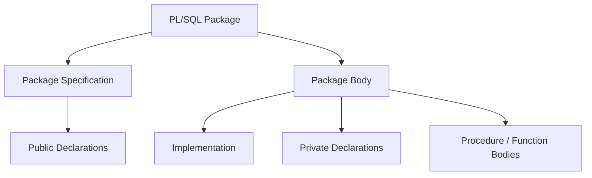

### Simple idea

Think of a package as a **container** for related PL/SQL code.

For example, a university database might have a package:

```text
STUDENT_PKG
├── add_student()
├── update_student()
├── get_student()
├── calculate_grade()
└── student-related constants/types
```

---

# 2. Package Specification

The **package specification** is the public interface of a package.

It declares the elements that can be accessed from outside the package.

It may contain declarations of:

- Public procedures
- Public functions
- Public variables
- Public constants
- Public cursors
- Public exceptions
- Public types

Example:

```sql
CREATE OR REPLACE PACKAGE student_pkg AS

    PROCEDURE add_student(
        p_id   IN NUMBER,
        p_name IN VARCHAR2
    );

    FUNCTION get_student_count
    RETURN NUMBER;

END student_pkg;
/
```

The specification tells users:

> "These are the operations and public items this package provides."

It does **not** normally contain the implementation of the procedures/functions.

---

# 3. Package Body

The **package body** contains the implementation of the package.

Example:

```sql
CREATE OR REPLACE PACKAGE BODY student_pkg AS

    PROCEDURE add_student(
        p_id   IN NUMBER,
        p_name IN VARCHAR2
    )
    IS
    BEGIN
        INSERT INTO student(student_id, name)
        VALUES (p_id, p_name);
    END add_student;


    FUNCTION get_student_count
    RETURN NUMBER
    IS
        v_count NUMBER;
    BEGIN
        SELECT COUNT(*)
        INTO v_count
        FROM student;

        RETURN v_count;
    END get_student_count;

END student_pkg;
/
```

The body implements the declarations exposed in the specification.

---

# 4. Package Specification vs Package Body

| Package Specification | Package Body |
|---|---|
| Public interface | Implementation |
| Declares public elements | Defines their implementation |
| Visible to users/callers | Usually hidden from users |
| Required for a package | Required when implementation is needed |
| Defines what can be called externally | Defines how it works |
| Public items are declared here | Private items can also be declared here |

### Memory trick

> **Specification = WHAT is available**

> **Body = HOW it works**

---

# 5. Public and Private Elements

A package can provide **encapsulation** by separating public elements from private implementation details.

## Public Elements

Declared in the package specification.

They can be accessed from outside the package.

Example:

```sql
CREATE OR REPLACE PACKAGE math_pkg AS
    FUNCTION square(p_num NUMBER) RETURN NUMBER;
END math_pkg;
/
```

`SQUARE` is public.

## Private Elements

Declared only in the package body.

They cannot normally be called directly by outside users.

Example:

```sql
CREATE OR REPLACE PACKAGE BODY math_pkg AS

    FUNCTION internal_check(p_num NUMBER)
    RETURN BOOLEAN
    IS
    BEGIN
        RETURN p_num >= 0;
    END;

    FUNCTION square(p_num NUMBER)
    RETURN NUMBER
    IS
    BEGIN
        RETURN p_num * p_num;
    END;

END math_pkg;
/
```

`INTERNAL_CHECK` is private because it is not declared in the specification.

---

# 6. Package Execution and Initialization

A package body can contain an initialization section that executes when the package is initialized in a session.

General structure:

```sql
CREATE OR REPLACE PACKAGE BODY example_pkg AS

    -- procedures/functions

BEGIN
    -- package initialization statements
END example_pkg;
/
```

Conceptually:

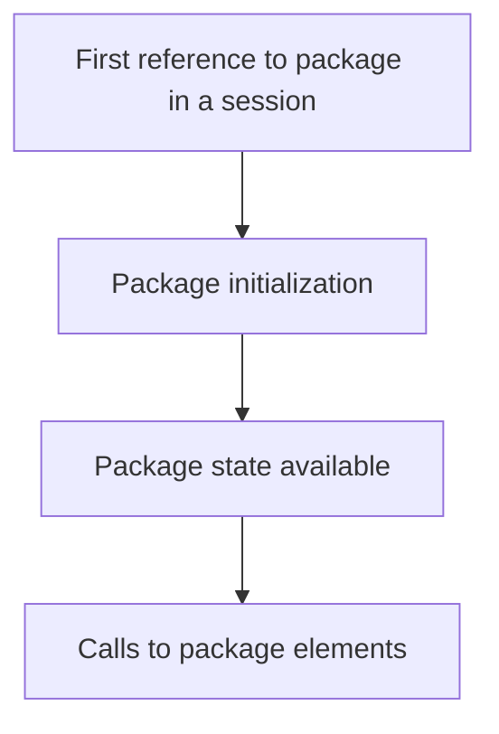

Package variables can maintain state for the duration of a session, subject to Oracle's package-state behavior.

---

# 7. Package Example

Consider a banking package.

### Specification

```sql
CREATE OR REPLACE PACKAGE bank_pkg AS

    PROCEDURE deposit(
        p_account_id IN NUMBER,
        p_amount     IN NUMBER
    );

    PROCEDURE withdraw(
        p_account_id IN NUMBER,
        p_amount     IN NUMBER
    );

    FUNCTION get_balance(
        p_account_id IN NUMBER
    ) RETURN NUMBER;

END bank_pkg;
/
```

### Body

```sql
CREATE OR REPLACE PACKAGE BODY bank_pkg AS

    PROCEDURE deposit(
        p_account_id IN NUMBER,
        p_amount     IN NUMBER
    )
    IS
    BEGIN
        UPDATE account
        SET balance = balance + p_amount
        WHERE account_id = p_account_id;
    END deposit;


    PROCEDURE withdraw(
        p_account_id IN NUMBER,
        p_amount     IN NUMBER
    )
    IS
    BEGIN
        UPDATE account
        SET balance = balance - p_amount
        WHERE account_id = p_account_id;
    END withdraw;


    FUNCTION get_balance(
        p_account_id IN NUMBER
    ) RETURN NUMBER
    IS
        v_balance NUMBER;
    BEGIN
        SELECT balance
        INTO v_balance
        FROM account
        WHERE account_id = p_account_id;

        RETURN v_balance;
    END get_balance;

END bank_pkg;
/
```

Calling:

```sql
BEGIN
    bank_pkg.deposit(101, 5000);
END;
/
```

Calling the function:

```sql
DECLARE
    v_balance NUMBER;
BEGIN
    v_balance := bank_pkg.get_balance(101);
    DBMS_OUTPUT.PUT_LINE(v_balance);
END;
/
```

---

# 8. Advantages of Packages

## 8.1 Modularity

Related functionality is grouped together.

```text
BANK_PKG
├── deposit
├── withdraw
├── transfer
└── get_balance
```

## 8.2 Encapsulation

Implementation details can be hidden in the package body.

## 8.3 Reusability

The same package procedures/functions can be called from many applications or PL/SQL units.

## 8.4 Easier Maintenance

A package provides a logical grouping of related operations.

## 8.5 Performance Benefits

Oracle can load package information into memory and reuse it within a session, reducing repeated parsing/loading overhead in appropriate circumstances.

## 8.6 Persistent Package State

Package variables can retain values for the duration of a session.

## 8.7 Separation of Interface and Implementation

The specification provides the interface while the body contains implementation details.

---

# 9. Package Dependency

A package specification is a public interface.

If another PL/SQL unit depends on the package specification, changing the package **body** without changing the specification can often avoid invalidating dependent program units.

However, changing the specification can affect dependent objects.

This supports the idea of:

> **Stable interface + replaceable implementation**

---

# 10. Trigger

A **trigger** is a stored PL/SQL program unit that is automatically executed when a specified event occurs.

Unlike a procedure, a trigger is normally not called explicitly by the user.

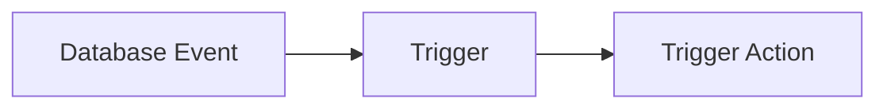

Examples of events:

- `INSERT`
- `UPDATE`
- `DELETE`
- DDL operations such as `CREATE`, `ALTER`, `DROP`
- Certain database/system events

---

# 11. Why Use Triggers?

Triggers can be used for:

1. Auditing.
2. Automatic validation.
3. Enforcing complex business rules.
4. Maintaining derived or related information.
5. Recording changes.
6. Automatically generating or modifying values.
7. Preventing unauthorized operations.
8. Responding to database/system events.

Example:

```text
Employee salary updated
        ↓
Trigger fires
        ↓
Old + new salary recorded in audit table
```

---

# 12. Basic Trigger Structure

A simplified DML trigger has the following form:

```sql
CREATE OR REPLACE TRIGGER trigger_name
BEFORE INSERT OR UPDATE OR DELETE
ON table_name
FOR EACH ROW
BEGIN
    -- trigger logic
END;
/
```

Not every trigger needs `FOR EACH ROW`.

---

# 13. Trigger Components

A trigger definition commonly specifies:

1. **Trigger timing**
   - BEFORE
   - AFTER
   - INSTEAD OF

2. **Triggering event**
   - INSERT
   - UPDATE
   - DELETE
   - DDL/system event

3. **Trigger level**
   - Statement-level
   - Row-level

4. **Object**
   - Table
   - View
   - Schema
   - Database, depending on trigger type

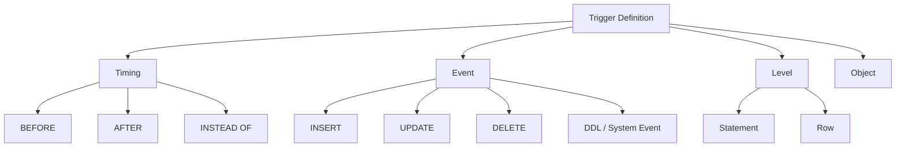

---

# 14. Trigger Types — Main Classification

Triggers can be classified in several dimensions.

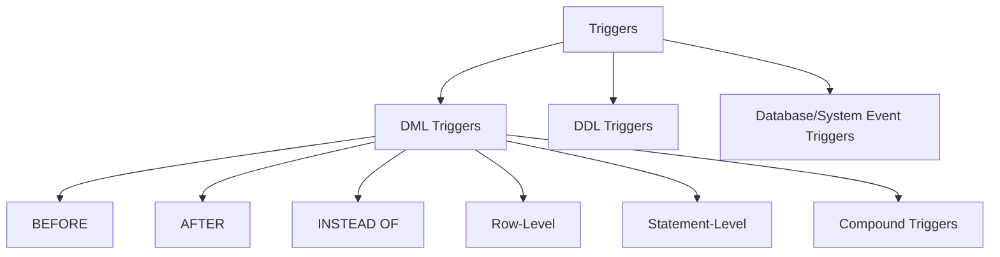

---

# 15. DML Triggers

A **DML trigger** fires in response to:

- `INSERT`
- `UPDATE`
- `DELETE`

Example:

```sql
CREATE OR REPLACE TRIGGER emp_audit_trg
AFTER UPDATE ON employee
FOR EACH ROW
BEGIN
    INSERT INTO employee_audit(
        employee_id,
        old_salary,
        new_salary
    )
    VALUES (
        :OLD.employee_id,
        :OLD.salary,
        :NEW.salary
    );
END;
/
```

Whenever an employee row is updated, the trigger executes.

---

# 16. BEFORE Trigger

A **BEFORE trigger** executes before the triggering operation is completed.

Example:

```sql
CREATE OR REPLACE TRIGGER emp_before_insert
BEFORE INSERT ON employee
FOR EACH ROW
BEGIN
    IF :NEW.salary < 0 THEN
        :NEW.salary := 0;
    END IF;
END;
/
```

Typical uses:

- Validate data.
- Modify `:NEW` values before insertion/update.
- Enforce rules.

### Flow

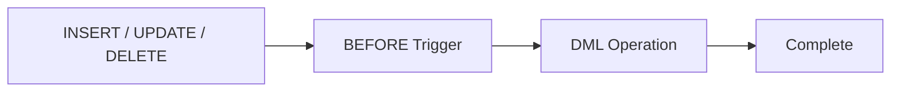

---

# 17. AFTER Trigger

An **AFTER trigger** executes after the triggering DML operation has taken place.

Example use:

```text
Employee updated
       ↓
AFTER trigger
       ↓
Insert audit information
```

Example:

```sql
CREATE OR REPLACE TRIGGER emp_after_update
AFTER UPDATE ON employee
FOR EACH ROW
BEGIN
    INSERT INTO employee_audit(
        employee_id,
        old_salary,
        new_salary
    )
    VALUES (
        :OLD.employee_id,
        :OLD.salary,
        :NEW.salary
    );
END;
/
```

### Flow


---

# 18. BEFORE vs AFTER Trigger

| BEFORE | AFTER |
|---|---|
| Fires before DML operation completes | Fires after DML operation |
| Useful for validation | Useful for auditing |
| Can modify `:NEW` values in applicable row-level cases | Typically observes the result of the operation |
| Useful for preparing data | Useful for recording completed changes |

---

# 19. Statement-Level Trigger

A **statement-level trigger** fires once for the triggering SQL statement, regardless of how many rows the statement affects.

Example:

```sql
UPDATE employee
SET salary = salary * 1.10
WHERE department_id = 10;
```

If 500 employees are updated:

```text
Statement-level trigger
→ fires once
```

It does not execute separately for every affected row.

---

# 20. Row-Level Trigger

A **row-level trigger** uses:

```sql
FOR EACH ROW
```

It fires once for each affected row.

If:

```sql
UPDATE employee
SET salary = salary * 1.10
WHERE department_id = 10;
```

updates 500 rows:

```text
Row-level trigger
→ fires 500 times
```

### Comparison

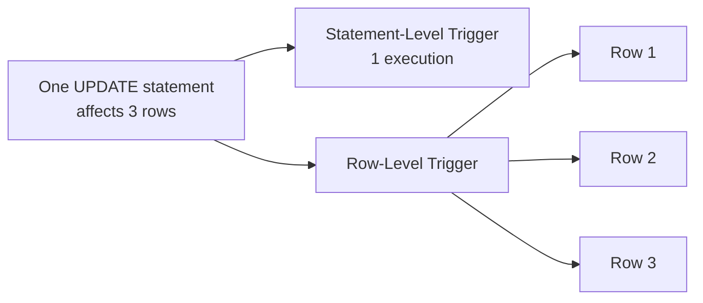

---

# 21. Statement-Level vs Row-Level

| Statement-Level | Row-Level |
|---|---|
| Fires once per statement | Fires once per affected row |
| Does not use `FOR EACH ROW` | Uses `FOR EACH ROW` |
| Good for statement-wide actions | Good for row-specific validation/auditing |
| Cannot directly use row pseudorecords like `:OLD` and `:NEW` | Can use `:OLD` and `:NEW` for applicable DML events |

---

# 22. `:OLD` and `:NEW`

Row-level DML triggers can use special correlation names.

### `:OLD`

Represents the value before the operation.

### `:NEW`

Represents the value after the operation / proposed new value.

Example:

```sql
CREATE OR REPLACE TRIGGER salary_audit
AFTER UPDATE OF salary ON employee
FOR EACH ROW
BEGIN
    INSERT INTO salary_audit(
        employee_id,
        old_salary,
        new_salary
    )
    VALUES (
        :OLD.employee_id,
        :OLD.salary,
        :NEW.salary
    );
END;
/
```

### Availability concept

| Event | `:OLD` | `:NEW` |
|---|---|---|
| INSERT | Not applicable | New value |
| UPDATE | Old value | New value |
| DELETE | Old value | Not applicable |

---

# 23. INSTEAD OF Trigger

An **INSTEAD OF trigger** is generally used on a view to define what should happen when an `INSERT`, `UPDATE`, or `DELETE` is attempted against the view.

It executes **instead of** the triggering DML operation on the view.

Example situation:

```text
Complex View
     ↓
User performs INSERT
     ↓
INSTEAD OF trigger
     ↓
Insert into underlying tables
```

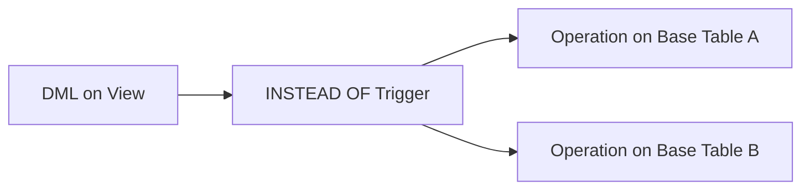

This is useful for making complex or non-updatable views behave in a controlled way.

---

# 24. DDL Triggers

A **DDL trigger** fires when specified DDL operations occur.

Examples of DDL events:

- `CREATE`
- `ALTER`
- `DROP`
- `TRUNCATE`

DDL triggers can be used for:

- Auditing schema changes.
- Preventing certain schema modifications.
- Recording database structure changes.

Conceptually:

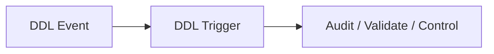

---

# 25. Database/System Event Triggers

Triggers can also respond to certain database or system events.

Examples can include:

- Database startup.
- Database shutdown.
- Logon.
- Logoff.
- Server errors.
- Schema-level events.

For example:

```text
User logs in
   ↓
LOGON trigger
   ↓
Record / enforce security policy
```

These are useful for administration, security, and auditing.

---

# 26. Schema-Level vs Database-Level Triggers

Depending on the trigger type, triggers can be associated with:

- A particular table.
- A view.
- A schema.
- The database.

### Schema-level

Used for events occurring in a specific schema.

### Database-level

Used for database-wide system events.

---

# 27. Compound Triggers

A **compound trigger** is a trigger that can contain multiple timing sections for a single triggering statement.

It can be useful when related processing is required at multiple timing points.

Conceptually:

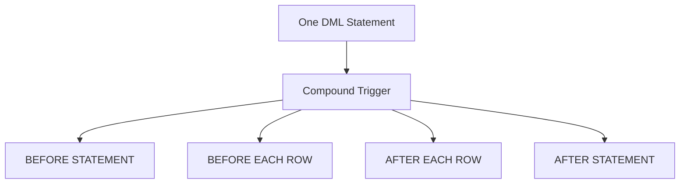

Not every compound trigger needs every possible timing section.

### Why use compound triggers?

They can:

- Share state across timing sections.
- Coordinate statement-level and row-level processing.
- Help solve certain mutating-table-related design problems.
- Improve organization of complex trigger logic.

---

# 28. Enabling and Disabling Triggers

Triggers can be enabled or disabled.

Example:

```sql
ALTER TRIGGER emp_audit_trg DISABLE;
```

Enable:

```sql
ALTER TRIGGER emp_audit_trg ENABLE;
```

For all triggers on a table:

```sql
ALTER TABLE employee DISABLE ALL TRIGGERS;
```

Enable:

```sql
ALTER TABLE employee ENABLE ALL TRIGGERS;
```

A disabled trigger does not fire for its associated events.

---

# 29. Trigger Firing Flow

For a row-level `UPDATE`, a simplified conceptual flow is:

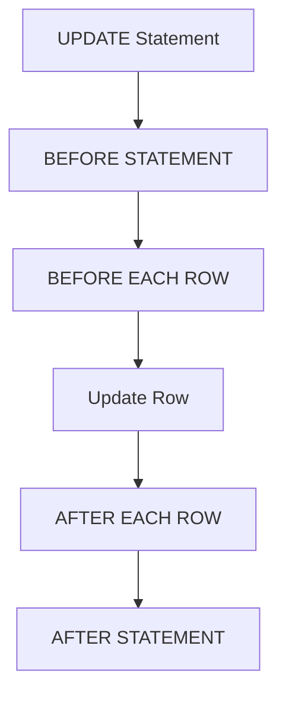

This diagram illustrates the conceptual timing order for a statement that uses the corresponding trigger sections.

---

# 30. Trigger Restrictions and Important Points

Triggers are powerful, but they should be used carefully.

## 30.1 Avoid Unnecessary Triggers

A trigger introduces automatic behavior that may not be obvious to someone reading the DML statement.

For example:

```sql
UPDATE employee
SET salary = salary + 1000;
```

may silently cause several triggers to execute.

## 30.2 Mutating Table Problem

A row-level trigger on a table can encounter restrictions if it attempts to query or modify the same table in certain ways while the triggering statement is in progress.

This is commonly called the **mutating-table problem**.

Compound triggers or redesigning the logic can sometimes help.

## 30.3 Cascading Trigger Effects

One trigger action can cause another trigger to fire.

Conceptually:

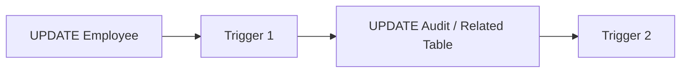

Excessive trigger chains can make systems difficult to understand and debug.

---

# 31. Trigger Advantages

1. Automatic execution.
2. Useful for auditing.
3. Can enforce complex rules.
4. Can maintain related data.
5. Can centralize certain database-level behavior.
6. Can respond to system/database events.

---

# 32. Trigger Disadvantages

1. Hidden side effects.
2. More difficult debugging.
3. Potential performance overhead.
4. Complex trigger chains.
5. Concurrency/transaction complications.
6. Mutating-table restrictions in relevant cases.
7. Business logic can become difficult to locate if overused.

### Exam point

> A trigger should be used when automatic event-driven behavior is appropriate, not simply because a procedure could perform the same task.

---

# 33. Introduction to Database Objects

The term **object** can refer to different things in a DBMS.

In an Oracle database, many schema elements are called database objects, including:

- Tables
- Views
- Indexes
- Sequences
- Procedures
- Functions
- Packages
- Triggers
- Object types

In the context of **object-relational databases**, an object can also mean a structured value created from an **object type**.

The remainder of this section focuses on **object types and object-relational features**.

---

# 34. Object-Relational Database Concept

A traditional relational database represents data mainly using:

```text
Tables
Rows
Columns
```

An object-relational database extends the relational model with object-oriented concepts such as:

- Object types.
- Attributes.
- Methods.
- Object identity/reference mechanisms.
- Inheritance.

Conceptually:

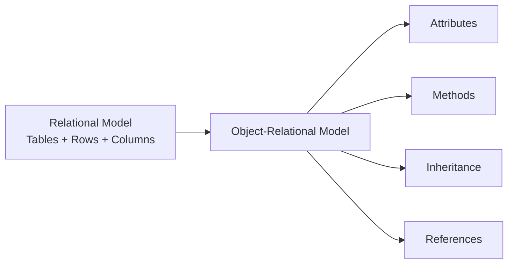

---

# 35. Object Type

An **object type** is a user-defined type that combines:

- Attributes (data).
- Methods (behavior).

It is similar conceptually to a class in object-oriented programming.

Example:

```text
STUDENT_TYPE
├── student_id
├── student_name
├── marks
└── calculate_grade()
```

---

# 36. Creating an Object Type

Oracle supports object types using `CREATE TYPE`.

Example:

```sql
CREATE OR REPLACE TYPE student_type AS OBJECT (
    student_id   NUMBER,
    student_name VARCHAR2(50),
    marks        NUMBER,

    MEMBER FUNCTION calculate_grade
        RETURN VARCHAR2
);
/
```

This defines the structure and interface of the object type.

The implementation of methods is defined separately in the type body.

---

# 37. Object Type Body

The **object type body** contains the implementation of methods declared in the object type specification.

Example:

```sql
CREATE OR REPLACE TYPE BODY student_type AS

    MEMBER FUNCTION calculate_grade
    RETURN VARCHAR2
    IS
    BEGIN
        IF marks >= 90 THEN
            RETURN 'A+';
        ELSIF marks >= 75 THEN
            RETURN 'A';
        ELSIF marks >= 60 THEN
            RETURN 'B';
        ELSE
            RETURN 'C';
        END IF;
    END;

END;
/
```

### Similarity to packages

There is a useful analogy:

```text
Package specification → public interface
Package body          → implementation

Object type specification → object attributes/method declarations
Object type body          → method implementation
```

---

# 38. Object Attributes

Attributes represent the data contained in an object.

Example:

```sql
CREATE OR REPLACE TYPE address_type AS OBJECT (
    house_no NUMBER,
    street   VARCHAR2(100),
    city     VARCHAR2(50),
    pincode  VARCHAR2(10)
);
/
```

The attributes are:

```text
house_no
street
city
pincode
```

---

# 39. Object Methods

Methods define behavior associated with an object type.

Common conceptual categories include:

- Member methods.
- Static methods.
- Constructor methods.
- Map methods.
- Order methods.

For basic exams, the important idea is:

> **Attributes represent state; methods represent behavior.**

---

# 40. Member Method

A **member method** operates on an object instance.

Example:

```sql
CREATE OR REPLACE TYPE student_type AS OBJECT (
    student_id NUMBER,
    marks      NUMBER,

    MEMBER FUNCTION passed
        RETURN VARCHAR2
);
/
```

Its implementation:

```sql
CREATE OR REPLACE TYPE BODY student_type AS

    MEMBER FUNCTION passed
    RETURN VARCHAR2
    IS
    BEGIN
        IF marks >= 40 THEN
            RETURN 'YES';
        ELSE
            RETURN 'NO';
        END IF;
    END;

END;
/
```

The method can access the attributes of the current object.

---

# 41. Creating an Object Instance

An instance can be created using the object type constructor.

Example:

```sql
DECLARE
    v_student student_type;
BEGIN
    v_student :=
        student_type(101, 85);

    DBMS_OUTPUT.PUT_LINE(
        v_student.student_id
    );
END;
/
```

The constructor has the object type's name:

```text
student_type(...)
```

---

# 42. Storing Objects in the Database

One way to store object instances is an **object table**.

An object table is a table whose rows are objects of a specified object type.

Example:

```sql
CREATE TABLE students_obj OF student_type;
```

This creates a table whose rows are instances of `student_type`.

---

# 43. Inserting Objects

Example:

```sql
INSERT INTO students_obj
VALUES (
    student_type(101, 'Ravi', 85)
);
```

Another object can be inserted:

```sql
INSERT INTO students_obj
VALUES (
    student_type(102, 'Neha', 92)
);
```

---

# 44. Querying Object Tables

Object attributes can be selected like columns.

Example:

```sql
SELECT s.student_id,
       s.student_name,
       s.marks
FROM students_obj s;
```

Objects can therefore be queried using SQL.

---

# 45. Updating Objects

Object attributes can be updated using SQL.

Example:

```sql
UPDATE students_obj s
SET s.marks = 90
WHERE s.student_id = 101;
```

---

# 46. Deleting Objects

Objects can be deleted using normal SQL DML.

Example:

```sql
DELETE FROM students_obj
WHERE student_id = 102;
```

Thus, object-relational systems allow SQL-based manipulation of object data.

---

# 47. Calling Object Methods

Suppose `student_type` has:

```text
calculate_grade()
```

A method can be invoked on an object instance.

Conceptually:

```sql
SELECT s.calculate_grade()
FROM students_obj s;
```

The exact SQL syntax and method eligibility depend on the object type definition.

---

# 48. Object References

Object-relational databases can support references to object instances.

A **REF** can identify/reference an object stored in an object table.

Conceptually:

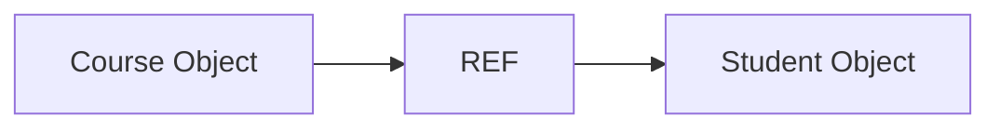

For example, instead of storing only an ordinary foreign-key value, an object-relational design can use a reference to an object instance.

References are useful when modeling object relationships.

---

# 49. Object Table vs Relational Table

| Object Table | Relational Table |
|---|---|
| Rows are instances of an object type | Rows are tuples |
| Supports object attributes/methods | Mainly stores columns |
| Can use object references | Commonly uses primary/foreign keys |
| Supports object-relational features | Traditional relational model |

---

# 50. Nested Objects

An object type can contain another object type as an attribute.

Example:

```sql
CREATE OR REPLACE TYPE address_type AS OBJECT (
    city VARCHAR2(50),
    pincode VARCHAR2(10)
);
/
```

Then:

```sql
CREATE OR REPLACE TYPE person_type AS OBJECT (
    person_id NUMBER,
    name      VARCHAR2(50),
    address   address_type
);
/
```

Conceptually:

```text
PERSON
├── person_id
├── name
└── address
    ├── city
    └── pincode
```

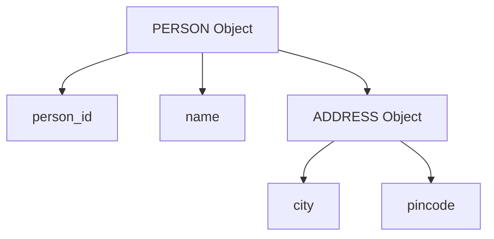

---

# 51. Object Inheritance

Object types can support inheritance.

A subtype can inherit attributes and methods from a supertype.

Conceptually:

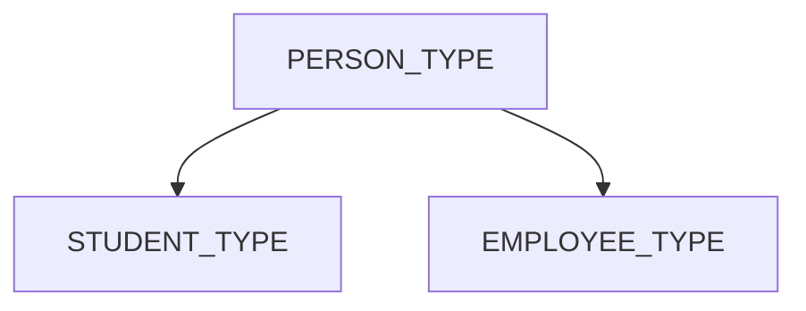

If:

```text
PERSON_TYPE
├── person_id
└── name
```

and:

```text
STUDENT_TYPE
└── program
```

then a student object can inherit:

```text
person_id
name
```

and add:

```text
program
```

Inheritance supports modeling "is-a" relationships.

---

# 52. Creating an Object Type with Inheritance

A simplified conceptual example is:

```sql
CREATE OR REPLACE TYPE person_type AS OBJECT (
    person_id NUMBER,
    name      VARCHAR2(50)
) NOT FINAL;
/
```

A subtype can then be defined using Oracle's object-type inheritance facilities.

The important exam concept is:

> A subtype inherits attributes and behavior from a supertype and may add specialized attributes/methods.

---

# 53. Object Constructor

An object type has a constructor that creates an instance of that type.

For:

```text
student_type(student_id, name, marks)
```

an instance can be constructed conceptually as:

```sql
student_type(101, 'Ravi', 85)
```

The constructor initializes the object's attributes.

---

# 54. Object Manipulation Lifecycle

A simple object-relational workflow is:

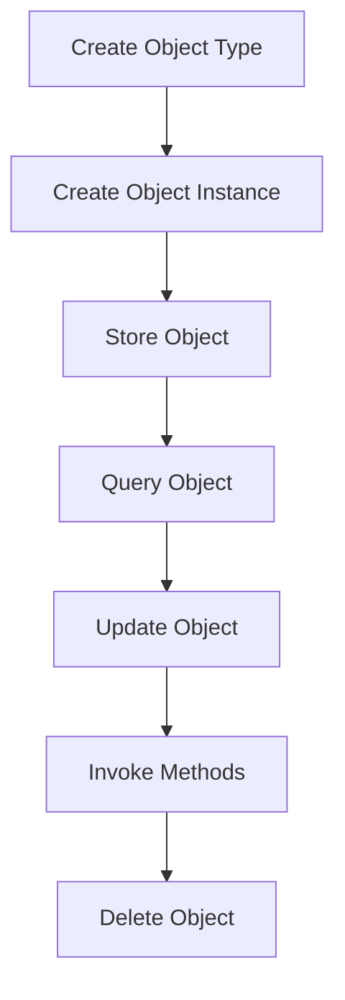

---

# 55. Creating, Storing, and Manipulating Objects — Complete Example

## Step 1: Create object type

```sql
CREATE OR REPLACE TYPE student_type AS OBJECT (
    student_id   NUMBER,
    student_name VARCHAR2(50),
    marks        NUMBER
);
/
```

## Step 2: Create object table

```sql
CREATE TABLE student_objects OF student_type;
```

## Step 3: Insert object

```sql
INSERT INTO student_objects
VALUES (
    student_type(101, 'Ravi', 85)
);
```

## Step 4: Query object

```sql
SELECT s.student_id,
       s.student_name,
       s.marks
FROM student_objects s;
```

## Step 5: Update object

```sql
UPDATE student_objects
SET marks = 90
WHERE student_id = 101;
```

## Step 6: Delete object

```sql
DELETE FROM student_objects
WHERE student_id = 101;
```

This demonstrates the basic object lifecycle.

---

# 56. Object Views

An **object view** allows object-oriented access to data that may physically be stored in relational tables.

Conceptually:

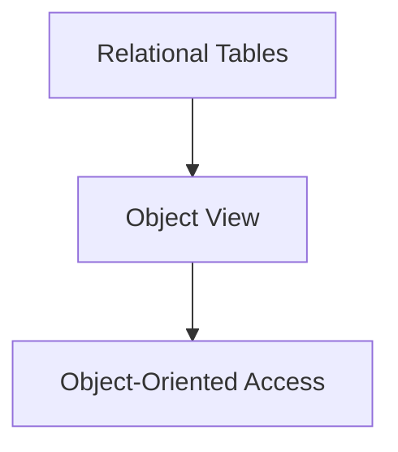

This can help organizations use object-relational features without necessarily converting every existing relational table into an object table.

---

# 57. Object-Relational vs Pure Relational Approach

| Pure Relational | Object-Relational |
|---|---|
| Tables and rows are primary concepts | Tables plus object features |
| Simple scalar attributes are common | Complex/object types can be modeled |
| Relationships commonly use foreign keys | Foreign keys plus object references where appropriate |
| Behavior usually outside data model | Methods can be associated with object types |
| Inheritance is not a basic relational feature | Object inheritance can be supported |

---

# 58. Advantages of Object-Relational Objects

## 58.1 Complex Data Modeling

Objects can represent complex structures more naturally.

## 58.2 Reusability

Object types can be reused in different database structures.

## 58.3 Encapsulation

Data and associated methods can be grouped conceptually.

## 58.4 Inheritance

Specialized object types can inherit from general types.

## 58.5 Integration with Object-Oriented Applications

Object-relational features can reduce the conceptual mismatch between application objects and database structures.

---

# 59. Limitations / Challenges of Objects

1. More complex database design.
2. Additional concepts to learn and manage.
3. Object-relational features may be unnecessary for simple relational applications.
4. Migration and integration can be complicated.
5. Query and indexing strategies can become more sophisticated.

---

# 60. Packages vs Triggers vs Objects

| Feature | Package | Trigger | Object Type |
|---|---|---|---|
| Main purpose | Group related PL/SQL functionality | Automatic event response | Model structured data + behavior |
| Explicitly called? | Yes, normally | No, fires automatically | Instances are created/manipulated |
| Contains procedures/functions | Yes | Trigger logic | Methods |
| Has specification/body | Yes | Trigger definition | Type specification/body when methods exist |
| Event-driven | No | Yes | No |
| Supports encapsulation | Yes | Limited | Yes |
| Typical use | Reusable database logic | Audit/validation/automatic actions | Complex object-relational modeling |

---

# 61. Package vs Procedure

| Package | Procedure |
|---|---|
| Container for related program elements | Single subprogram |
| Can contain many procedures/functions | Represents one procedure |
| Has specification and body | Has its own definition |
| Supports public/private members | Scope depends on where it is declared |
| Useful for modular systems | Useful for individual operations |

---

# 62. Procedure vs Trigger

| Procedure | Trigger |
|---|---|
| Normally called explicitly | Automatically fired by an event |
| Can be called with parameters | Triggering event determines execution |
| Can be invoked when needed | Executes when event occurs |
| Good for reusable operations | Good for event-driven database actions |

---

# 63. Trigger Types — Quick Revision

### Based on timing

```text
BEFORE
AFTER
INSTEAD OF
```

### Based on level

```text
STATEMENT-LEVEL
ROW-LEVEL
```

### Based on event

```text
DML
DDL
DATABASE/SYSTEM EVENT
```

### Advanced

```text
COMPOUND TRIGGER
```

---

# 64. DML Trigger Matrix

| Event | BEFORE | AFTER | INSTEAD OF |
|---|---|---|---|
| INSERT | Yes | Yes | Primarily for views |
| UPDATE | Yes | Yes | Primarily for views |
| DELETE | Yes | Yes | Primarily for views |

`INSTEAD OF` triggers are particularly associated with views.

---

# 65. Most Important Trigger Example: Auditing

Suppose:

```text
EMPLOYEE
employee_id
salary
```

and:

```text
EMPLOYEE_AUDIT
employee_id
old_salary
new_salary
changed_at
```

When salary changes:


Example:

```sql
CREATE OR REPLACE TRIGGER salary_audit_trg
AFTER UPDATE OF salary ON employee
FOR EACH ROW
BEGIN
    INSERT INTO employee_audit(
        employee_id,
        old_salary,
        new_salary,
        changed_at
    )
    VALUES (
        :OLD.employee_id,
        :OLD.salary,
        :NEW.salary,
        SYSDATE
    );
END;
/
```

This is a classic trigger use case and is worth remembering for exams.

---

# 66. Most Important Package Example

Remember this pattern:

```text
PACKAGE SPECIFICATION
        ↓
Public declarations
        ↓
PACKAGE BODY
        ↓
Implement procedures/functions
```

Example:

```sql
CREATE OR REPLACE PACKAGE emp_pkg AS
    PROCEDURE add_employee(
        p_id NUMBER,
        p_name VARCHAR2
    );

    FUNCTION get_salary(
        p_id NUMBER
    ) RETURN NUMBER;
END emp_pkg;
/
```

Then:

```sql
CREATE OR REPLACE PACKAGE BODY emp_pkg AS

    PROCEDURE add_employee(
        p_id NUMBER,
        p_name VARCHAR2
    )
    IS
    BEGIN
        INSERT INTO employee(employee_id, name)
        VALUES (p_id, p_name);
    END;

    FUNCTION get_salary(
        p_id NUMBER
    ) RETURN NUMBER
    IS
        v_salary NUMBER;
    BEGIN
        SELECT salary
        INTO v_salary
        FROM employee
        WHERE employee_id = p_id;

        RETURN v_salary;
    END;

END emp_pkg;
/
```

---

# 67. Most Important Object Example

Remember this sequence:

```text
CREATE TYPE
    ↓
CREATE OBJECT TABLE
    ↓
INSERT OBJECT
    ↓
SELECT / UPDATE / DELETE
```

Example:

```sql
CREATE OR REPLACE TYPE person_type AS OBJECT (
    person_id NUMBER,
    name VARCHAR2(50)
);
/

CREATE TABLE person_objects OF person_type;

INSERT INTO person_objects
VALUES (person_type(1, 'Amit'));

SELECT p.person_id, p.name
FROM person_objects p;

UPDATE person_objects
SET name = 'Amit Kumar'
WHERE person_id = 1;

DELETE FROM person_objects
WHERE person_id = 1;
```

---

# 68. Exam-Focused Questions

You should be able to answer these without notes:

## Packages

1. What is a package in PL/SQL?
2. What are the two parts of a package?
3. Explain package specification.
4. Explain package body.
5. Differentiate package specification and package body.
6. What are public and private package elements?
7. What is package initialization?
8. Explain the advantages of packages.
9. How do packages provide encapsulation?
10. Write a simple package specification and body.

## Triggers

11. What is a trigger?
12. Why are triggers used?
13. Explain BEFORE triggers.
14. Explain AFTER triggers.
15. Explain INSTEAD OF triggers.
16. What is a statement-level trigger?
17. What is a row-level trigger?
18. Differentiate statement-level and row-level triggers.
19. Explain `:OLD` and `:NEW`.
20. What are DML triggers?
21. What are DDL triggers?
22. What are database/system event triggers?
23. What is a compound trigger?
24. How are triggers enabled/disabled?
25. Explain trigger advantages and disadvantages.
26. What is the mutating-table problem?
27. Write an audit trigger for an UPDATE operation.

## Objects

28. What is an object-relational database?
29. What is an object type?
30. What are attributes and methods?
31. How is an object type created?
32. What is an object type body?
33. How are object instances created?
34. What is an object table?
35. How are objects stored?
36. How are objects queried and manipulated?
37. What is an object reference?
38. What is an object view?
39. Explain object inheritance.
40. Compare relational and object-relational databases.

---

# 69. Last-Minute Memory Map

```mermaid
mindmap
  root((PL/SQL Advanced Topics))
    Packages
      Specification
        Public interface
        Public procedures
        Public functions
        Public variables
      Body
        Implementation
        Private elements
        Initialization
      Benefits
        Modularity
        Encapsulation
        Reusability
        Maintenance
    Triggers
      Timing
        BEFORE
        AFTER
        INSTEAD OF
      Level
        Statement
        Row
      Events
        INSERT
        UPDATE
        DELETE
        DDL
        System events
      Features
        OLD
        NEW
        Compound
      Uses
        Audit
        Validation
        Business rules
    Objects
      Object Type
        Attributes
        Methods
      Object Instance
      Object Table
      Object View
      REF
      Inheritance
      Manipulation
        Create
        Store
        Query
        Update
        Delete
```

---

# 70. Ultra-Short Revision

## Packages

> **Package = container of related PL/SQL elements.**

```text
Specification → WHAT is public
Body          → HOW it works
```

Public:

```text
Declared in specification
```

Private:

```text
Declared only in body
```

---

## Triggers

> **Trigger = automatically executed program unit responding to an event.**

Remember three classifications:

```text
Timing:
BEFORE / AFTER / INSTEAD OF

Level:
STATEMENT / ROW

Event:
DML / DDL / SYSTEM
```

Important:

```text
:OLD → old value
:NEW → new value
```

For a row-level trigger:

```text
FOR EACH ROW
```

---

## Objects

> **Object type = structured data + associated behavior.**

```text
Object Type
├── Attributes
└── Methods
```

Basic lifecycle:

```text
CREATE TYPE
     ↓
CREATE OBJECT TABLE
     ↓
CREATE OBJECT
     ↓
STORE
     ↓
QUERY / UPDATE / DELETE
```

---

# 71. One-Page Mental Model

```text
PACKAGE
│
├── SPECIFICATION
│   └── Public interface
│
└── BODY
    ├── Implementation
    └── Private elements


TRIGGER
│
├── Automatically fires
│
├── Timing
│   ├── BEFORE
│   ├── AFTER
│   └── INSTEAD OF
│
├── Level
│   ├── Statement
│   └── Row
│
└── Events
    ├── DML
    ├── DDL
    └── System


OBJECT
│
├── Object Type
│   ├── Attributes
│   └── Methods
│
├── Object Instance
│
├── Object Table
│
├── References
│
└── Inheritance
```

## Final memory rules

> **Package = group related PL/SQL code.**

> **Specification = interface; Body = implementation.**

> **Trigger = automatic event-driven execution.**

> **BEFORE = before the event's DML operation completes.**

> **AFTER = after the DML operation.**

> **INSTEAD OF = replace the attempted operation, especially on views.**

> **Statement trigger = once per statement.**

> **Row trigger = once per affected row.**

> **`:OLD` = previous value; `:NEW` = new value.**

> **Object type = attributes + methods.**

> **Object table = table whose rows are object instances.**

> **Object-relational database = relational database extended with object-oriented features.**
